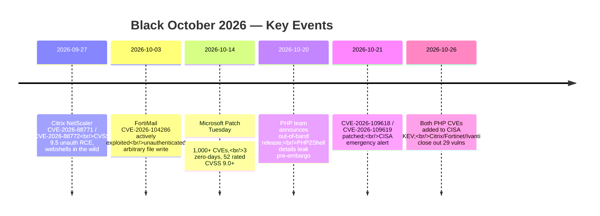
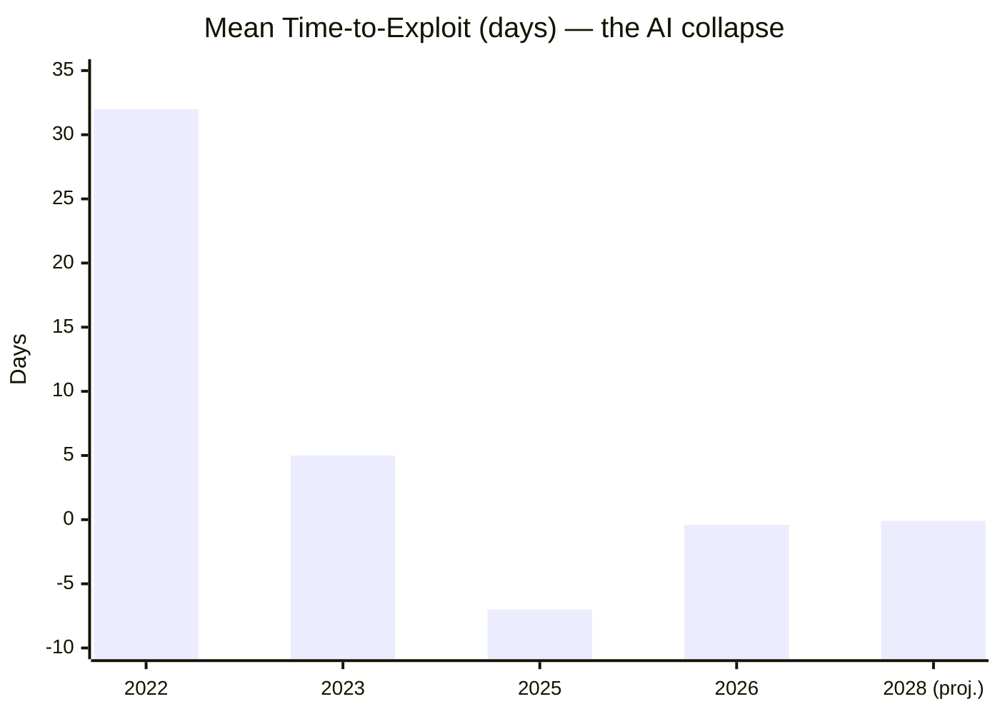

# Black October 2026: Anatomy of the Vulnerability Wave & How AI Collapses Time-to-Exploit to Negative

> **Answer-First:** October 2026 earned the name "Black October" — roughly 79 dated attacks and breaches in a single month, driven by an unprecedented pile-up of exploited zero-days in core internet infrastructure: Citrix NetScaler (CVE-2026-88771/88772, CVSS 9.5), FortiMail (CVE-2026-104286), PHP core "PHP2Shell" (CVE-2026-109618/109619), and a record 1,000+ CVE Microsoft patch release. The common thread is not vendor quality — it is **time**: mean time-to-exploit has collapsed from 32 days (2022) to **negative seven days** (Mandiant M-Trends 2026) and roughly 10 hours from disclosure to working exploit in 2026, because AI now does at machine speed what exploit development teams did at human speed. The disclosure → patch → deploy model is structurally dead; this article dissects the wave, quantifies the AI-driven collapse, and lays out the defense playbook that still works.

> **Prerequisite:** Readers should know CVE/KEV fundamentals (the CISA Known Exploited Vulnerabilities catalog and its patching deadlines), basic memory-corruption classes (UAF, RCE), OWASP Top 10 and the ASI (Agentic AI) series, and modern runtime security primitives (eBPF enforcement). For the PHP2Shell technical anatomy itself, read our dedicated deep dive: [PHP2Shell (CVE-2026-109618 & CVE-2026-109619): Zend Engine OOM Bailout & SRE Remediation](/radar/2026-10/radar-2026-10-23-php2shell-cve-2026-109618-zend-engine-sre-remediation/).

---

```yaml
name: "AI-Native Vulnerability Response: Runtime Enforcement Over Patch-Race"
ring: "Adopt"
quadrant: "Security & Resilience"
rationale: "With time-to-exploit negative, perimeter and patch-race defenses arrive too late by construction. Compensating controls — eBPF runtime enforcement, virtual patching at the edge, KEV-driven prioritization, and treating AI-generated artifacts as untrusted input — are the only levers that operate inside the collapsed window."
adr_link: "/posts/black-october-2026-ai-accelerated-vulnerabilities/"
justification: "Calibrated against Black October 2026 incident timelines (NetScaler webshell campaigns, FortiMail file-write exploitation, PHP2Shell pre-embargo leak exploitation) and published time-to-exploit series (32d → 5d → −7d → ~10h)."
```

---

## 1. What Happened: The Black October Timeline

> **BLUF:** Four independent vendors, four exploited-before-patched zero-days, one record Patch Tuesday, and a 22-year-old PHP memory-management flaw resurrected into a global crisis — all inside 34 days. The wave was not coordinated, but it shared one enabler: exploit development had become faster than emergency patching.



| Window | Event | Why it mattered |
| :--- | :--- | :--- |
| Sep 27–28 | **Citrix NetScaler** CVE-2026-88771 & CVE-2026-88772 | Unauthenticated RCE on load balancers sitting in front of everything; exploited globally for weeks to plant webshells before many fleets patched. |
| Oct 1–10 | **FortiMail** CVE-2026-104286 | Unauthenticated arbitrary file write exploited in the wild *before any patch existed* — the purest example of negative time-to-exploit. |
| Oct 14 | **Microsoft Patch Tuesday** | 1,000+ CVEs in a single release, 3 zero-days (one actively exploited), 52 rated 9.0+. Patch volumes have outrun IT operations capacity. |
| Oct 20–21 | **PHP2Shell** — CVE-2026-109618 & CVE-2026-109619 | Out-of-band PHP core release: `zend_bailout()` OOM `longjmp()` state corruption and cross-request UAF in PHP-FPM workers. Details leaked before the embargo lifted, and exploitation followed the leak, not the patch. |
| Oct 21–26 | **CISA alert → KEV additions** | Federal deadline machine engaged; both PHP CVEs entered KEV within five days of disclosure. |
| Late Oct | **Vendor cleanup wave** | Citrix, Fortinet, and Ivanti together shipped 29 fixes, closing out the month. |

## 2. Why October Was "Black": The Common Failure Pattern

> **BLUF:** Black October was not a coincidence of vendor negligence — it is what the vulnerability lifecycle looks like when exploitation outruns remediation everywhere at once. All four headline incidents share the same three properties: core-infrastructure blast radius, exploited-before-patched, and pre-patch information leakage.

1. **Blast radius: core infrastructure, not apps.** NetScaler terminates TLS for enterprises. FortiMail guards corporate email. PHP runs a double-digit percentage of all web servers. None of these are niche products — a single unpatched class exposes entire industries simultaneously.
2. **Exploited before patched.** FortiMail exploitation predated any fix. PHP2Shell exploitation followed a pre-embargo leak, meaning the exploit window opened *while defenders were still forbidden to talk about the bug*. NetScaler webshells were harvested across fleets for weeks.
3. **Information asymmetry flipped.** The traditional model assumed defenders had a head start: advisory first, exploit later. Black October shows the inversion is now normal — leaks, telemetry probing, and AI-assisted reverse engineering mean attackers often hold working exploits *before* defenders hold patches.

This is why the month deserves a name. It is not that bad bugs happened — bad bugs happen every month. It is that **every stage of the defense lifecycle lost its head start at once**.

## 3. The Collapsing Window: Time-to-Exploit Has Gone Negative

> **BLUF:** Mean time-to-exploit fell from 32 days (2022) to 5 days (2023) to **minus 7 days** (M-Trends 2026 data for 2025), with disclosure-to-working-exploit averaging around **10 hours** in 2026 — down from 56 days in 2024. Analysts project minutes by 2028. "Patch Tuesday is now exploit-last-Friday": roughly 71% of known exploits land before a patch is available.



| Era | Mean time-to-exploit | Dominant method |
| :--- | :---: | :--- |
| 2022 | ~32 days | Manual reverse engineering by funded teams |
| 2023 | ~5 days | Exploit chains shared in criminal ecosystems; vulnerability intelligence feeds |
| 2025 | **−7 days** (M-Trends 2026) | Exploitation precedes patch availability; pre-embargo leaks; telemetry probing |
| 2026 | ~10 hours disclosure→exploit | LLM-assisted diff analysis, PoC synthesis, automated variant discovery |
| 2028 (projection) | minutes | Autonomous offensive agents exploiting at machine speed |

Three consequences break conventional vulnerability management:

1. **CVSS-based prioritization is obsolete as a scheduling tool.** When a "high" (not critical) bug can be weaponized in hours, scoring-based backlogs of 30/60/90 days are an artifact of a slower era. The only prioritization signal that kept pace in Black October was **KEV membership and active-exploitation telemetry**.
2. **Patch SLAs measured in weeks are an admission of exposure.** If the window is 10 hours, a 14-day SLA is not risk management — it is risk documentation.
3. **The exploit-before-patch era needs compensating controls.** When there is nothing to deploy yet, the only levers are runtime enforcement, edge virtual patching, and containment — Section 8 covers the playbook.

## 4. AI on the Production Side: Insecure Code at Scale

> **BLUF:** The supply of vulnerabilities is being industrialized. AI writes a growing share of production code, and its security quality has stalled: the 2026 Veracode GenAI Code Security Report (100+ models, 80 tasks) found only **56% of AI-generated tasks produce secure code — essentially unchanged from 55% in 2025**. Java fails hardest (~72% insecure), and ~45% of AI-generated samples contain OWASP Top 10 weaknesses, XSS above all.

The key numbers:

- **Security pass rate stagnation:** 55% (2025) → 56% (2026). Capability is improving; security is not. Models optimize for the reward signal they are trained on — working features — not for the absence of flaws.
- **Language asymmetry:** Java's ~72% failure rate makes AI-assisted enterprise backends the highest-risk surface; Go and Python fare comparatively better but still fail in the 30–50% band depending on task class.
- **Vibe coding as an attack-surface multiplier:** Georgia Tech's "Vibe Security Radar" tracked **74 CVEs tied to AI coding tools through March 2026** across 50 projects, with monthly counts still climbing. The deeper problem is *who* now ships code: non-engineers can generate working applications they cannot review, creating what practitioners call the **vibe-coding liability gap**.

The engineering response is a change of trust model, not a change of tools:

1. **Treat AI-generated code as untrusted third-party input.** It enters review with the same privileges as a stranger's pull request: mandatory static analysis, SAST rules mapped to OWASP Top 10, provenance and license checks — the "vibe-coding liability gate." (Our deep dive on building a deterministic [multi-agent AI code review pipeline](/posts/vibe-coding-and-ai-code-review-future/) covers the AST-gated architecture.)
2. **Never let generated code introduce dependencies unchecked** — Section 6 explains why the package name itself is now an attack vector.
3. **Security-aware generation:** prefer prompts and pipelines that emit tests for security properties (authz checks, input validation) alongside features, and gate merges on those tests, not on human optimism.

## 5. AI on the Attack Side: From Bug Discovery to Bug-as-a-Service

> **BLUF:** Offensive AI has crossed the commercialization line. XBOW, an autonomous penetration-testing agent, reached **#1 on HackerOne**, finding 50+ valid critical bugs in real programs. Academic results (Kang et al.) show LLM agents independently rediscovering known CVEs and finding new variant bugs at a fraction of human cost. The remaining bottleneck — reliable end-to-end exploit *validation* — is closing every quarter.

What changed in 2025–2026:

1. **Discovery at machine speed.** LLM agents read patch diffs, synthesize trigger inputs, and mutate exploit variants thousands of times per hour. Daniel Kang's research line demonstrated AI-assisted vulnerability discovery beating manual timeframes by orders of magnitude on web and C-style codebases.
2. **Commercial autonomous pentesting.** XBOW runs pentest-on-demand from ~$4,000 per engagement, scaling from one app to thousands — which means mid-market attackers who could never fund an exploit team now rent one. Its #1 HackerOne ranking came from *real* bounty programs, not benchmarks.
3. **The validation bottleneck is the last defense.** 2026 analyses agree AI reliably produces vulnerability *candidates* but still struggles to prove exploitability on live systems without human help. Every quarter that bottleneck narrows; planning on it as a permanent moat is negligence.

The strategic read: the marginal cost of finding an exploitable bug is heading toward zero, which means **unpatched debt of any kind is now an active liability, not a deferred one**.

## 6. New Attack Surfaces That Only Exist Because of AI

> **BLUF:** AI did not just accelerate old attacks — it created new vulnerability classes. Slopsquatting weaponizes hallucinated package names; phantom squatting weaponizes hallucinated domains; MCP tool poisoning and tool shadowing weaponize the agent toolchain itself. All three share one property: the attacker no longer needs to guess — they only need to *listen to what the model invents*.

### 6.1 Slopsquatting: harvesting hallucinated dependencies

LLMs confidently invent package names that do not exist (`starlette-reverse-proxy` is a cited example). Research from Cloud Security Alliance and Endor Labs shows these hallucinations are **reproducible** — the same fake names recur across prompts — so attackers monitor AI outputs, register the invented names on PyPI/npm with malware inside, and wait for the next developer to ask the same question. Unlike typosquatting, there is no legitimate package to mimic: **the attack surface is the model's imagination**.

### 6.2 Phantom squatting: hallucinated infrastructure

Unit 42's "phantom squatting" extends the same idea to web domains — models hallucinate plausible-looking endpoints and URLs, which attackers pre-register for phishing and C2. Any workflow where an agent *navigates to* a model-suggested URL is exposed.

### 6.3 MCP tool poisoning and the agentic toolchain

The Model Context Protocol made tool ecosystems composable — and composable toolchains are poisonable. CrowdStrike's 2026 analysis of agentic tool-chain attacks catalogs the three canonical moves:

- **Tool poisoning:** malicious instructions hidden in tool descriptions/metadata that the model reads as trusted context. The MCPTox benchmark measured **>60% attack success rates** against major models (GPT-4o-mini, o1-mini, DeepSeek).
- **Tool shadowing:** a malicious MCP server defines tools that override or mask trusted ones cross-server.
- **Rug pulls:** a benign tool redefined as malicious after installation — trust established at install time, revoked at runtime.

The defense is the same governance we apply to agent memory: treat tool metadata as **untrusted input at write time and untrusted content at read time**, allowlist servers, least-privilege scopes, and runtime monitoring (see our [OWASP ASI01–ASI10 gateway radar](/radar/2026-08/owasp-nist-ai-agent-gateway/) and [agentic memory architecture radar](/radar/2026-11/radar-2026-11-01-agentic-memory-architecture/) for the write-gating and provenance patterns that transfer directly to tool chains).

## 7. Forecast: What Future Vulnerabilities Look Like (2027–2028)

> **BLUF:** Five predictions, ordered by confidence. The unifying trend: **vulnerability velocity becomes machine-limited on the attack side while defense remains process-limited** — and every prediction shortens the defender's window further.

1. **Minute-scale exploitation becomes normal (confidence: high).** Disclosure-to-exploit of ~10 hours compresses toward minutes for popular stacks, as autonomous agents chain diff-reading, PoC synthesis, and validation. KEV-with-SLA patching stops being meaningful for internet-facing cores; runtime and edge controls become the primary mitigation tier.
2. **Slopsquatting enters the top-5 web supply-chain vectors (confidence: high).** Registry telemetry already shows adversarial registration of hallucinated names; expect package-manager-native defenses (registry-level AI-name reputation, provenance attestations like Sigstore on every publish) to become standard.
3. **Agent-to-agent attacks go mainstream (confidence: high).** Poisoned memory, poisoned tool metadata, and cross-agent instruction injection (the OWASP ASI series) become the dominant web-application attack class against AI-first products — because the memory and toolchain *are* the application now. Write-gating, provenance floors, and role-scoped stores move from "architecture nicety" to compliance requirement.
4. **The exploit market shifts from sellable artifacts to sellable capability (confidence: medium).** When exploit generation is automated, the scarce asset is not the PoC — it is the *agent configuration* that finds and validates exploits. Expect access brokerage ("rent the fleet that pwns X") to displace classic 0-day sales for many targets.
5. **Attribution degrades and insurance reprices (confidence: medium).** Machine-speed campaigns with recycled infrastructure make attribution harder; cyber insurers will demand demonstrable runtime enforcement and AI-output governance before underwriting — turning Sections 6–7 into procurement requirements, not best practices.

The counter-trend worth naming: the same AI that accelerates offense also industrializes defense — automated triage, variant-aware fuzzing, and AI-native incident response are real. But defense is an *organizational* adoption problem while offense is a *capability* problem, and capability diffuses faster than process change. That asymmetry is the actual story of the next two years.

## 8. The Defense Playbook That Still Works Inside a 10-Hour Window

> **BLUF:** You cannot win a patch race you lose before it starts. The playbook operates inside the collapsed window: prioritize by exploitation evidence, neutralize at runtime and edge, contain blast radius, and govern AI outputs as untrusted input.

### The 10-point checklist

1. **Prioritize on KEV + exploitation telemetry, not CVSS alone.** KEV membership carries a federal patch deadline for a reason; mirror that logic internally with an "exploited-in-the-wild = fix within 24–72h" tier.
2. **Runtime enforcement for internet-facing cores.** eBPF sandboxing (Tetragon-class) kills post-exploit process behavior — see our [Cilium 1.17 & Tetragon 1.4 radar](/radar/2026-10/cilium-tetragon-ebpf-ai-agent-security/) for the sub-12µs enforcement model. It does not care that the patch does not exist yet.
3. **Virtual patching at the edge.** WAF/reverse-proxy rules for known exploit primitives (the PHP2Shell multipart-OOM primitive, for example) buy days inside a 10-hour window. Our [PHP2Shell SRE remediation playbook](/radar/2026-10/radar-2026-10-23-php2shell-cve-2026-109618-zend-engine-sre-remediation/) ships the concrete configs.
4. **Zero-trust segmentation limits blast radius.** A NetScaler or FortiMail compromise should never equal domain compromise — mTLS workload identity (SPIFFE/SPIRE) and per-service policy make "core appliance" a contained failure domain (see our [zero-trust service mesh deep dive](/posts/zero-trust-service-mesh-security-spiffe-spire-istio-golang/)).
5. **Gate AI-generated code like untrusted input.** SAST + OWASP Top 10 mapping + provenance/license review on every AI-assisted merge; dependency names from AI suggestions verified against registries before install (anti-slopsquatting).
6. **Govern agent toolchains and memory.** Tool allowlists, least-privilege MCP scopes, write-gated memory with provenance — the ASI mapping in Section 6 is the checklist.
7. **Assume pre-embargo leaks.** Patch emergency releases within hours of availability, not within sprint cadence; treat embargoed details as already-attacker-known.
8. **Exercise the negative-window incident runbook.** Tabletop: "CVE published, exploit public, no patch for 5 days" — who flips the WAF rule, who isolates the subnet, who communicates? Most orgs have never run this drill; Black October was the live fire.
9. **Buy down the backlog ruthlessly.** In a 10-hour world, a 90-day-old internet-facing vulnerability is not debt — it is a lease to someone else.
10. **Instrument AI-native detection.** Automated triage and anomaly detection on exploit telemetry, because human SOC triage speed is now the bottleneck of your detection pipeline.

## 9. Conclusion: The Window Is the Story

Black October 2026 will be remembered less for any single CVE than for the moment the industry had to admit the lifecycle math had flipped: **exploitation now precedes defense as a rule, not an exception**. AI accelerated the production of insecure code (56% secure-task stagnation), the discovery and validation of exploits (XBOW at #1 on HackerOne), and the birth of attack surfaces that exist only because models hallucinate confidently (slopsquatting, tool poisoning).

None of this is a reason for fatalism. Every mechanism described here has a working countermeasure that ships today — eBPF runtime enforcement, edge virtual patching, KEV-driven prioritization, and untrusted-input governance for everything AI touches. What no countermeasure can fix is a *process* that still assumes defenders get the head start. The teams that internalize the negative window first will be the ones still standing in the minute-scale era.

---

## FAQ


"Black October" is the name practitioners gave to October 2026, when roughly 79 dated attacks and breaches coincided with an unusual pile-up of actively exploited zero-days in core internet infrastructure: Citrix NetScaler (CVE-2026-88771/88772), FortiMail (CVE-2026-104286), PHP core "PHP2Shell" (CVE-2026-109618/109619), and a record Microsoft Patch Tuesday with 1,000+ CVEs.



It means active exploitation begins *before* a vendor patch is available — the mean time between vulnerability disclosure and exploitation is negative. Mandiant's M-Trends 2026 measured −7 days for 2025, and 2026 reports put disclosure-to-working-exploit at around 10 hours on average, down from 32 days in 2022.



The 2026 Veracode GenAI Code Security Report found only 56% of AI code-generation tasks produce secure code — statistically unchanged from 55% in 2025 despite model improvements. About 45% of AI-generated samples contain OWASP Top 10 weaknesses, and Java tasks fail security checks around 72% of the time. The right model is to treat AI output as untrusted third-party input until it passes the same security gates as any external dependency.



Slopsquatting is a supply-chain attack where adversaries monitor package names hallucinated by LLMs and register those invented names on PyPI/npm with malicious payloads. Because hallucinations are reproducible, victims reliably install the attacker's package later. Defense: verify every AI-suggested dependency against the official registry, pin lockfiles, and block installs of packages with no prior provenance or download history.



Malicious instructions are hidden in an MCP tool's description or metadata, which the model reads as trusted context; poisoned tools can redirect agent actions, exfiltrate data, or override trusted tools ("tool shadowing"). The MCPTox benchmark measured attack success rates above 60% against major models. Defense: allowlist servers, least-privilege scopes, treat tool metadata as untrusted input, and monitor tool invocations at runtime.



Three actions inside a week: (1) stand up a KEV-driven patch tier with a 24–72h SLA for exploited-in-the-wild CVEs; (2) deploy virtual patching rules at your edge for the current Black October exploit primitives and runtime eBPF enforcement on internet-facing cores; (3) turn on provenance and security gates for all AI-generated code and AI-suggested dependencies.

