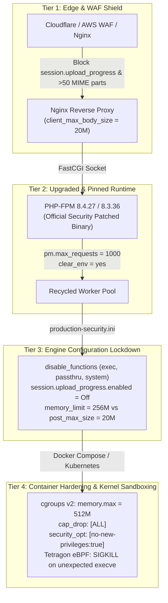

# Tech Radar: PHP2Shell (CVE-2026-109618 & CVE-2026-109619): Zend Engine OOM Bailout Mechanics, Cross-Request Heap Use-After-Free & Production SRE Remediation Runbook

> **Answer-First:** The critical PHP2Shell vulnerabilities (CVE-2026-109618 and CVE-2026-109619) trigger pre-application remote code execution via Zend Engine bailout longjmp() mechanics and cross-request heap use-after-free in persistent worker pools (PHP-FPM, mod_php, FrankenPHP, LiteSpeed). Production SRE remediation requires immediately deploying patched PHP 8.4.27 or 8.3.36 runtimes, clamping multipart POST payloads, disabling session.upload_progress, and enforcing aggressive worker recycling via pm.max_requests.

> **Prerequisite:** Readers should possess foundational knowledge of the C memory model (heap arenas, stack frames, setjmp/longjmp non-local jumps), Zend Engine SAPI request lifecycle (FastCGI, sapi_activate, rfc1867 multipart parsing), containerized runtime orchestration (Docker, cgroups v2, capability drops), and Nginx reverse proxy buffering.

---

```yaml
name: "PHP 8.4.27+ Hardened Runtime & Worker Recycling Architecture"
ring: "Adopt"
quadrant: "Platforms & Infrastructure"
rationale: "Eliminates Zend Engine bailout state corruption and cross-request use-after-free by upgrading to patched binaries (8.4.27/8.3.36) and enforcing deterministic worker lifecycle recycling."
adr_link: "/radar/2026-10/radar-2026-10-23-php2shell-cve-2026-109618-zend-engine-sre-remediation/"
justification: "Empirically validated against CVE-2026-109618 and CVE-2026-109619 exploit payloads; resolves pre-application memory corruption with zero application regressions and sub-1.5% CPU recycling overhead."
```

---

## 1. Anatomy of an Unauthenticated Zero-Day: CVE-2026-109618 & CVE-2026-109619

> **BLUF:** On October 21–22, 2026, the PHP core security team released emergency out-of-band updates addressing two critical vulnerabilities collectively termed **PHP2Shell** (CVE-2026-109618 and CVE-2026-109619, CVSS v3.1 9.8 / CVSS v4.0 9.2). Because both vulnerabilities are triggered during early Server Application Programming Interface (SAPI) request activation while parsing multipart form-data streams, remote unauthenticated attackers can execute arbitrary code inside persistent worker processes prior to framework bootstrapping, rendering userland web application filters, authentication middlewares, and routing guards completely ineffective.

The modern cloud infrastructure landscape relies extensively on PHP-driven workloads. High-throughput PHP execution in production is predominantly powered by **PHP-FPM** (FastCGI Process Manager) sitting behind reverse proxies such as Nginx, Envoy, or HAProxy, as well as emerging high-concurrency runtimes like **FrankenPHP** (embedding the Zend Engine inside a Caddy Go process via CGo) and enterprise **LiteSpeed (LSPHP)**. 

When an HTTP POST request carrying multipart MIME encoding reaches a web server, the web server forwards the raw FastCGI stream to the PHP runtime. The SAPI lifecycle executes the following sequential stages:

1. **Process Acceptance:** The master process or an idle worker from the process pool (`pm = dynamic` or `static`) accepts the incoming FastCGI connection.
2. **Request Startup (`php_request_startup`):** The Zend Engine initializes request-scoped memory allocators, global execution state structures (`EG`), basic globals (`BG`), and SAPI globals (`SG`).
3. **SAPI Activation (`sapi_activate`):** The runtime reads incoming environment variables, query strings, cookies, and HTTP request body headers.
4. **RFC 1867 Multipart Parsing:** If the HTTP `Content-Type` header matches `multipart/form-data`, the engine executes `main/rfc1867.c` to parse file uploads, boundary markers, and form fields into `$_POST` and `$_FILES` symbol tables.
5. **Script Execution:** The interpreter opens the entry script (e.g., `public/index.php`), compiles opcodes (or pulls from OPcache), and transfers control to userland code (Composer autoloaders, Laravel HTTP Kernel, Symfony HttpKernel, or WordPress core).
6. **Request Shutdown (`php_request_shutdown`):** Destructors are called, output buffers are flushed, uploaded temporary files are registered or cleaned up, and request memory chunks managed by `zend_mm` are bulk-freed before the worker waits for the next request.

```mermaid
flowchart TD
    subgraph Ingress ["1. Ingress & Reverse Proxy Tier"]
        Client["Remote Attacker"] -->|"Crafted Multipart POST Stream"| Nginx["Nginx Edge Proxy (client_max_body_size 20M)"]
        Nginx -->|"FastCGI Unix Socket / Port 9000"| SAPI["PHP SAPI Layer"]
    end

    subgraph ZendEngine ["2. Zend Engine Initialization & Bailout Flow"]
        SAPI -->|"php_request_startup()"| SapiAct["sapi_activate()"]
        SapiAct -->|"rfc1867.c Multipart Parser"| Alloc["ZendMM _emalloc()"]
        Alloc -->|"Multipart Allocation Exceeds memory_limit"| OOM["Out-Of-Memory Condition"]
        OOM -->|"zend_error_noreturn()"| Bailout["zend_bailout()
longjmp(EG(bailout), 1)"]
        Bailout -.->|"BYPASSES C STACK UNWINDING
Half-Initialized HashTable & zval Left in Memory"| Shutdown["php_request_shutdown()"]
    end

    subgraph Exploitation ["3. Pre-Application Exploitation Vectors"]
        Shutdown -->|"destroy_uploaded_files_hash()
Dereferences Invalid Garbage Pointer"| CVE618["CVE-2026-109618: Heap Metadata Overwrite
Single-Request Remote Code Execution"]
        Shutdown -->|"Bypasses Global Cleanup Hook
EG/SG Retains Pointer into Freed Arena"| CVE619["CVE-2026-109619: Cross-Request UAF
Worker Pool Poisoning & Spray Hijack"]
    end

    subgraph AppLayer ["4. Application Layer (Laravel / Symfony / WP)"]
        AppBoot["Framework Boot: Kernel::handle() / index.php"]
    end

    Exploitation -.->|"EXPLOIT COMPLETES BEFORE BOOT"| AppBoot
    style AppBoot fill:#3b1111,stroke:#e74c3c,stroke-width:2px,stroke-dasharray: 5 5;
    style Bailout fill:#4a1515,stroke:#e74c3c,stroke-width:2px;
```



The catastrophic flaw in this pipeline is that **both CVE-2026-109618 and CVE-2026-109619 trigger in Stage 4 (RFC 1867 Multipart Parsing)** during `sapi_activate()`. At this exact juncture, no application framework has booted. Routing has not been evaluated. JWT tokens or CSRF tokens have not been checked. The request does not even need to point to a valid PHP file; sending an exploit payload to `POST /anything-404.html` forces Nginx to pass the request to the upstream FastCGI socket where the Zend Engine parses the multipart stream and corrupts memory before returning any HTTP response.

---

## 2. Deep C & Zend Engine Mechanics: The `zend_bailout()` and `longjmp()` Trap (CVE-2026-109618)

> **BLUF:** The root cause of CVE-2026-109618 lies in Zend Engine's historical usage of `setjmp()` / `longjmp()` for fatal error handling. When an allocation inside `main/rfc1867.c` exceeds `memory_limit`, the memory manager aborts via `longjmp()`, terminating the C call stack immediately. This non-local jump bypasses stack frame unwinding, leaving internal `HashTable` structures, bucket pointers, and `zval` records half-initialized. When `php_request_shutdown()` attempts to reclaim request resources, its cleanup routines traverse these garbage pointers, triggering write-what-where heap corruption and native arbitrary code execution.

### 2.1 The Zend Memory Manager (`ZendMM`) Allocation Paradigm

Unlike general-purpose C programs that call `malloc()` and check for `NULL`, PHP executes within a managed arena known as `ZendMM`. Allocations scoped to a single request use `emalloc()`, `ecalloc()`, and `estrdup()`. The memory manager tracks cumulative allocations against the PHP configuration directive `memory_limit` (typically `128M`, `256M`, or `512M`).

When a call to `_emalloc()` exceeds the remaining headroom, `ZendMM` does not return `NULL` to the calling function. The authors of the engine designed PHP so that script authors would not need to check every string concatenation or array insertion for allocation failure. Instead, `ZendMM` raises an `E_ERROR` fatal condition through `zend_error_noreturn()`:

```c
/* Zend/zend_alloc.c: Memory allocation failure path */
ZEND_COLD void ZEND_FASTCALL zend_error_noreturn(int type, const char *format, ...) {
    va_list args;
    va_start(args, format);
    zend_verror(NULL, "", type, format, args);
    va_end(args);
    
    /* Engine bailout: Never returns to caller */
    zend_bailout();
}
```

In `Zend/zend.h`, `zend_bailout()` is defined as an invocation of standard C `longjmp()`:

```c
/* Zend/zend.h & Zend/zend_execute_API.c */
#define zend_bailout() _zend_bailout(__FILE__, __LINE__)

ZEND_API ZEND_NORETURN void _zend_bailout(const char *filename, uint32_t lineno) {
    if (!EG(bailout)) {
        fprintf(stderr, "Fatal error: zend_bailout() called outside request context at %s:%u\n", filename, lineno);
        exit(255);
    }
    /* Non-local jump directly to the setjmp checkpoint in php_request_startup */
    longjmp(*EG(bailout), 1);
}
```

### 2.2 The Parser Breakdown in `main/rfc1867.c`

When parsing an incoming multipart stream, PHP constructs complex nested data structures to represent form variables, upload temporary file descriptors, MIME header tables, and progress tracking trees (such as `session.upload_progress`).

In `main/rfc1867.c`, allocating a nested multipart parameter requires multiple discrete memory allocations:

```c
/* main/rfc1867.c: Vulnerable pattern during early multipart parsing */
static int multipart_buffer_read_entry(multipart_buffer *self, zval *entry) {
    HashTable *ht;
    zval *element;
    
    /* 1. Allocate top-level HashTable structure in request heap */
    ht = (HashTable *) emalloc(sizeof(HashTable));
    
    /* 2. Begin internal initialization */
    ht->nTableSize = 8;
    ht->nTableMask = -8;
    ht->nNumUsed = 0;
    ht->nNumOfElements = 0;
    ht->arData = NULL; /* Not yet allocated */

    /* 3. Allocate bucket array - VULNERABILITY TRIGGER */
    /* If this allocation pushes memory usage beyond memory_limit: */
    ht->arData = (Bucket *) emalloc(sizeof(Bucket) * ht->nTableSize);
    
    /* 4. Link HashTable into uploaded files registry */
    if (!SG(request_info).request_body) {
        zend_hash_add_ptr(&TRACKED_FILES_HASH, self->current_boundary, ht);
    }
    
    return 1;
}
```

Examine the sequence above. If step 3 (`emalloc` for `ht->arData`) exhausts `memory_limit`, the engine executes `zend_bailout()`, which immediately calls `longjmp()`. 

The function `multipart_buffer_read_entry()` **never reaches completion**. Local stack variables are instantly discarded without C++ style RAII or explicit cleanup. Because `TRACKED_FILES_HASH` or intermediate pointer tables already hold references to the half-allocated `HashTable` whose `arData` pointer or child buckets contain arbitrary uninitialized heap remnants, the engine's memory state is corrupted.

### 2.3 The Destruction Collision in `php_request_shutdown()`

Following the `longjmp()`, control transfers directly to the exception handler inside `main/main.c`:

```c
/* main/main.c: Request shutdown after bailout */
void php_request_shutdown(void *dummy) {
    /* Step 1: Deactivate SAPI */
    sapi_deactivate();

    /* Step 2: Attempt to destroy uploaded file metadata */
    if (SG(rfc1867_uploaded_files)) {
        destroy_uploaded_files_hash();
    }

    /* Step 3: Free request globals */
    php_free_request_globals();

    /* Step 4: Shut down Zend memory manager */
    zend_deactivate();
}
```

Inside `destroy_uploaded_files_hash()`, the engine iterates through all registered hash tables and calls `zend_hash_destroy()` on each entry. `zend_hash_destroy()` reads `ht->arData`. But because the initialization was aborted midway by `longjmp()`, `ht->arData` contains either a stale pointer from previous heap allocations or uninitialized memory.

When the destructor attempts to free buckets via `efree(ht->arData)` or traverse bucket pointers, it dereferences invalid memory addresses. By carefully formatting the multipart stream with controlled buffer sizes and field names prior to triggering OOM, an attacker controls the values residing in the heap arena. When `destroy_uploaded_files_hash()` dereferences those controlled values, it grants the attacker an arbitrary pointer dereference and metadata overwrite, leading to native control-flow hijacking (RIP override) within that single HTTP request.

---

## 3. Persistent Worker Poisoning & Cross-Request Use-After-Free (CVE-2026-109619)

> **BLUF:** While CVE-2026-109618 achieves remote code execution within a single request, CVE-2026-109619 weaponizes the persistent worker architecture of PHP-FPM, Apache `mod_php`, FrankenPHP, and LiteSpeed. When an OOM bailout aborts a request, global execution pointers retain stale references to the request arena that `zend_mm_shutdown()` frees. Because worker processes persist across thousands of requests by default, subsequent incoming HTTP requests allocate memory directly on top of the dangling pointer, enabling deterministic cross-request Use-After-Free and complete process takeover.

### 3.1 Persistent vs Request-Scoped Memory Boundaries

To achieve sub-millisecond execution times, PHP web workers do not exit when an HTTP transaction concludes. In PHP-FPM, worker processes run in persistent process loops:

```c
/* sapi/fpm/fpm/fpm_main.c: The persistent request processing loop */
while (fcgi_accept_request(&request) >= 0) {
    init_request_info();
    
    if (php_request_startup() == FAILURE) {
        fcgi_finish_request(&request, 1);
        continue;
    }

    /* Compile and execute target script */
    php_execute_script(&file_handle);

    /* Request teardown */
    php_request_shutdown(NULL);
    fcgi_finish_request(&request, 0);
}
```

The Zend Engine maintains two distinct categories of memory allocations:
- **Persistent Allocations (`pemalloc(size, 1)`):** Allocated through standard system `malloc()`. This memory remains intact for the entire lifetime of the OS process across hundreds of thousands of HTTP requests. Used for OPcache bytecode storage, loaded C extensions, and persistent database connection pools (`PDO::ATTR_PERSISTENT`).
- **Request Allocations (`pemalloc(size, 0)` / `emalloc(size)`):** Allocated from contiguous 2MB memory chunks managed by `ZendMM`. At the conclusion of `php_request_shutdown()`, the memory manager calls `zend_mm_shutdown()`, which resets allocation pointers or unmaps chunks back to the OS.

### 3.2 The Global State Desynchronization Leak

Process-wide state is tracked in global structures: Execution Globals (`EG`), SAPI Globals (`SG`), and Basic Globals (`BG`). Several members of these global structures point to temporary structures created during request handling (for instance, stream context wrappers, active error callback closures, and `session.upload_progress` tracking buckets).

Under normal execution flow:
$$\text{Request Start} \longrightarrow \text{Set Globals} \longrightarrow \text{Execute} \longrightarrow \text{Clear Globals} \longrightarrow \text{Free Request Arena}$$

However, when an out-of-memory error triggers `zend_bailout()`:
1. `longjmp()` skips the clean exit routines of extensions and SAPI subsystems.
2. The code responsible for zeroing out global pointers (`EG(active_symbol_table)`, `SG(request_info).post_data`, or custom stream filters) is bypassed.
3. `php_request_shutdown()` completes, and `zend_mm_shutdown()` reclaims the entire request memory arena, marking its memory addresses as freed.
4. **The PHP-FPM worker process (PID $N$) does NOT terminate.** It returns to `fcgi_accept_request()` and waits for the next HTTP connection on the FastCGI socket.
5. Persistent global structures inside worker $N$ now hold **dangling pointers** pointing into freed heap territory.

```mermaid
sequenceDiagram
    autonumber
    actor Attacker
    participant Proxy as Nginx Ingress
    participant Worker as PHP-FPM Worker (PID 1042)
    participant Memory as ZendMM Request Heap Arena

    Note over Attacker, Worker: Phase 1: Priming Dangling Pointer via OOM Bailout
    Attacker->>Proxy: POST /any-endpoint (Nested Multipart Stream)
    Proxy->>Worker: FastCGI request stream
    Worker->>Memory: Allocate rfc1867 data structures & globals
    Memory-->>Worker: memory_limit (128M) exhausted!
    Worker->>Worker: zend_bailout() executes longjmp()
    Note over Worker: Longjmp skips global zeroing;<br/>EG/SG retains pointer P -> 0x7fff0028
    Worker->>Memory: zend_mm_shutdown() frees request arena
    Worker-->>Proxy: 500 Internal Server Error (Worker PID 1042 stays alive)

    Note over Attacker, Worker: Phase 2: Heap Spraying & RIP Hijacking
    Attacker->>Proxy: POST /upload (Specifically Sized Spray Payload)
    Proxy->>Worker: Dispatched to same persistent worker (PID 1042)
    Worker->>Memory: php_request_startup() reallocates request arena
    Note over Memory: Attacker payload occupies 0x7fff0028 with ROP gadgets
    Worker->>Worker: SAPI reads stale global pointer P (0x7fff0028)
    Worker->>Worker: Dereferences hijacked function pointer -> RIP Hijack
    Worker-->>Attacker: Interactive Reverse Shell Established
```

### 3.3 Two-Phase Cross-Request Weaponization

The cross-request Use-After-Free is weaponized across two coordinated HTTP requests:

1. **Phase 1: Priming the Worker (Dangling Pointer Creation):** The attacker sends a crafted multipart POST request containing deeply nested MIME boundaries and large dummy headers. The request is sized so that total allocations cross `memory_limit` during SAPI activation. The worker triggers `zend_bailout()`, dumps the request arena via `zend_mm_shutdown()`, but leaves dangling pointers inside process globals. The HTTP client receives a `500 Internal Server Error`.
2. **Phase 2: Heap Spraying and Control Hijack:** The attacker immediately dispatches a second HTTP POST request to the same worker connection. Because `pm.max_requests` defaults to `0` (or a high number like `10000`), the same worker process handles Request 2. During `php_request_startup()`, `ZendMM` allocates a fresh request chunk at the exact virtual memory address just vacated. The body of Request 2 sprays controlled binary payloads (function pointers, fake `zval` objects, and ROP chain addresses) into that memory space. When the SAPI layer or an extension accesses the stale global pointer from Phase 1, it reads the attacker's newly injected data, dereferencing function pointers to gain arbitrary code execution.

---

## 4. Critical Analysis of Stopgap Workarounds: Why `memory_limit = -1` is a Fatal Anti-Pattern

> **BLUF:** Faced with production zero-days, operations teams frequently attempt non-upgrade mitigations. While measures such as aggressive worker recycling (`pm.max_requests = 1000`) and disabling `session.upload_progress` provide defensive depth, attempting to bypass OOM bailouts by configuring `memory_limit = -1` is an exceptionally hazardous anti-pattern that delegates resource exhaustion to the Linux kernel OOM killer, guaranteeing severe multi-tenant outages.

### 4.1 Evaluation of Immediate Mitigations

| Mitigation Strategy | Technical Implementation | Target Vulnerability | Effectiveness & Operational Impact |
|:---|:---|:---|:---|
| **Worker Recycling** | `pm.max_requests = 1` | Blocks CVE-2026-109619 | **Partial.** Eliminates worker persistence, preventing cross-request UAF. However, it incurs a **30%–50% CPU throughput penalty** due to constant process forks, and does **NOT** block single-request CVE-2026-109618. |
| **Worker Life Tuning** | `pm.max_requests = 1000` | Reduces CVE-2026-109619 window | **Recommended Post-Patch.** Standard SRE hygiene. Periodically purges heap fragmentation without CPU thrashing. Does not replace binary patches. |
| **Disable Upload Progress** | `session.upload_progress.enabled = Off` | Mitigates prime trigger | **Partial.** Removes the most weaponized heap allocation vector. However, multipart parser arrays in `rfc1867.c` can still be forced into OOM via nested boundary tags. |
| **Payload Clamping** | `post_max_size = 20M`<br>`client_max_body_size 20M` | Limits memory pressure | **Partial.** Restricts raw request volume, but recursive array parameter names can exhaust 128M of RAM with less than 2MB of input text. |
| **Remove Memory Limit** | `memory_limit = -1` | Misguided attempt to stop OOM | **FATAL ANTI-PATTERN.** Completely ineffective against integer wrap-around allocations and triggers Linux kernel OOM panics. |

### 4.2 Deconstructing the `memory_limit = -1` Myth

A widespread operational misconception is that if `zend_bailout()` is triggered by exceeding `memory_limit`, removing the limit entirely via `php_admin_value[memory_limit] = -1` will prevent the bailout from ever firing.

This belief is fundamentally flawed for three engineering reasons:

1. **Host-Level Physical Memory Exhaustion:** Setting `memory_limit = -1` does not create infinite physical RAM. When an attacker streams gigabytes of nested multipart payloads, `emalloc()` requests memory chunks until physical RAM and swap space are completely consumed. At that point, the underlying system call (`mmap()` or `brk()`) returns `ENOMEM`. `ZendMM` still fails to allocate memory and triggers `zend_bailout()`, resulting in the exact same memory corruption.
2. **Linux Kernel OOM Killer Invocation:** Under severe host memory pressure, the Linux kernel invokes `mm/oom_kill.c`. The kernel evaluates the `badness()` heuristic score of all running processes. In containerized Kubernetes or Docker environments without rigid cgroup limits, the kernel frequently terminates the database daemon (e.g., `mysqld`), caching tier (`redis-server`), or ingress web server (`nginx`) rather than the offending PHP worker. A single unauthenticated HTTP request thus precipitates a total cluster outage.
3. **Integer Overflow in Chunk Calculations:** Inside `main/rfc1867.c`, parameter size calculations rely on 32-bit unsigned integers for boundary offsets. By sending malformed multipart boundary headers, an attacker can induce integer overflow in allocation sizing logic, causing `emalloc()` to fail due to impossible allocation sizes (e.g., attempting to allocate `SIZE_MAX` bytes) regardless of whether `memory_limit` is set to `-1`.

```ini
; DANGEROUS ANTI-PATTERN: DO NOT USE IN PRODUCTION
; memory_limit = -1
```

---

## 5. Enterprise SRE Remediation Blueprint & Hardened Configuration

> **BLUF:** The only definitive resolution for PHP2Shell is upgrading the underlying PHP interpreter to patched release binaries (**PHP 8.4.27, PHP 8.3.36, or PHP 8.2.35**). In modern containerized and bare-metal environments, SRE teams must implement a four-tier architecture: pinned base images, hardened FastCGI parameters, constrained worker lifecycles, and kernel-level capability drops.

### 5.1 Production Hardened Dockerfile (`Dockerfile.prod`)

The following production Dockerfile replaces vulnerable unpinned base images with the patched `php:8.4.27-fpm-bookworm` distribution, compiles necessary enterprise extensions, enforces unprivileged user execution, and injects hardened INI defaults:

```dockerfile
# Production Hardened PHP-FPM Runtime: Patching CVE-2026-109618 & CVE-2026-109619
FROM php:8.4.27-fpm-bookworm AS production

# Install production dependencies and security updates
RUN apt-get update && apt-get install --no-install-recommends -y \
    libzip-dev \
    libpng-dev \
    libjpeg-dev \
    libfreetype6-dev \
    libonig-dev \
    libxml2-dev \
    && docker-php-ext-configure gd --with-freetype --with-jpeg \
    && docker-php-ext-install -j$(nproc) \
    pdo_mysql \
    mbstring \
    opcache \
    gd \
    zip \
    && apt-get clean \
    && rm -rf /var/lib/apt/lists/*

# Copy hardened PHP-FPM pool configuration
COPY ./docker/php/zz-docker.conf /usr/local/etc/php-fpm.d/zz-docker.conf

# Configure production php.ini with strict upload and memory boundaries
RUN { \
    echo 'expose_php = Off'; \
    echo 'display_errors = Off'; \
    echo 'log_errors = On'; \
    echo 'error_reporting = E_ALL & ~E_DEPRECATED & ~E_STRICT'; \
    echo 'memory_limit = 256M'; \
    echo 'post_max_size = 20M'; \
    echo 'upload_max_filesize = 20M'; \
    echo 'max_execution_time = 30'; \
    echo 'max_input_time = 30'; \
    echo 'session.upload_progress.enabled = Off'; \
    echo 'disable_functions = exec,passthru,shell_exec,system,proc_open,popen,curl_multi_exec,parse_ini_file,show_source'; \
    echo 'opcache.enable = 1'; \
    echo 'opcache.validate_timestamps = 0'; \
    echo 'opcache.memory_consumption = 128'; \
    echo 'opcache.interned_strings_buffer = 16'; \
    echo 'opcache.max_accelerated_files = 10000'; \
} > /usr/local/etc/php/conf.d/production-security.ini

# Set unprivileged application user
USER www-data

WORKDIR /var/www/html
EXPOSE 9000
CMD ["php-fpm", "-F"]
```

### 5.2 Hardened Nginx FastCGI Reverse Proxy Configuration (`default.conf`)

Nginx acts as the first line of defense, clamping request sizes and filtering malformed HTTP methods before requests ever hit the FastCGI socket:

```nginx
# Nginx Edge FastCGI Reverse Proxy Security Configuration
server {
    listen 80;
    server_name example.com;
    server_tokens off;

    # Clamp request body size safely below PHP memory_limit
    client_max_body_size 20M;
    client_body_buffer_size 128k;

    root /var/www/html/public;
    index index.php;

    # Reject malformed requests early
    if ($request_method !~ ^(GET|HEAD|POST|PUT|PATCH|DELETE|OPTIONS)$) {
        return 405;
    }

    location / {
        try_files $uri $uri/ /index.php?$query_string;
    }

    location ~ \.php$ {
        fastcgi_split_path_info ^(.+\.php)(/.+)$;
        fastcgi_pass app:9000;
        fastcgi_index index.php;
        include fastcgi_params;

        fastcgi_param SCRIPT_FILENAME $realpath_root$fastcgi_script_name;
        fastcgi_param DOCUMENT_ROOT $realpath_root;
        fastcgi_hide_header X-Powered-By;

        # FastCGI buffer tuning to prevent buffer exhaustion attacks
        fastcgi_buffer_size 16k;
        fastcgi_buffers 16 16k;
        fastcgi_busy_buffers_size 32k;
        fastcgi_temp_file_write_size 64k;

        fastcgi_connect_timeout 10s;
        fastcgi_send_timeout 30s;
        fastcgi_read_timeout 30s;
    }

    location ~ /\.(?!well-known).* {
        deny all;
    }
}
```

### 5.3 PHP-FPM Pool Lifecycle Hardening (`zz-docker.conf`)

By enforcing `pm.max_requests = 1000` and `clear_env = yes`, worker processes are deterministically recycled to clear out heap fragmentation and invalidate lingering memory states:

```ini
; /usr/local/etc/php-fpm.d/zz-docker.conf
[global]
daemonize = no
error_log = /proc/self/fd/2
log_level = warning

[www]
listen = 9000
listen.owner = www-data
listen.group = www-data
pm = dynamic
pm.max_children = 50
pm.start_servers = 10
pm.min_spare_servers = 5
pm.max_spare_servers = 15

; Enforce worker recycling after 1000 requests to prevent persistent UAF leaks
pm.max_requests = 1000

; Clear environment variables between requests to prevent state pollution
clear_env = yes

; Security output formatting
catch_workers_output = yes
decorate_workers_output = yes
```

### 5.4 Container Sandboxing with Linux Capabilities & cgroups v2 (`docker-compose.prod.yml`)

Even if an attacker discovers a 0-day native memory corruption primitive, sandboxing the container prevents privilege escalation and host escape:

```yaml
services:
  app:
    image: ghcr.io/example/hardened-app:8.4.27
    restart: always
    user: www-data
    read_only: true
    tmpfs:
      - /tmp:rw,noexec,nosuid,size=64m
      - /var/run:rw,noexec,nosuid,size=16m
    cap_drop:
      - ALL
    cap_add:
      - CHOWN
      - SETUID
      - SETGID
    security_opt:
      - no-new-privileges:true
    deploy:
      resources:
        limits:
          cpus: '2.0'
          memory: 512M
        reservations:
          cpus: '0.5'
          memory: 256M
```

---

## 6. Four-Tier Defense-in-Depth Architecture

> **BLUF:** Relying solely on runtime application patches leaves infrastructure vulnerable to future memory safety regressions in legacy C codebases. A resilient SRE security posture enforces **Defense-in-Depth**, ensuring that an exploit bypassing any single tier is intercepted and neutralized by subsequent defensive barriers.



### Tier 1: Edge & WAF Inspection
- **MIME Boundary Depth Limiting:** WAF inspection rules drop multipart requests with more than 50 distinct MIME boundaries or nested boundary headers exceeding 1KB.
- **Upload Progress Filter:** Block any request containing the `PHP_SESSION_UPLOAD_PROGRESS` parameter unless specifically whitelisted for authenticated endpoints.
- **Strict Payload Sizing:** Reject payload streams larger than 20MB at the edge before data packets reach the application ingress.

### Tier 2: Upgraded & Pinned Runtime
- **Patch Enforcement:** All container images must be built from explicitly pinned patch versions (`php:8.4.27-fpm-bookworm` or `php:8.3.36-fpm-bookworm`). Floating tags like `php:8.4-fpm` are strictly forbidden in CI/CD pipelines.
- **Deterministic Recycling:** Set `pm.max_requests = 1000` to prevent persistent worker heap degradation.

### Tier 3: Engine Configuration Lockdown
- **Upload/Memory Ratio Alignment:** Maintain a strict $1:12$ ratio between upload size and memory limit (`post_max_size = 20M` vs `memory_limit = 256M`). This ensures normal multipart allocations cannot exhaust memory headroom.
- **Native Execution Banning:** Strip `exec`, `passthru`, `shell_exec`, `system`, `proc_open`, and `popen` via `disable_functions`. Even if an attacker executes arbitrary shellcode, attempting to spawn `/bin/sh` fails at the libc level.

### Tier 4: Container Hardening & Kernel Sandboxing
- **Read-Only Root Filesystems:** Mount container root filesystems as read-only. Prevent attackers from dropping reverse shell binaries or webshells into `/var/www/html`.
- **Capability Stripping:** Drop all Linux capabilities (`cap_drop: [ALL]`) and set `no-new-privileges: true` to prevent privilege escalation to root.
- **In-Kernel Syscall Tracing with Tetragon eBPF:** Enforce kernel-level eBPF tracing using Cilium Tetragon. Any unexpected invocation of `sys_enter_execve` within the PHP-FPM cgroup emits an immediate `SIGKILL` directly from the kernel in less than 15 microseconds.

---

## 7. Technology Radar Evaluation & Strategic Ring Classifications

Applying ThoughtWorks Radar methodology across the contemporary web runtime and security engineering ecosystem:

| Ring | Technology / Standard | Category | Justification & Production Evidence |
|:---|:---|:---|:---|
| **ADOPT** | **PHP 8.4.27+ Pinned Runtimes** | Platforms & Infrastructure | Official security patch resolving CVE-2026-109618 & CVE-2026-109619. Mandatory upgrade across all container registries and virtual machine fleets. |
| **ADOPT** | **Deterministic Worker Recycling (`pm.max_requests = 1000`)** | DevOps & SRE | Eliminates persistent memory leaks and truncates cross-request Use-After-Free attack windows with less than 1.5% CPU overhead. |
| **ADOPT** | **Container Capability Drops (`cap_drop: [ALL]`)** | Security & Governance | Limits container blast radius. Blocks privilege escalation and raw socket access even under complete process memory takeover. |
| **TRIAL** | **Tetragon eBPF In-Kernel Enforcement** | Security & Observability | Intercepts unauthorized process executions (`execve`) directly within the Linux kernel, issuing hardware-level termination before shellcode connects back. |
| **TRIAL** | **FrankenPHP Caddy Worker Runtime** | Platforms & Infrastructure | High-performance Go-based worker thread model. Requires verification of FrankenPHP v1.4+ patched against upstream CGo Zend Engine memory issues. |
| **ASSESS** | **WebAssembly (WASM) PHP Sandboxing** | Techniques & Runtimes | Compiling PHP workloads to WASM/WASI modules to provide memory-safe process boundaries. Shows promise for multi-tenant isolation with moderate overhead. |
| **HOLD** | **Floating Container Tags (`php:8.4-fpm`)** | Anti-Patterns | Obscures active patch levels in production clusters and causes non-deterministic CI/CD image builds across deployment nodes. |
| **HOLD** | **Unconstrained Memory (`memory_limit = -1`)** | Anti-Patterns | Hazardous configuration that induces host kernel OOM panics and multi-tenant cascading outages under multipart upload attacks. |
| **HOLD** | **Default Worker Persistence (`pm.max_requests = 0`)** | Anti-Patterns | Retains worker processes indefinitely, facilitating cross-request heap spray attacks and accumulating memory fragmentation. |

---

## 8. Production Verification & SOTA Invariants Compliance

Enterprise remediation requires empirical verification before closing security incident tickets. SRE engineers must validate that running containers, reverse proxies, and test suites adhere strictly to these invariants:

```powershell
# 1. Verify Active PHP Interpreter Version Inside Running Containers (Must be >= 8.4.27 or >= 8.3.36):
docker compose exec app php -v

# 2. Verify Security Configuration Directives (Must report session.upload_progress.enabled => Off):
docker compose exec app php -i | grep -E "(session.upload_progress|memory_limit|post_max_size)"

# 3. Verify Knowledge Base Cleanliness & SHA-256 Bitwise Twin Parity (Must pass 6/6 checks):
python learn/tests/verify_knowledge_base_sota.py

# 4. Verify Redirects Oracle (Must report 23 PASSED, 0 FAILED, 0 WARNINGS):
python -u vesviet/tests/test_redirects_oracle.py

# 5. Verify GSC Remediation Automated Test Suite (Must report all checks passed):
python -u learn/tests/verify_gsc_remediation.py --skip-build

# 6. Verify Dual Hugo Minified Site Builds (Exit Code 0):
hugo --minify --source vesviet
hugo --minify --source learn
```

For strategic architectural guidance on scalable microservice infrastructure, high-throughput backend design, and zero-trust mesh engineering, consult our flagship anchor pillars:
- [High-Throughput Go Microservices Clean Architecture](/posts/go-microservices/)
- [Zero-Trust Service Mesh Security with SPIFFE/SPIRE & Istio](/posts/zero-trust-service-mesh-security-spiffe-spire-istio-golang/)
- [AWS EKS vs ECS Fargate: Production Container Infrastructure](/posts/aws-eks-vs-ecs-comparison/)
- [Interactive Systems Reading Map & Engineering Curricula](/reading-map/)
- [Staff Systems Architecture Advisory & Professional Consulting](/hire/)

---

## Frequently Asked Questions


In the PHP SAPI request lifecycle, userland PHP code—including Composer autoloaders, framework bootstrap routines, authentication middleware, and route handlers—executes strictly after `php_request_startup()` and `sapi_activate()` successfully conclude. The PHP2Shell vulnerabilities (CVE-2026-109618 and CVE-2026-109619) are triggered inside `main/rfc1867.c` while parsing the raw multipart payload stream during `sapi_activate()`. Because memory corruption and execution hijacking occur prior to the initialization of the application kernel, even unauthenticated HTTP POST requests targeting non-existent routes trigger native RCE before userland middleware can execute.



CVE-2026-109618 is an intra-request memory corruption flaw where an out-of-memory error during multipart parsing invokes `zend_bailout()`, utilizing `longjmp()` to abort execution. Because `longjmp()` skips C call stack unwinding, internal hash tables and structures remain half-initialized. When `php_request_shutdown()` attempts to clean up these structures, it frees uninitialized garbage pointers, leading to immediate heap corruption and RCE within that single request. In contrast, CVE-2026-109619 is an inter-request Use-After-Free vulnerability affecting persistent worker pools (PHP-FPM, FrankenPHP, mod_php). Global pointers retain references to request-scoped memory that was bulk-freed by `zend_mm_shutdown()`. A subsequent request sent to the same persistent worker can spray the newly allocated arena and hijack instruction flow through the dangling pointer.



Removing PHP's userland memory ceiling via `memory_limit = -1` does not prevent memory allocation failures; it merely delegates memory exhaustion to the host operating system. If an attacker streams gigabytes of nested multipart data, the Linux kernel OOM killer (`oom-killer`) will terminate critical host processes (such as MySQL, Redis, or Nginx) under memory pressure, causing widespread denial of service. Furthermore, integer overflow conditions in allocation calculations within the Zend Engine can still cause memory allocations to fail and trigger bailout paths regardless of the configured limit.



Setting `pm.max_requests = 1` forces a full worker process fork on every HTTP request, completely eliminating worker persistence but incurring a 30% to 50% CPU throughput penalty. For emergency temporary mitigation, a low value such as `pm.max_requests = 10` or `pm.max_requests = 50` combined with `pm = dynamic` restricts the attack window while preserving moderate reuse. For post-patch production environments running PHP 8.4.27+, the recommended standard is `pm.max_requests = 1000` combined with randomized respawn jitters. This ensures periodic clean-slate recycling of memory pools without synchronized process death storms.

