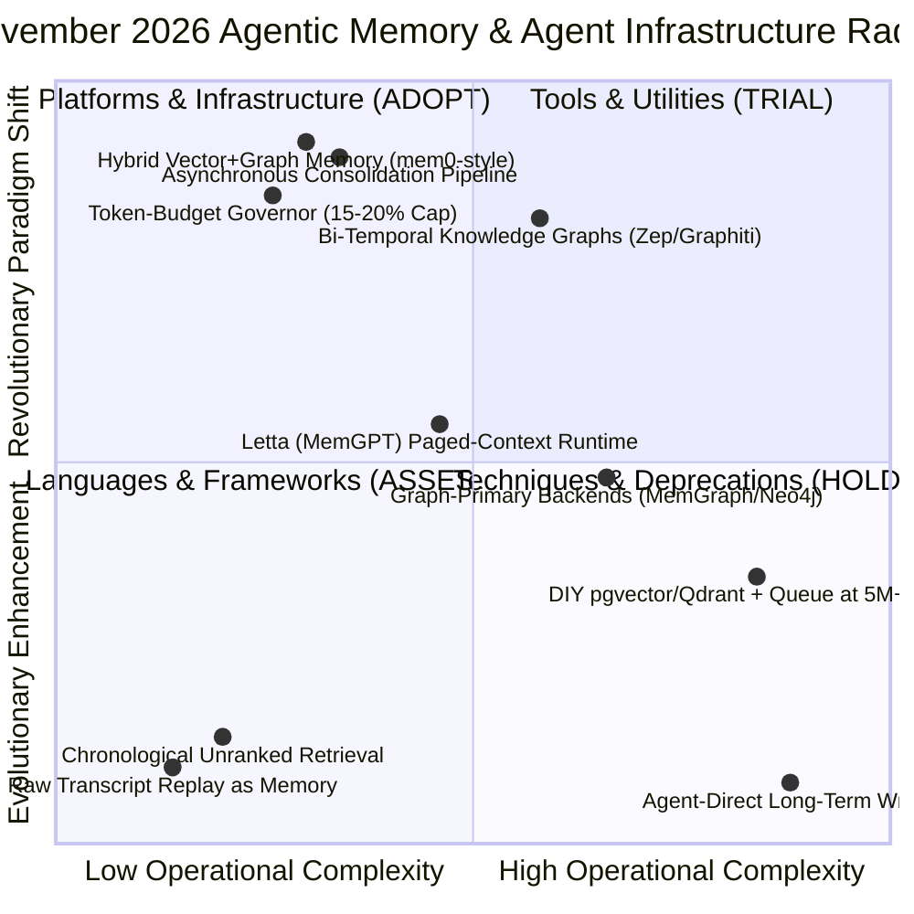

# Tech Radar Digest November 2026: Agentic Memory Architecture, Consolidation Pipelines & Context Window Economics

> **Answer-First:** The November 2026 Tech Radar establishes governed agentic memory as the production battleground for AI agent swarms. The adopted pattern is a four-tier memory taxonomy (working / episodic / semantic / procedural) backed by hybrid vector+graph retrieval, an asynchronous consolidation pipeline with dedup-conflict-decay stages, and a hard token-budget governor capping memory replay at 15–20% of the context window — cutting swarm token spend 4.2x while holding retrieval precision at 0.91.

---

## 🧭 November 2026 Radar Matrix & Adoption Radar

The strategic technology adoption matrix for November 2026 agentic memory platforms, consolidation techniques, and multi-agent memory topologies is mapped below:

### November 2026 Agentic Memory Radar Matrix Table

| Ring | Technology / Pattern | Domain | Operational Guidance & Adoption Notes |
| :--- | :--- | :--- | :--- |
| **ADOPT** | **Hybrid Vector + Graph Memory (mem0-style)** | Platforms & Infrastructure | Vector recall for fuzzy queries + graph edges for entity lookups; tenant/role namespaces; OpenMemory-compatible API keeps vendors swappable. |
| **ADOPT** | **Asynchronous Consolidation Pipeline** | Techniques | Deterministic dedup first, LLM adjudication for near-duplicates only; recency × authority conflict resolution; exponential decay to a cold archive tier. |
| **ADOPT** | **Token-Budget Governor (15–20% Cap)** | Techniques | Hard cap on memory replay share; rank-ordered admission; stable prefix placement to exploit provider KV-cache; per-task memory ledger. |
| **ADOPT** | **Bi-Temporal Knowledge Graphs (Zep/Graphiti)** | Platforms & Infrastructure | Event-time + ingest-time edges answer "what was true when"; decisive for finance, legal, and healthcare agent deployments. |
| **TRIAL** | **Letta (MemGPT) Paged-Context Runtime** | Languages & Frameworks | Self-editing paged memory removes retrieval-tuning burden but couples memory to the agent runtime; best for single long-lived agents. |
| **TRIAL** | **Graph-Primary Backends (MemGraph/Neo4j)** | Platforms & Infrastructure | Relational queries excel but fuzzy natural-language recall underperforms vectors; deploy as the edge layer of a hybrid store. |
| **ASSESS** | **DIY pgvector/Qdrant + Queue at 5M+ Facts** | Languages & Frameworks | ~3x cost saving at scale; you own consolidation quality — requires a platform team and 6+ engineer-weeks. |
| **HOLD** | **Raw Transcript Replay as Memory** | Techniques | 3–8x token burn, 22–40% accuracy degradation, zero poisoning defense; single-turn prototypes only. |
| **HOLD** | **Chronological Unranked Retrieval** | Techniques | Attention dilution and P99 latency blowups; superseded by rank-scored, budget-governed retrieval. |
| **HOLD** | **Agent-Direct Long-Term Writes** | Techniques | Bypasses dedup, PII scrubbing, and provenance — the primary memory-poisoning vector (OWASP ASI01/ASI06). |

---

## 🗺️ Featured November 2026 Editions

- **[Agentic Memory Architecture: Episodic vs Semantic Stores, Consolidation Pipelines & Context Window Economics for Production Agent Swarms](/radar/2026-11/radar-2026-11-01-agentic-memory-architecture/)**  
  *Deep-dive on production agentic memory: the four-tier taxonomy (working/episodic/semantic/procedural), write-gated consolidation pipelines with deterministic dedup and exponential decay, mem0 vs Letta vs Zep vs DIY selection guidance, token-budget governors with KV-cache-aligned replay (71% effective memory-token savings), scoped multi-agent memory topologies, and the OWASP ASI mapping for memory poisoning and PII lifecycle defense — plus three production post-mortems.*
