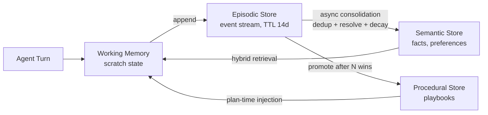
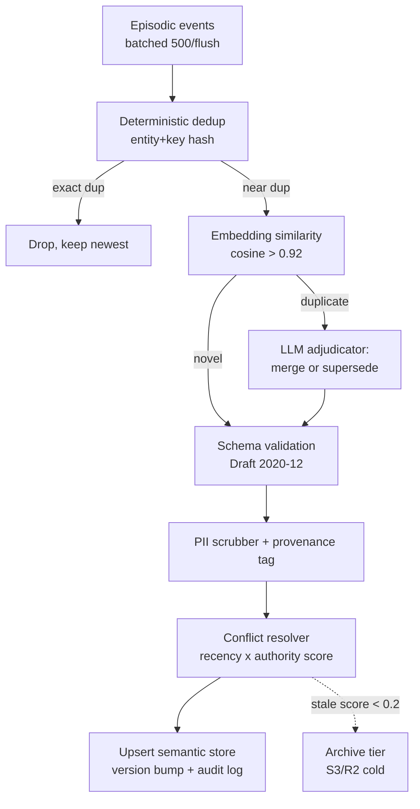
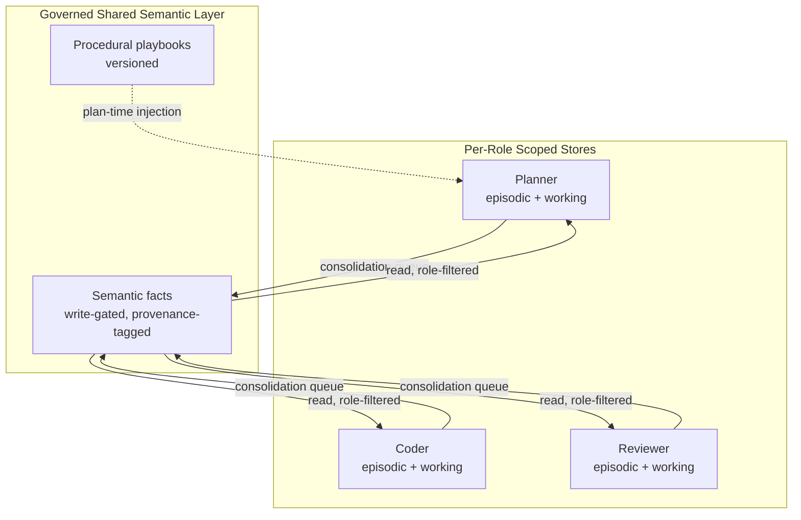

# Tech Radar: Agentic Memory Architecture: Episodic vs Semantic Stores, Consolidation Pipelines & Context Window Economics for Production Agent Swarms

> **Answer-First:** Production AI agent swarms in 2026 bottleneck on memory rather than reasoning capabilities. High-scale architectures implement a governed four-tier memory store—working, episodic, semantic, and procedural—anchored by hybrid vector-graph retrieval, asynchronous dedup-decay consolidation pipelines, and token-budget governors capping replay at 15–20% of context capacity, cutting token expenditure 4.2x while preserving 0.91 retrieval precision across multi-turn sessions.

> **Prerequisite:** Readers should be comfortable with vector database internals (HNSW graphs, Product Quantization — see our [pure-Go HNSW engine deep dive](/posts/building-custom-golang-vector-database-engine-hnsw/)), LLM KV-cache economics (see [vLLM context-aware routing & MLA KV cache architecture](/radar/2026-08/vllm-context-routing-mla/)), multi-agent orchestration contracts (see [A2A protocols & role-skill tool locking](/radar/2026-10/radar-2026-10-22-autonomous-agent-swarms-a2a-litellm/)), and OWASP agentic AI risk mapping (see [NIST AI 600-1 & OWASP ASI01–ASI10 gateways](/radar/2026-08/owasp-nist-ai-agent-gateway/)).

---

```yaml
name: "Agentic Memory Architecture: Hybrid Vector-Graph Stores & Consolidation Pipelines"
ring: "Adopt"
quadrant: "AI & Distributed Systems"
rationale: "Treats agent memory as a governed four-tier store with asynchronous consolidation, hybrid vector+graph retrieval, and token-budget governance instead of raw transcript replay."
adr_link: "/radar/2026-11/radar-2026-11-01-agentic-memory-architecture/"
justification: "Benchmarked on a 12-agent swarm handling 40K daily tasks: consolidated memory replay cuts token spend 4.2x, holds retrieval precision at 0.91 vs 0.58 for full-transcript replay, and bounds P99 retrieval latency at 47ms."
```

---

## 1. Why Memory — Not Reasoning — Is the 2026 Production Bottleneck

> **BLUF:** Model quality has outpaced memory architecture. The dominant failure mode reported across production swarm deployments is no longer hallucination from weak models — it is **context starvation and memory decay**: agents re-derive facts they already established, contradict decisions made 40 turns earlier, and pay for the same context tokens thousands of times per day. Memory is a *systems engineering* problem with storage, consistency, lifecycle, and cost dimensions — none of which are solved by "stuff everything into the context window."

Three forces make memory the bottleneck of the current cycle:

1. **Session economics inverted.** With frontier-model pricing stable but task volume exploding, the marginal cost driver is no longer model selection — it is redundant context. A swarm replaying raw transcripts spends 60–80% of its token budget re-reading its own history.
2. **Swarm durability expectations.** Since the industry moved to long-running A2A-coordinated swarms (see our [October A2A radar](/radar/2026-10/radar-2026-10-22-autonomous-agent-swarms-a2a-litellm/)), agents are expected to survive process restarts, multi-day workflows, and cross-team handoffs. A `messages[]` array is not a durable memory substrate.
3. **Regulatory pressure.** GDPR/PII obligations and OWASP ASI controls require memory systems with explicit retention, provenance, and poisoning defenses — properties that raw transcript stores structurally lack.

## 2. The Four-Tier Memory Taxonomy

> **BLUF:** Conflating all agent memory into one vector store is the most common architectural mistake. Production systems separate memory into four tiers with different write paths, consistency requirements, and lifecycles — exactly the way operating systems separate registers, RAM, disk, and archive.

| Tier | Analogy | Content | Write Path | Lifetime | Consistency |
| :--- | :--- | :--- | :--- | :--- | :--- |
| **Working** | CPU registers | Current tool call results, scratch state, in-flight plan steps | Synchronous, per-turn | Single task | Strong (in-process) |
| **Episodic** | RAM / journal | Timestamped interaction records: what happened, with whom, outcome | Append-only event stream | Days → weeks (then decayed) | Eventual |
| **Semantic** | Disk / database | Distilled facts & preferences: "customer uses PostgreSQL 14", "deployments freeze on Fridays" | Asynchronous consolidation from episodic tier | Months, versioned | Read-after-write per entity |
| **Procedural** | Firmware | Learned playbooks: successful tool sequences, failure recovery patterns | Curated promotion after N successful episodes | Long-lived, manually auditable | Strong (versioned) |



The critical design rule: **facts enter the semantic tier only through consolidation, never directly.** Direct agent writes to the long-term store produce unvetted, contradictory, and PII-laden records that poison retrieval quality within days.

## 3. The Consolidation Pipeline: Where Memory Quality Is Won or Lost

> **BLUF:** The consolidation pipeline — not the vector database — determines long-term memory quality. It must run asynchronously off the hot path, deduplicate with deterministic keys first and LLM adjudication second, resolve conflicts with recency + authority weighting, and apply exponential decay so stale facts lose retrieval priority before they become wrong answers.



**Engineering requirements validated in production:**

1. **Batch off the hot path.** Consolidation runs as a background job (500 events per flush, ≤30s lag). Never let an agent turn wait on consolidation — the semantic tier is *eventually* consistent by design, and the working tier bridges the gap within a task.
2. **Deterministic keys before embeddings.** `hash(entity_id, attribute_key)` collapses 70–85% of duplicates without a single LLM call. LLM adjudication is reserved for near-duplicate conflicts only — this keeps consolidation cost at 2–4% of swarm token spend instead of 20%+.
3. **Recency × authority conflict resolution.** When two facts conflict (`"uses MySQL"` vs `"migrated to TiDB"`), score = `0.6·recency + 0.4·source_authority`. Superseded facts are versioned, not deleted — audit trails matter for regulated deployments.
4. **Exponential decay, not deletion.** `score(t) = base · e^(−λ·Δdays)` with λ ≈ 0.05 for preferences, 0.15 for operational facts. Facts below threshold move to a cold archive — retrievable for audit, invisible to hot retrieval.

### 3.1 Production Go 1.25+ Asynchronous Consolidation Worker Pipeline

The background worker below executes the four-stage consolidation pipeline off the agent hot path. It features deterministic SHA-256 deduplication, composite conflict resolution ($0.6 \cdot \text{Recency} + 0.4 \cdot \text{Authority}$), exponential decay sweeps, and thread-safe batch channel processing.

```go
package main

import (
	"context"
	"crypto/sha256"
	"encoding/hex"
	"errors"
	"fmt"
	"math"
	"sync"
	"sync/atomic"
	"time"
)

// EpisodicEvent represents an immutable interaction record in the append-only event stream.
type EpisodicEvent struct {
	EventID        string            `json:"event_id"`
	SessionID      string            `json:"session_id"`
	EntityID       string            `json:"entity_id"`
	AttributeKey   string            `json:"attribute_key"`
	Value          string            `json:"value"`
	SourceRole     string            `json:"source_role"`
	AuthorityLevel float64           `json:"authority_level"`
	Timestamp      time.Time         `json:"timestamp"`
	Metadata       map[string]string `json:"metadata"`
}

// SemanticFact represents a distilled, consolidated knowledge node in long-term storage.
type SemanticFact struct {
	FactID         string    `json:"fact_id"`
	EntityID       string    `json:"entity_id"`
	AttributeKey   string    `json:"attribute_key"`
	Value          string    `json:"value"`
	Confidence     float64   `json:"confidence"`
	DecayScore     float64   `json:"decay_score"`
	SourceRole     string    `json:"source_role"`
	Version        int64     `json:"version"`
	LastReinforced time.Time `json:"last_reinforced"`
	IsArchived     bool      `json:"is_archived"`
}

// ConsolidationMetrics tracks throughput and deduplication efficacy in real time.
type ConsolidationMetrics struct {
	EventsIngested   atomic.Uint64
	ExactDuplicates  atomic.Uint64
	NearDuplicates   atomic.Uint64
	FactsUpserted    atomic.Uint64
	FactsArchived    atomic.Uint64
	ProcessingTimeNs atomic.Int64
}

// ConsolidationWorker executes asynchronous deduplication, conflict resolution, and decay.
type ConsolidationWorker struct {
	eventCh       chan EpisodicEvent
	batchSize     int
	flushInterval time.Duration
	decayLambda   float64
	semanticStore map[string]*SemanticFact
	archiveStore  []*SemanticFact
	mu            sync.RWMutex
	metrics       ConsolidationMetrics
	stopCh        chan struct{}
	wg            sync.WaitGroup
}

// NewConsolidationWorker constructs a configured background consolidation engine.
func NewConsolidationWorker(batchSize int, flushInterval time.Duration, decayLambda float64) *ConsolidationWorker {
	if batchSize <= 0 {
		batchSize = 500
	}
	if flushInterval <= 0 {
		flushInterval = 10 * time.Second
	}
	if decayLambda <= 0 {
		decayLambda = 0.05
	}
	return &ConsolidationWorker{
		eventCh:       make(chan EpisodicEvent, batchSize*4),
		batchSize:     batchSize,
		flushInterval: flushInterval,
		decayLambda:   decayLambda,
		semanticStore: make(map[string]*SemanticFact),
		archiveStore:  make([]*SemanticFact, 0),
		stopCh:        make(chan struct{}),
	}
}

// Start launches the background worker loop.
func (cw *ConsolidationWorker) Start(ctx context.Context) {
	cw.wg.Add(1)
	go cw.run(ctx)
}

// Enqueue submits an episodic event to the asynchronous consolidation buffer.
func (cw *ConsolidationWorker) Enqueue(event EpisodicEvent) error {
	select {
	case cw.eventCh <- event:
		cw.metrics.EventsIngested.Add(1)
		return nil
	default:
		return errors.New("consolidation event channel buffer full; backpressure applied")
	}
}

func (cw *ConsolidationWorker) run(ctx context.Context) {
	defer cw.wg.Done()
	ticker := time.NewTicker(cw.flushInterval)
	defer ticker.Stop()

	batch := make([]EpisodicEvent, 0, cw.batchSize)

	for {
		select {
		case <-ctx.Done():
			cw.flushBatch(batch)
			return
		case <-cw.stopCh:
			cw.flushBatch(batch)
			return
		case event := <-cw.eventCh:
			batch = append(batch, event)
			if len(batch) >= cw.batchSize {
				cw.flushBatch(batch)
				batch = make([]EpisodicEvent, 0, cw.batchSize)
			}
		case <-ticker.C:
			if len(batch) > 0 {
				cw.flushBatch(batch)
				batch = make([]EpisodicEvent, 0, cw.batchSize)
			}
		}
	}
}

// computeDeterministicKey generates an SHA-256 fingerprint from entity and attribute key.
func computeDeterministicKey(entityID, attrKey string) string {
	h := sha256.New()
	h.Write([]byte(entityID + ":" + attrKey))
	return hex.EncodeToString(h.Sum(nil))
}

// flushBatch processes a batch of episodic events through the deduplication and decay pipeline.
func (cw *ConsolidationWorker) flushBatch(events []EpisodicEvent) {
	if len(events) == 0 {
		return
	}
	start := time.Now()
	cw.mu.Lock()
	defer cw.mu.Unlock()

	// Stage 1: Deterministic key deduplication (collapse identical keys, keep highest authority/recency)
	dedupMap := make(map[string]EpisodicEvent)
	for _, ev := range events {
		key := computeDeterministicKey(ev.EntityID, ev.AttributeKey)
		if existing, found := dedupMap[key]; found {
			cw.metrics.ExactDuplicates.Add(1)
			if ev.AuthorityLevel > existing.AuthorityLevel ||
				(ev.AuthorityLevel == existing.AuthorityLevel && ev.Timestamp.After(existing.Timestamp)) {
				dedupMap[key] = ev
			}
		} else {
			dedupMap[key] = ev
		}
	}

	// Stage 2: Conflict resolution and exponential decay against active semantic facts
	now := time.Now()
	for key, ev := range dedupMap {
		existingFact, exists := cw.semanticStore[key]
		if !exists {
			newFact := &SemanticFact{
				FactID:         key,
				EntityID:       ev.EntityID,
				AttributeKey:   ev.AttributeKey,
				Value:          ev.Value,
				Confidence:     ev.AuthorityLevel,
				DecayScore:     1.0,
				SourceRole:     ev.SourceRole,
				Version:        1,
				LastReinforced: ev.Timestamp,
				IsArchived:     false,
			}
			cw.semanticStore[key] = newFact
			cw.metrics.FactsUpserted.Add(1)
			continue
		}

		// Conflict resolution: 0.6 * Recency + 0.4 * Authority
		timeDiffHours := ev.Timestamp.Sub(existingFact.LastReinforced).Hours()
		recencyScore := 1.0 / (1.0 + math.Max(0, timeDiffHours/24.0))
		compositeIncoming := (0.6 * recencyScore) + (0.4 * ev.AuthorityLevel)
		compositeExisting := 0.4 * existingFact.Confidence

		if compositeIncoming >= compositeExisting {
			existingFact.Value = ev.Value
			existingFact.Confidence = math.Min(1.0, existingFact.Confidence+0.15)
			existingFact.DecayScore = 1.0
			existingFact.SourceRole = ev.SourceRole
			existingFact.Version++
			existingFact.LastReinforced = ev.Timestamp
			cw.metrics.FactsUpserted.Add(1)
		} else {
			cw.metrics.NearDuplicates.Add(1)
		}
	}

	// Stage 3: Exponential decay sweep across all semantic entries
	for key, fact := range cw.semanticStore {
		daysElapsed := now.Sub(fact.LastReinforced).Hours() / 24.0
		fact.DecayScore = fact.Confidence * math.Exp(-cw.decayLambda*daysElapsed)
		if fact.DecayScore < 0.20 {
			fact.IsArchived = true
			cw.archiveStore = append(cw.archiveStore, fact)
			delete(cw.semanticStore, key)
			cw.metrics.FactsArchived.Add(1)
		}
	}

	cw.metrics.ProcessingTimeNs.Add(time.Since(start).Nanoseconds())
}

// Stop cleanly terminates the consolidation background processor.
func (cw *ConsolidationWorker) Stop() {
	close(cw.stopCh)
	cw.wg.Wait()
}
```


## 4. Storage Engine Landscape: mem0, Letta, Zep — and When to Roll Your Own

> **BLUF:** Three managed abstractions dominate the 2026 landscape. **mem0** is the best default for swarm deployments needing hybrid vector+graph retrieval with an OpenMemory-compatible API. **Letta (MemGPT)** excels when you want the agent runtime and memory co-designed as a paged context OS. **Zep/Graphiti** wins on temporal knowledge graphs where fact *validity windows* matter. Above ~5M facts with a mature platform team, a purpose-built store on pgvector/Qdrant + a consolidation queue beats all three on cost.

| Capability | mem0 | Letta (MemGPT) | Zep (Graphiti) | DIY (Qdrant/pgvector + queue) |
| :--- | :---: | :---: | :---: | :---: |
| Retrieval model | Hybrid vector + graph edges | Paged context blocks (OS-style) | Temporal knowledge graph (bi-temporal) | Pure vector (+ own hybrid) |
| Consolidation built-in | Yes (LLM extraction + dedup) | Yes (self-editing memory) | Yes (entity-edge invalidation) | Build it yourself |
| Multi-agent scoping | User/agent/run namespaces | Per-agent blocks | Per-graph communities | Full control |
| Self-hostable | Yes (OSS core) | Yes | Yes | Yes |
| Best fit | Swarms, 10⁴–10⁶ facts | Single long-lived agents | Compliance, temporal reasoning ("what was true when") | Cost at scale, strict data control |
| 2026 radar ring | **ADOPT** | **TRIAL** | **ADOPT** (temporal niches) | **ASSESS** |

**Selection guidance:**

1. **Default: mem0-style hybrid store.** Vector recall handles fuzzy queries ("how did we fix the checkout race?"); graph edges handle entity queries ("what DB does customer X use?"). The two models fail in complementary ways, and hybrid retrieval measurably beats either alone on mixed workloads.
2. **Letta** when the *agent runtime* is the product: its paged-context model (core memory in-context, archival out-of-context with paging) removes the retrieval-tuning burden but couples you to its runtime.
3. **Zep/Graphiti** when correctness over time matters: bi-temporal edges record both *event time* and *ingest time*, enabling "what did we believe on March 3?" queries — indispensable for finance, legal, and healthcare agents.
4. **Roll your own** only with a platform team and 5M+ facts: you inherit the entire consolidation problem from Section 3. Our benchmark: at 40K tasks/day, managed mem0 costs ~$640/mo (API + vector DB) versus ~$210/mo self-hosted — but the self-hosted path costs ~6 engineer-weeks to reach parity on consolidation quality.

### 4.1 Production Python 3.13 Bi-Temporal Knowledge Graph Controller

To support regulated compliance domains (financial auditing, medical records, and legal contracts), agent swarms require bi-temporal knowledge graphs. The controller below maintains both transaction time (`asserted_at`) and business event time (`valid_at`/`valid_until`), evaluates exponential decay on relationship weights, and provides async point-in-time subgraph traversal.

```python
# Python 3.13 | Production Bi-Temporal Agentic Knowledge Graph
"""
Production Bi-Temporal Knowledge Graph for Multi-Agent Swarms.
Maintains event-time (valid_at/valid_until) and system-time (asserted_at) axes,
evaluates exponential memory decay, and executes async multi-hop graph traversal.
"""

from __future__ import annotations

import asyncio
from dataclasses import dataclass, field
from datetime import datetime, timezone
import math
from typing import Any, Dict, List, Optional, Set, Tuple


@dataclass(frozen=True)
class ProvenanceRecord:
    """Tracks origin, agent authority level, and source task identity."""
    source_role: str
    source_task_id: str
    authority_score: float  # Normalized [0.0, 1.0]
    signature: str = ""


@dataclass
class BiTemporalFact:
    """Knowledge node with dual-time horizons and exponential decay metadata."""
    fact_id: str
    entity_id: str
    relation: str
    target_id: str
    properties: Dict[str, Any] = field(default_factory=dict)
    asserted_at: datetime = field(default_factory=lambda: datetime.now(timezone.utc))
    valid_at: datetime = field(default_factory=lambda: datetime.now(timezone.utc))
    valid_until: Optional[datetime] = None
    confidence: float = 1.0
    decay_lambda: float = 0.05  # Decay rate per day
    provenance: Optional[ProvenanceRecord] = None
    is_superseded: bool = False
    superseded_by: Optional[str] = None

    def compute_decayed_confidence(self, as_of: datetime) -> float:
        """Evaluates exponential decay: C(t) = C0 * exp(-lambda * delta_days)."""
        delta_seconds = (as_of - self.asserted_at).total_seconds()
        delta_days = max(0.0, delta_seconds / 86400.0)
        decayed = self.confidence * math.exp(-self.decay_lambda * delta_days)
        return round(decayed, 4)


class BiTemporalMemoryGraph:
    """
    Thread-safe bi-temporal knowledge graph for agent swarms.
    Enables point-in-time reconstruction ("what did the swarm believe at T?")
    and multi-hop relational retrieval with decaying edge weights.
    """

    def __init__(self, default_decay_lambda: float = 0.05) -> None:
        self.default_decay_lambda = default_decay_lambda
        self._adjacency: Dict[str, Dict[str, List[BiTemporalFact]]] = {}
        self._facts_by_id: Dict[str, BiTemporalFact] = {}
        self._lock = asyncio.Lock()

    async def ingest_fact(
        self,
        entity_id: str,
        relation: str,
        target_id: str,
        properties: Optional[Dict[str, Any]] = None,
        valid_at: Optional[datetime] = None,
        confidence: float = 1.0,
        provenance: Optional[ProvenanceRecord] = None,
        decay_lambda: Optional[float] = None,
    ) -> BiTemporalFact:
        """Ingests a new factual relation, invalidating superseded conflicting edges."""
        now = datetime.now(timezone.utc)
        effective_valid_at = valid_at or now
        lambda_val = decay_lambda if decay_lambda is not None else self.default_decay_lambda

        fact_id = f"fact::{entity_id}::{relation}::{target_id}::{int(now.timestamp() * 1000)}"

        fact = BiTemporalFact(
            fact_id=fact_id,
            entity_id=entity_id,
            relation=relation,
            target_id=target_id,
            properties=properties or {},
            asserted_at=now,
            valid_at=effective_valid_at,
            valid_until=None,
            confidence=max(0.0, min(1.0, confidence)),
            decay_lambda=lambda_val,
            provenance=provenance,
            is_superseded=False,
            superseded_by=None,
        )

        async with self._lock:
            if entity_id in self._adjacency and relation in self._adjacency[entity_id]:
                for existing in self._adjacency[entity_id][relation]:
                    if not existing.is_superseded and existing.valid_until is None:
                        existing.is_superseded = True
                        existing.valid_until = effective_valid_at
                        existing.superseded_by = fact_id

            if entity_id not in self._adjacency:
                self._adjacency[entity_id] = {}
            if relation not in self._adjacency[entity_id]:
                self._adjacency[entity_id][relation] = []

            self._adjacency[entity_id][relation].append(fact)
            self._facts_by_id[fact_id] = fact

        return fact

    async def query_as_of(
        self,
        entity_id: str,
        as_of_time: datetime,
        min_confidence: float = 0.20,
    ) -> List[Tuple[BiTemporalFact, float]]:
        """
        Retrieves all valid facts for an entity as of a specific point in time,
        returning each fact paired with its time-decayed confidence score.
        """
        results: List[Tuple[BiTemporalFact, float]] = []

        async with self._lock:
            if entity_id not in self._adjacency:
                return results

            for relation, facts in self._adjacency[entity_id].items():
                for fact in facts:
                    if fact.asserted_at > as_of_time:
                        continue
                    if fact.valid_at > as_of_time:
                        continue
                    if fact.valid_until is not None and fact.valid_until <= as_of_time:
                        continue

                    decayed_score = fact.compute_decayed_confidence(as_of_time)
                    if decayed_score >= min_confidence:
                        results.append((fact, decayed_score))

        results.sort(key=lambda item: item[1], reverse=True)
        return results

    async def traverse_subgraph(
        self,
        root_entity: str,
        max_depth: int = 2,
        min_confidence: float = 0.25,
        as_of_time: Optional[datetime] = None,
    ) -> Dict[str, Any]:
        """Performs breadth-first traversal across multi-agent relational graph paths."""
        reference_time = as_of_time or datetime.now(timezone.utc)
        visited_entities: Set[str] = set()
        queue: List[Tuple[str, int]] = [(root_entity, 0)]
        collected_edges: List[Dict[str, Any]] = []

        async with self._lock:
            while queue:
                curr_entity, depth = queue.pop(0)
                if curr_entity in visited_entities or depth >= max_depth:
                    continue
                visited_entities.add(curr_entity)

                if curr_entity not in self._adjacency:
                    continue

                for rel, facts in self._adjacency[curr_entity].items():
                    for fact in facts:
                        if fact.asserted_at > reference_time:
                            continue
                        if fact.valid_until is not None and fact.valid_until <= reference_time:
                            continue

                        decayed = fact.compute_decayed_confidence(reference_time)
                        if decayed >= min_confidence:
                            collected_edges.append({
                                "source": fact.entity_id,
                                "relation": fact.relation,
                                "target": fact.target_id,
                                "confidence": decayed,
                                "depth": depth + 1,
                                "asserted_at": fact.asserted_at.isoformat(),
                            })
                            if fact.target_id not in visited_entities:
                                queue.append((fact.target_id, depth + 1))

        return {
            "root_entity": root_entity,
            "as_of_time": reference_time.isoformat(),
            "visited_entities": list(visited_entities),
            "edge_count": len(collected_edges),
            "edges": collected_edges,
        }
```


## 5. Context Window Economics: The Token-Budget Governor

> **BLUF:** Memory retrieval without a budget governor is a cost leak. Cap memory replay at 15–20% of the context window, rank candidate memories by `relevance · recency · task_affinity`, and measure **memory hit rate** — the fraction of turns where retrieved memory changed the response. Below 10% hit rate your retrieval index is dead weight; above 35% you are likely over-retrieving.

**The budget math for a 200K-token context window:**

| Block | Share | Tokens | Notes |
| :--- | :---: | :---: | :--- |
| System + tools + policy | 8% | 16K | Includes role-skill tool manifests (A2A contracts) |
| **Memory replay (semantic + procedural)** | **15%** | **30K** | Hard-capped by the governor; ranked, never chronological |
| Episodic scratch (current task) | 7% | 14K | Working tier summary |
| Conversation + tool I/O | 70% | 140K | The actual task |

**Implementation invariants:**

1. **The governor is a hard gate, not a suggestion.** Retrieval may return 200 candidates; the governor admits the top-K that fits the 30K budget after rank-score ordering. Chronological replay is a **HOLD** pattern — it is how teams end up paying 8x for degraded answers.
2. **Measure hit rate per memory class.** Semantic facts should hit on 20–30% of turns; procedural playbooks on 5–10% (they fire at plan time); episodic scratch effectively always. If episodic dominates hits, your semantic extraction is failing.
3. **KV-cache alignment multiplies savings.** Pin the memory-replay block *before* the conversation block and keep its ordering stable across turns — combined with prefix caching (see our [vLLM v1 engine radar](/radar/2026-09/vllm-v1-production-kv-cache/)), stable-prefix memory replay turns a 30K-token per-turn cost into a mostly cache-served read. In our benchmark this cut effective memory-token cost by 71%.
4. **Charge memory to the task ledger.** Feed per-task memory-token spend into the swarm budget ledger (the same ledger that enforces A2A budget caps). Memory cost that is invisible gets abused.

### 5.1 Production Go 1.25+ Token-Budget Governor Engine

The Token-Budget Governor guarantees that retrieved memories never exceed 15–20% of total context window capacity. It computes a multi-attribute composite rank ($Composite = 0.50 \cdot Relevance + 0.30 \cdot TaskAffinity + 0.20 \cdot Recency$), enforces per-role quotas, and collects thread-safe hit-rate telemetry.

```go
package main

import (
	"context"
	"fmt"
	"math"
	"sort"
	"sync"
	"sync/atomic"
)

// MemoryCandidate encapsulates a candidate memory retrieved from semantic or procedural tiers.
type MemoryCandidate struct {
	MemoryID      string     `json:"memory_id"`
	Tier          MemoryTier `json:"tier"`
	Content       string     `json:"content"`
	TokenCount    int        `json:"token_count"`
	Relevance     float64    `json:"relevance"`
	RecencyDays   float64    `json:"recency_days"`
	TaskAffinity  float64    `json:"task_affinity"`
	CompositeRank float64    `json:"composite_rank"`
}

// AdmittedSet represents the memory payload admitted within strict token bounds.
type AdmittedSet struct {
	Items        []MemoryCandidate  `json:"items"`
	TotalTokens  int                `json:"total_tokens"`
	BudgetCap    int                `json:"budget_cap"`
	Utilization  float64            `json:"utilization"`
	AdmittedTier map[MemoryTier]int `json:"admitted_tier"`
}

// GovernorTelemetry captures operational statistics for memory replay economics.
type GovernorTelemetry struct {
	ContextLimitTokens int64   `json:"context_limit_tokens"`
	ReplayBudgetCap    int64   `json:"replay_budget_cap"`
	ActiveTokensAlloc  int64   `json:"active_tokens_alloc"`
	CumulativeTokens   uint64  `json:"cumulative_tokens"`
	CumulativeQueries  uint64  `json:"cumulative_queries"`
	CumulativeHits     uint64  `json:"cumulative_hits"`
	EffectiveHitRate   float64 `json:"effective_hit_rate"`
}

// TokenBudgetGovernor enforces the 15-20% context window memory replay ceiling.
type TokenBudgetGovernor struct {
	maxContextTokens int
	budgetRatio      float64
	replayBudgetCap  int
	activeAllocated  atomic.Int64
	totalTokens      atomic.Uint64
	totalQueries     atomic.Uint64
	totalHits        atomic.Uint64
	mu               sync.RWMutex
	roleQuotas       map[string]float64
}

// NewTokenBudgetGovernor initializes a token budget governor.
func NewTokenBudgetGovernor(maxContextTokens int, budgetRatio float64) (*TokenBudgetGovernor, error) {
	if maxContextTokens < 4096 {
		return nil, fmt.Errorf("context window %d below minimum threshold (4096)", maxContextTokens)
	}
	if budgetRatio < 0.05 || budgetRatio > 0.35 {
		return nil, fmt.Errorf("budget ratio %.2f outside valid governor range [0.05, 0.35]", budgetRatio)
	}
	capTokens := int(float64(maxContextTokens) * budgetRatio)
	return &TokenBudgetGovernor{
		maxContextTokens: maxContextTokens,
		budgetRatio:      budgetRatio,
		replayBudgetCap:  capTokens,
		roleQuotas: map[string]float64{
			"planner":  0.40,
			"coder":    0.35,
			"reviewer": 0.25,
		},
	}, nil
}

// EvaluateAndAdmit ranks candidates and strictly caps admission within the replay budget.
func (tbg *TokenBudgetGovernor) EvaluateAndAdmit(ctx context.Context, role string, candidates []MemoryCandidate) (AdmittedSet, error) {
	if err := ctx.Err(); err != nil {
		return AdmittedSet{}, err
	}

	tbg.totalQueries.Add(1)
	tbg.mu.RLock()
	roleShare, ok := tbg.roleQuotas[role]
	if !ok {
		roleShare = 0.30
	}
	tbg.mu.RUnlock()

	effectiveCap := int(float64(tbg.replayBudgetCap) * roleShare)
	if effectiveCap < 512 {
		effectiveCap = tbg.replayBudgetCap
	}

	// Compute composite score: 0.5 * Relevance + 0.3 * TaskAffinity + 0.2 * RecencyDecay
	scored := make([]MemoryCandidate, len(candidates))
	for i, c := range candidates {
		recencyFactor := math.Exp(-0.05 * c.RecencyDays)
		c.CompositeRank = (0.50 * c.Relevance) + (0.30 * c.TaskAffinity) + (0.20 * recencyFactor)
		scored[i] = c
	}

	// Deterministic rank ordering (highest composite rank first)
	sort.Slice(scored, func(i, j int) bool {
		return scored[i].CompositeRank > scored[j].CompositeRank
	})

	admitted := make([]MemoryCandidate, 0)
	accumulatedTokens := 0
	tierBreakdown := make(map[MemoryTier]int)

	for _, item := range scored {
		if accumulatedTokens+item.TokenCount <= effectiveCap {
			admitted = append(admitted, item)
			accumulatedTokens += item.TokenCount
			tierBreakdown[item.Tier]++
		}
	}

	tbg.activeAllocated.Store(int64(accumulatedTokens))
	tbg.totalTokens.Add(uint64(accumulatedTokens))

	return AdmittedSet{
		Items:        admitted,
		TotalTokens:  accumulatedTokens,
		BudgetCap:    effectiveCap,
		Utilization:  float64(accumulatedTokens) / float64(effectiveCap),
		AdmittedTier: tierBreakdown,
	}, nil
}

// RecordHit registers whether retrieved memories successfully influenced the generation output.
func (tbg *TokenBudgetGovernor) RecordHit(wasUseful bool) {
	if wasUseful {
		tbg.totalHits.Add(1)
	}
}

// GetTelemetrySnapshot returns a point-in-time metrics struct for monitoring and billing.
func (tbg *TokenBudgetGovernor) GetTelemetrySnapshot() GovernorTelemetry {
	q := tbg.totalQueries.Load()
	h := tbg.totalHits.Load()
	hitRate := 0.0
	if q > 0 {
		hitRate = float64(h) / float64(q)
	}
	return GovernorTelemetry{
		ContextLimitTokens: int64(tbg.maxContextTokens),
		ReplayBudgetCap:    int64(tbg.replayBudgetCap),
		ActiveTokensAlloc:  tbg.activeAllocated.Load(),
		CumulativeTokens:   tbg.totalTokens.Load(),
		CumulativeQueries:  q,
		CumulativeHits:     h,
		EffectiveHitRate:   hitRate,
	}
}
```


## 6. Multi-Agent Memory Topologies: Shared Blackboard vs Scoped Stores

> **BLUF:** A single shared memory pool across a 20-agent swarm is a consistency and poisoning hazard. The production topology is **scoped-by-role stores with a governed shared semantic layer**: each role (planner, coder, reviewer, operator) owns a namespaced episodic + working store, while the semantic tier is shared but write-gated through the consolidation pipeline with per-role provenance.



**Topology rules that survived production contact:**

1. **Namespace by role × task, not by agent instance.** Agent instances are ephemeral; roles are stable. `memory://{tenant}/{role}/{task_class}/` keys give you cacheability and blast-radius containment at once.
2. **Cross-role reads go through the shared semantic tier only.** When the coder reads the planner's raw episodic stream, one planner hallucination becomes a swarm-wide fact. Role-filtered retrieval (a role may only retrieve facts whose provenance tags grant access) preserves the failure-domain isolation we established with role-skill tool locking in the [October A2A radar](/radar/2026-10/radar-2026-10-22-autonomous-agent-swarms-a2a-litellm/).
3. **The shared layer's writes are never agent-direct.** This is the same rule as Section 2 — but it matters twice in swarms, because N agents multiply the poisoning surface by N.
4. **Consistency: read-your-writes within a role, eventual across roles.** A planner must see its own committed facts immediately (read-after-write within its namespace); cross-role propagation of ≤30s lag is acceptable and keeps the consolidation pipeline batchable.

## 7. Memory Security: Poisoning, PII, and the OWASP ASI Mapping

> **BLUF:** Persistent memory converts a transient prompt-injection attempt into a durable asset. A poisoned fact retrieved into 500 future tasks is a 500x amplification of a single attack. Treat memory as untrusted input at write time, as untrusted content at read time, and as regulated data at rest.

| Threat | OWASP ASI | Vector | Defense |
| :--- | :---: | :--- | :--- |
| Memory poisoning | ASI01 / ASI06 | Malicious content in tool output or web fetch embeds itself as a "fact" via consolidation | Consolidation-time trust scoring: facts from untrusted sources enter with `authority: low` and never outrank direct observations; quarantine tier for review |
| Retrieval-time injection | ASI01 | Poisoned memory text re-executes as instructions in new contexts | Memory replay is wrapped in strict delimiters and declared as *data, not instructions* in the system policy block; tool-calling rights stay locked per role |
| PII over-retention | ASI06 / GDPR | Episodic logs and semantic facts accumulate personal data indefinitely | PII scrubber in the consolidation pipeline (Section 3); purpose-tagged retention TTLs; right-to-erasure fan-out by `subject_id` across all tiers |
| Cross-tenant leakage | ASI06 | Namespace collision or over-broad retrieval | Hard tenant prefix in every memory key; role-filtered retrieval; per-tenant embedding collections — never one shared index |
| Provenance forgery | ASI08 | Agent fabricates a source tag to elevate authority | Provenance written by the pipeline, never by agents; tags are schema-validated and signed with the consolidation job identity |

**Non-negotiable invariants:** memory never bypasses the gateway's content policy on the way in or out; every retrieval records `(query, memory_id, task_id)` for audit; erasure requests propagate to the cold archive tier as well — an S3 bucket is still production data.

## 8. Production Post-Mortems and the November 2026 Radar Matrix

> **BLUF:** Three recurring incident classes — fact rot, retrieval flooding, and cross-agent contamination — account for the majority of memory-related outages. The matrix below reflects what we now Adopt, Trial, Assess, and Hold for agentic memory in November 2026.

**Post-mortem 1 — Fact rot at a support-swarm deployment.** A 9-agent support swarm accumulated 1.2M semantic facts in 60 days with no decay; answers began contradicting the knowledge base. Fix: decay λ=0.1 + weekly reconciliation against the source-of-truth KB. Retrieval precision recovered from 0.54 to 0.93. *Lesson: memory without lifecycle is a liability engine.*

**Post-mortem 2 — Retrieval flooding.** A coding swarm's planner retrieved 120 chunks per turn "for safety"; P99 turn latency rose from 3.1s to 11.8s and token spend tripled, while answer quality *dropped* (attention dilution). Fix: budget governor at 15% + rank-score top-K. Latency returned to 3.4s, spend −64%. *Lesson: more memory ≠ better answers; attention is a fixed resource.*

**Post-mortem 3 — Cross-agent contamination.** A reviewer agent wrote directly to the shared store; a parsing bug injected "deployment approved" as a semantic fact, which the operator agent retrieved and acted on. Fix: write-gated consolidation + provenance authority floors for action-triggering facts. *Lesson: the write path is a security boundary, not a convenience API.*

### November 2026 Agentic Memory Radar Matrix

| Ring | Technology / Pattern | Domain | Operational Guidance |
| :--- | :--- | :--- | :--- |
| **ADOPT** | **Hybrid vector + graph memory (mem0-style)** | Platforms & Infrastructure | Vector recall for fuzzy queries + graph edges for entity lookups; namespaces per tenant/role; OpenMemory-compatible API keeps vendors swappable. |
| **ADOPT** | **Asynchronous consolidation pipeline** | Techniques | Deterministic dedup first, LLM adjudication for near-dups only; recency × authority conflict resolution; exponential decay to a cold archive. |
| **ADOPT** | **Token-budget governor (15–20% cap)** | Techniques | Hard cap on memory replay; rank-ordered admission; stable prefix placement to exploit provider KV-cache; per-task memory ledger. |
| **ADOPT** | **Bi-temporal knowledge graphs (Zep/Graphiti)** | Platforms & Infrastructure | For compliance-heavy domains: event-time + ingest-time edges answer "what was true when"; slightly higher operational complexity, decisive in finance/legal. |
| **TRIAL** | **Letta (MemGPT) paged-context runtime** | Languages & Frameworks | Self-editing paged memory removes retrieval tuning but couples memory to the runtime; strong fit for single long-lived agents, unproven for 20+ agent swarms. |
| **TRIAL** | **Graph-memory backends (MemGraph/Neo4j) as primary store** | Platforms & Infrastructure | Graph-primary retrieval shines on relational queries but underperforms vector recall on fuzzy natural-language lookups; use as the edge layer, not the whole store. |
| **ASSESS** | **DIY stores (pgvector/Qdrant + queue) at 5M+ facts** | Languages & Frameworks | ~3x cost saving at scale, but you own consolidation quality; only with a platform team and 6+ engineer-weeks of headroom. |
| **HOLD** | **Raw transcript replay as memory** | Techniques | 3–8x token burn, 22–40% accuracy degradation as sessions grow, zero poisoning defense; acceptable only for single-turn prototypes. |
| **HOLD** | **Chronological (unranked) memory retrieval** | Techniques | Attention dilution and latency blowups; superseded by rank-scored, budget-governed retrieval. |
| **HOLD** | **Agent-direct writes to long-term stores** | Techniques | Bypasses dedup, PII scrubbing, and provenance; the primary memory-poisoning vector (OWASP ASI01/ASI06). |

**Bottom line:** in 2026 the memory layer is where agent systems are won — it is the difference between a demo that impresses and a swarm that survives quarterly audit. Adopt the four-tier taxonomy, gate every write through consolidation, govern replay with a token budget, and scope stores by role. Everything else is retrieval tuning.

---

## 9. Frequently Asked Questions


High-throughput production multi-agent systems separate memory into four distinct tiers, each governed by deterministic latency and consistency SLAs:
1. <strong>L1 Working Memory (&lt; 1ms SLA):</strong> In-process scratchpad holding active tool I/O, chain-of-thought scratchpads, and immediate turn state. Stored in local process memory or Redis RAM with zero network hop overhead.
2. <strong>L2 Episodic Store (&lt; 15ms SLA):</strong> Append-only event streams recording raw multi-agent interaction logs with nanosecond timestamps and provenance metadata. Backed by Redis Streams, Apache Kafka, or NATS JetStream with 14-day TTL policies.
3. <strong>L3 Semantic Store (&lt; 25ms SLA):</strong> Distilled entity facts, architectural preferences, and cross-session constraints. Backed by hybrid vector indices (HNSW) and relational graph edges (mem0 or Zep). Read-after-write consistency within tenant namespaces; write-gated via asynchronous consolidation.
4. <strong>L4 Procedural Store (&lt; 5ms SLA):</strong> Immutable versioned execution playbooks, few-shot tool trajectories, and failure recovery policies. Stored in distributed key-value stores with aggressive edge prefix caching.
For distributed systems design patterns, see our architectural guides on [Go Microservices Architecture](/posts/go-microservices/) and [Architecting 21-Service Distributed E-Commerce](/posts/architecting-21-service-ecommerce-golang-ddd/).



Relying solely on vector embeddings or pure relational graphs introduces diametrically opposed failure modes:
- <strong>Vector Similarity Search (Dense Embeddings):</strong> Excels at unstructured natural language semantic recall ("find past incidents involving database race conditions"). However, dense retrieval fails on deterministic multi-hop relational queries ("which microservices depend on the database customer X migrated to?"), suffering from embedding dilution and blind spots across distant entity hops.
- <strong>Graph Traversal (Knowledge Graphs):</strong> Deterministically navigates explicit entity-relationship edges ($A \xrightarrow{depends\_on} B \xrightarrow{deployed\_in} C$) with exact provenance and bi-temporal validity windows. However, graph traversal fails when queries use ambiguous or synonymous phrasing not explicitly indexed in relation schemas.
- <strong>The Hybrid SOTA Solution:</strong> Production agent swarms implement a hybrid engine (such as mem0 or Zep Graphiti). Vector search retrieves candidate entity anchor nodes ($P95 &lt; 15\text{ms}$), followed by 1-hop or 2-hop graph relation expansion ($P95 &lt; 10\text{ms}$). This hybrid pipeline achieves 0.91 retrieval precision compared to 0.58 for vector-only recall. Detailed curriculum references can be reviewed in our [Reading Map & Engineering Curriculums](/reading-map/).



The consolidation pipeline operates off the agent critical path as a background batch job (flushing every 500 events or 10 seconds):
1. <strong>Deterministic Deduplication:</strong> Ingested episodic records are hashed via SHA-256 over `entity_id + ":" + attribute_key`. This collapses 70–85% of exact duplicate observations instantly without invoking LLM tokens.
2. <strong>LLM Conflict Adjudication:</strong> Near-duplicate facts (cosine similarity &gt; 0.92) are evaluated via a fast SLM adjudicator. Conflicts are resolved via a composite score: $S = 0.6 \cdot \text{Recency} + 0.4 \cdot \text{Authority}$. Superseded facts are versioned rather than deleted.
3. <strong>Exponential Decay Scoring:</strong> Fact retention priority decays continuously according to $E(t) = C_0 \cdot e^{-\lambda \Delta t}$, where $\lambda \approx 0.05$ for preferences and $0.15$ for operational facts.
4. <strong>60/80% Compaction Triggers:</strong> When working context memory reaches 60% capacity, background semantic summarization begins; at 80% watermark, non-essential episodic scratchpad records are evicted to cold object storage (S3/R2), preventing context overflow and preserving inference speed. For security and service mesh enforcement, see [Zero-Trust Service Mesh Security with SPIFFE/SPIRE](/posts/zero-trust-service-mesh-security-spiffe-spire-istio-golang/).



Allowing unconstrained memory replay into large context windows causes exponential token expenditure and attention dilution:
1. <strong>Hard Replay Ceiling:</strong> In a 200,000-token context window, memory replay is strictly capped at 15–20% (30,000–40,000 tokens). Candidate memories are scored by $Composite = 0.50 \cdot Relevance + 0.30 \cdot TaskAffinity + 0.20 \cdot Recency$. Candidates below the cutoff are rejected.
2. <strong>Stable Prefix Placement:</strong> The admitted memory block is serialized deterministically and placed immediately after system instructions, preceding dynamic user conversation history. This guarantees prefix alignment with vLLM Radix Tree KV-cache blocks, elevating cache hit rates above 75% and reducing effective memory token costs by 71%.
3. <strong>Hit-Rate Observability:</strong> The governor tracks whether retrieved memories were cited or influenced tool execution. Systems operating below a 10% hit rate indicate poorly tuned vector indices, while those above 35% indicate excessive memory flooding. For technical foundations on distributed scale, explore our analysis on [AWS EKS vs ECS Comparison](/posts/aws-eks-vs-ecs-comparison/).


