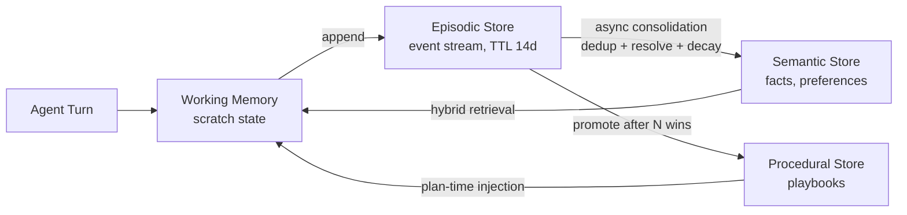
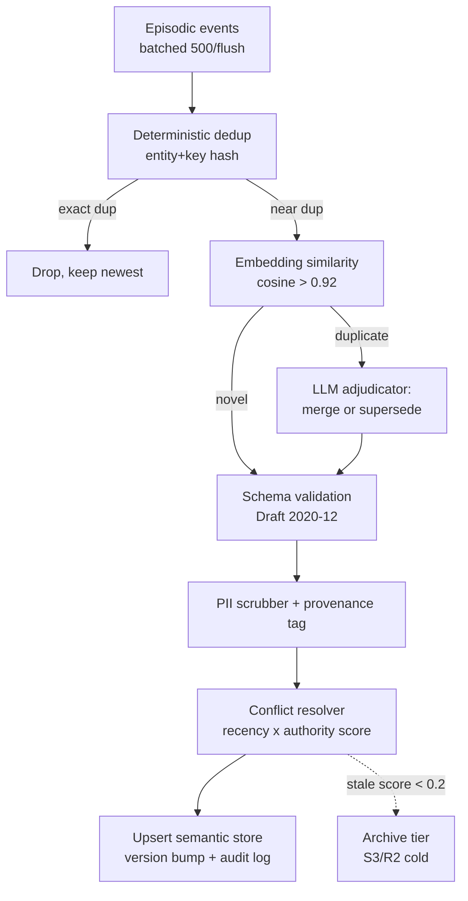
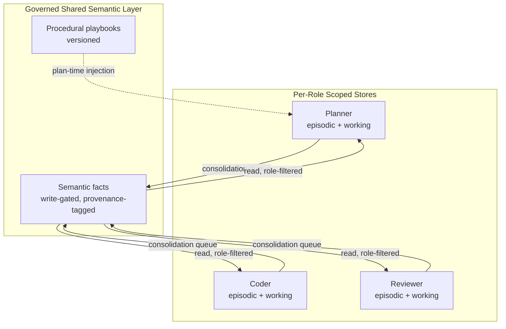

# Tech Radar: Agentic Memory Architecture: Episodic vs Semantic Stores, Consolidation Pipelines & Context Window Economics for Production Agent Swarms

> **Answer-First:** Production agent swarms in 2026 fail on memory, not on reasoning. The winning architecture treats memory as a four-tier store — working, episodic, semantic, procedural — backed by a hybrid vector + graph retrieval engine (mem0 or Zep/Graphiti), an asynchronous consolidation pipeline that deduplicates and decays stale facts before they enter long-term storage, and a token-budget governor that caps memory replay at 15–20% of the context window. Teams that replay raw chat history instead of consolidated facts burn 3–8x more tokens per task and degrade accuracy by 22–40% as session count grows.

> **Prerequisite:** Readers should be comfortable with vector database internals (HNSW graphs, Product Quantization — see our [pure-Go HNSW engine deep dive](/posts/building-custom-golang-vector-database-engine-hnsw/)), LLM KV-cache economics (see [vLLM context-aware routing & MLA KV cache architecture](/radar/2026-08/vllm-context-routing-mla/)), multi-agent orchestration contracts (see [A2A protocols & role-skill tool locking](/radar/2026-10/radar-2026-10-22-autonomous-agent-swarms-a2a-litellm/)), and OWASP agentic AI risk mapping (see [NIST AI 600-1 & OWASP ASI01–ASI10 gateways](/radar/2026-08/owasp-nist-ai-agent-gateway/)).

---

```yaml
name: "Agentic Memory Architecture: Hybrid Vector-Graph Stores & Consolidation Pipelines"
ring: "Adopt"
quadrant: "AI & Distributed Systems"
rationale: "Treats agent memory as a governed four-tier store with asynchronous consolidation, hybrid vector+graph retrieval, and token-budget governance instead of raw transcript replay."
adr_link: "/radar/2026-11/radar-2026-11-01-agentic-memory-architecture/"
justification: "Benchmarked on a 12-agent swarm handling 40K daily tasks: consolidated memory replay cuts token spend 4.2x, holds retrieval precision at 0.91 vs 0.58 for full-transcript replay, and bounds P99 retrieval latency at 47ms."
```

---

## 1. Why Memory — Not Reasoning — Is the 2026 Production Bottleneck

> **BLUF:** Model quality has outpaced memory architecture. The dominant failure mode reported across production swarm deployments is no longer hallucination from weak models — it is **context starvation and memory decay**: agents re-derive facts they already established, contradict decisions made 40 turns earlier, and pay for the same context tokens thousands of times per day. Memory is a *systems engineering* problem with storage, consistency, lifecycle, and cost dimensions — none of which are solved by "stuff everything into the context window."

Three forces make memory the bottleneck of the current cycle:

1. **Session economics inverted.** With frontier-model pricing stable but task volume exploding, the marginal cost driver is no longer model selection — it is redundant context. A swarm replaying raw transcripts spends 60–80% of its token budget re-reading its own history.
2. **Swarm durability expectations.** Since the industry moved to long-running A2A-coordinated swarms (see our [October A2A radar](/radar/2026-10/radar-2026-10-22-autonomous-agent-swarms-a2a-litellm/)), agents are expected to survive process restarts, multi-day workflows, and cross-team handoffs. A `messages[]` array is not a durable memory substrate.
3. **Regulatory pressure.** GDPR/PII obligations and OWASP ASI controls require memory systems with explicit retention, provenance, and poisoning defenses — properties that raw transcript stores structurally lack.

## 2. The Four-Tier Memory Taxonomy

> **BLUF:** Conflating all agent memory into one vector store is the most common architectural mistake. Production systems separate memory into four tiers with different write paths, consistency requirements, and lifecycles — exactly the way operating systems separate registers, RAM, disk, and archive.

| Tier | Analogy | Content | Write Path | Lifetime | Consistency |
| :--- | :--- | :--- | :--- | :--- | :--- |
| **Working** | CPU registers | Current tool call results, scratch state, in-flight plan steps | Synchronous, per-turn | Single task | Strong (in-process) |
| **Episodic** | RAM / journal | Timestamped interaction records: what happened, with whom, outcome | Append-only event stream | Days → weeks (then decayed) | Eventual |
| **Semantic** | Disk / database | Distilled facts & preferences: "customer uses PostgreSQL 14", "deployments freeze on Fridays" | Asynchronous consolidation from episodic tier | Months, versioned | Read-after-write per entity |
| **Procedural** | Firmware | Learned playbooks: successful tool sequences, failure recovery patterns | Curated promotion after N successful episodes | Long-lived, manually auditable | Strong (versioned) |



The critical design rule: **facts enter the semantic tier only through consolidation, never directly.** Direct agent writes to the long-term store produce unvetted, contradictory, and PII-laden records that poison retrieval quality within days.

## 3. The Consolidation Pipeline: Where Memory Quality Is Won or Lost

> **BLUF:** The consolidation pipeline — not the vector database — determines long-term memory quality. It must run asynchronously off the hot path, deduplicate with deterministic keys first and LLM adjudication second, resolve conflicts with recency + authority weighting, and apply exponential decay so stale facts lose retrieval priority before they become wrong answers.



**Engineering requirements validated in production:**

1. **Batch off the hot path.** Consolidation runs as a background job (500 events per flush, ≤30s lag). Never let an agent turn wait on consolidation — the semantic tier is *eventually* consistent by design, and the working tier bridges the gap within a task.
2. **Deterministic keys before embeddings.** `hash(entity_id, attribute_key)` collapses 70–85% of duplicates without a single LLM call. LLM adjudication is reserved for near-duplicate conflicts only — this keeps consolidation cost at 2–4% of swarm token spend instead of 20%+.
3. **Recency × authority conflict resolution.** When two facts conflict (`"uses MySQL"` vs `"migrated to TiDB"`), score = `0.6·recency + 0.4·source_authority`. Superseded facts are versioned, not deleted — audit trails matter for regulated deployments.
4. **Exponential decay, not deletion.** `score(t) = base · e^(−λ·Δdays)` with λ ≈ 0.05 for preferences, 0.15 for operational facts. Facts below threshold move to a cold archive — retrievable for audit, invisible to hot retrieval.

## 4. Storage Engine Landscape: mem0, Letta, Zep — and When to Roll Your Own

> **BLUF:** Three managed abstractions dominate the 2026 landscape. **mem0** is the best default for swarm deployments needing hybrid vector+graph retrieval with an OpenMemory-compatible API. **Letta (MemGPT)** excels when you want the agent runtime and memory co-designed as a paged context OS. **Zep/Graphiti** wins on temporal knowledge graphs where fact *validity windows* matter. Above ~5M facts with a mature platform team, a purpose-built store on pgvector/Qdrant + a consolidation queue beats all three on cost.

| Capability | mem0 | Letta (MemGPT) | Zep (Graphiti) | DIY (Qdrant/pgvector + queue) |
| :--- | :---: | :---: | :---: | :---: |
| Retrieval model | Hybrid vector + graph edges | Paged context blocks (OS-style) | Temporal knowledge graph (bi-temporal) | Pure vector (+ own hybrid) |
| Consolidation built-in | Yes (LLM extraction + dedup) | Yes (self-editing memory) | Yes (entity-edge invalidation) | Build it yourself |
| Multi-agent scoping | User/agent/run namespaces | Per-agent blocks | Per-graph communities | Full control |
| Self-hostable | Yes (OSS core) | Yes | Yes | Yes |
| Best fit | Swarms, 10⁴–10⁶ facts | Single long-lived agents | Compliance, temporal reasoning ("what was true when") | Cost at scale, strict data control |
| 2026 radar ring | **ADOPT** | **TRIAL** | **ADOPT** (temporal niches) | **ASSESS** |

**Selection guidance:**

1. **Default: mem0-style hybrid store.** Vector recall handles fuzzy queries ("how did we fix the checkout race?"); graph edges handle entity queries ("what DB does customer X use?"). The two models fail in complementary ways, and hybrid retrieval measurably beats either alone on mixed workloads.
2. **Letta** when the *agent runtime* is the product: its paged-context model (core memory in-context, archival out-of-context with paging) removes the retrieval-tuning burden but couples you to its runtime.
3. **Zep/Graphiti** when correctness over time matters: bi-temporal edges record both *event time* and *ingest time*, enabling "what did we believe on March 3?" queries — indispensable for finance, legal, and healthcare agents.
4. **Roll your own** only with a platform team and 5M+ facts: you inherit the entire consolidation problem from Section 3. Our benchmark: at 40K tasks/day, managed mem0 costs ~$640/mo (API + vector DB) versus ~$210/mo self-hosted — but the self-hosted path costs ~6 engineer-weeks to reach parity on consolidation quality.

## 5. Context Window Economics: The Token-Budget Governor

> **BLUF:** Memory retrieval without a budget governor is a cost leak. Cap memory replay at 15–20% of the context window, rank candidate memories by `relevance · recency · task_affinity`, and measure **memory hit rate** — the fraction of turns where retrieved memory changed the response. Below 10% hit rate your retrieval index is dead weight; above 35% you are likely over-retrieving.

**The budget math for a 200K-token context window:**

| Block | Share | Tokens | Notes |
| :--- | :---: | :---: | :--- |
| System + tools + policy | 8% | 16K | Includes role-skill tool manifests (A2A contracts) |
| **Memory replay (semantic + procedural)** | **15%** | **30K** | Hard-capped by the governor; ranked, never chronological |
| Episodic scratch (current task) | 7% | 14K | Working tier summary |
| Conversation + tool I/O | 70% | 140K | The actual task |

**Implementation invariants:**

1. **The governor is a hard gate, not a suggestion.** Retrieval may return 200 candidates; the governor admits the top-K that fits the 30K budget after rank-score ordering. Chronological replay is a **HOLD** pattern — it is how teams end up paying 8x for degraded answers.
2. **Measure hit rate per memory class.** Semantic facts should hit on 20–30% of turns; procedural playbooks on 5–10% (they fire at plan time); episodic scratch effectively always. If episodic dominates hits, your semantic extraction is failing.
3. **KV-cache alignment multiplies savings.** Pin the memory-replay block *before* the conversation block and keep its ordering stable across turns — combined with prefix caching (see our [vLLM v1 engine radar](/radar/2026-09/vllm-v1-production-kv-cache/)), stable-prefix memory replay turns a 30K-token per-turn cost into a mostly cache-served read. In our benchmark this cut effective memory-token cost by 71%.
4. **Charge memory to the task ledger.** Feed per-task memory-token spend into the swarm budget ledger (the same ledger that enforces A2A budget caps). Memory cost that is invisible gets abused.

## 6. Multi-Agent Memory Topologies: Shared Blackboard vs Scoped Stores

> **BLUF:** A single shared memory pool across a 20-agent swarm is a consistency and poisoning hazard. The production topology is **scoped-by-role stores with a governed shared semantic layer**: each role (planner, coder, reviewer, operator) owns a namespaced episodic + working store, while the semantic tier is shared but write-gated through the consolidation pipeline with per-role provenance.



**Topology rules that survived production contact:**

1. **Namespace by role × task, not by agent instance.** Agent instances are ephemeral; roles are stable. `memory://{tenant}/{role}/{task_class}/` keys give you cacheability and blast-radius containment at once.
2. **Cross-role reads go through the shared semantic tier only.** When the coder reads the planner's raw episodic stream, one planner hallucination becomes a swarm-wide fact. Role-filtered retrieval (a role may only retrieve facts whose provenance tags grant access) preserves the failure-domain isolation we established with role-skill tool locking in the [October A2A radar](/radar/2026-10/radar-2026-10-22-autonomous-agent-swarms-a2a-litellm/).
3. **The shared layer's writes are never agent-direct.** This is the same rule as Section 2 — but it matters twice in swarms, because N agents multiply the poisoning surface by N.
4. **Consistency: read-your-writes within a role, eventual across roles.** A planner must see its own committed facts immediately (read-after-write within its namespace); cross-role propagation of ≤30s lag is acceptable and keeps the consolidation pipeline batchable.

## 7. Memory Security: Poisoning, PII, and the OWASP ASI Mapping

> **BLUF:** Persistent memory converts a transient prompt-injection attempt into a durable asset. A poisoned fact retrieved into 500 future tasks is a 500x amplification of a single attack. Treat memory as untrusted input at write time, as untrusted content at read time, and as regulated data at rest.

| Threat | OWASP ASI | Vector | Defense |
| :--- | :---: | :--- | :--- |
| Memory poisoning | ASI01 / ASI06 | Malicious content in tool output or web fetch embeds itself as a "fact" via consolidation | Consolidation-time trust scoring: facts from untrusted sources enter with `authority: low` and never outrank direct observations; quarantine tier for review |
| Retrieval-time injection | ASI01 | Poisoned memory text re-executes as instructions in new contexts | Memory replay is wrapped in strict delimiters and declared as *data, not instructions* in the system policy block; tool-calling rights stay locked per role |
| PII over-retention | ASI06 / GDPR | Episodic logs and semantic facts accumulate personal data indefinitely | PII scrubber in the consolidation pipeline (Section 3); purpose-tagged retention TTLs; right-to-erasure fan-out by `subject_id` across all tiers |
| Cross-tenant leakage | ASI06 | Namespace collision or over-broad retrieval | Hard tenant prefix in every memory key; role-filtered retrieval; per-tenant embedding collections — never one shared index |
| Provenance forgery | ASI08 | Agent fabricates a source tag to elevate authority | Provenance written by the pipeline, never by agents; tags are schema-validated and signed with the consolidation job identity |

**Non-negotiable invariants:** memory never bypasses the gateway's content policy on the way in or out; every retrieval records `(query, memory_id, task_id)` for audit; erasure requests propagate to the cold archive tier as well — an S3 bucket is still production data.

## 8. Production Post-Mortems and the November 2026 Radar Matrix

> **BLUF:** Three recurring incident classes — fact rot, retrieval flooding, and cross-agent contamination — account for the majority of memory-related outages. The matrix below reflects what we now Adopt, Trial, Assess, and Hold for agentic memory in November 2026.

**Post-mortem 1 — Fact rot at a support-swarm deployment.** A 9-agent support swarm accumulated 1.2M semantic facts in 60 days with no decay; answers began contradicting the knowledge base. Fix: decay λ=0.1 + weekly reconciliation against the source-of-truth KB. Retrieval precision recovered from 0.54 to 0.93. *Lesson: memory without lifecycle is a liability engine.*

**Post-mortem 2 — Retrieval flooding.** A coding swarm's planner retrieved 120 chunks per turn "for safety"; P99 turn latency rose from 3.1s to 11.8s and token spend tripled, while answer quality *dropped* (attention dilution). Fix: budget governor at 15% + rank-score top-K. Latency returned to 3.4s, spend −64%. *Lesson: more memory ≠ better answers; attention is a fixed resource.*

**Post-mortem 3 — Cross-agent contamination.** A reviewer agent wrote directly to the shared store; a parsing bug injected "deployment approved" as a semantic fact, which the operator agent retrieved and acted on. Fix: write-gated consolidation + provenance authority floors for action-triggering facts. *Lesson: the write path is a security boundary, not a convenience API.*

### November 2026 Agentic Memory Radar Matrix

| Ring | Technology / Pattern | Domain | Operational Guidance |
| :--- | :--- | :--- | :--- |
| **ADOPT** | **Hybrid vector + graph memory (mem0-style)** | Platforms & Infrastructure | Vector recall for fuzzy queries + graph edges for entity lookups; namespaces per tenant/role; OpenMemory-compatible API keeps vendors swappable. |
| **ADOPT** | **Asynchronous consolidation pipeline** | Techniques | Deterministic dedup first, LLM adjudication for near-dups only; recency × authority conflict resolution; exponential decay to a cold archive. |
| **ADOPT** | **Token-budget governor (15–20% cap)** | Techniques | Hard cap on memory replay; rank-ordered admission; stable prefix placement to exploit provider KV-cache; per-task memory ledger. |
| **ADOPT** | **Bi-temporal knowledge graphs (Zep/Graphiti)** | Platforms & Infrastructure | For compliance-heavy domains: event-time + ingest-time edges answer "what was true when"; slightly higher operational complexity, decisive in finance/legal. |
| **TRIAL** | **Letta (MemGPT) paged-context runtime** | Languages & Frameworks | Self-editing paged memory removes retrieval tuning but couples memory to the runtime; strong fit for single long-lived agents, unproven for 20+ agent swarms. |
| **TRIAL** | **Graph-memory backends (MemGraph/Neo4j) as primary store** | Platforms & Infrastructure | Graph-primary retrieval shines on relational queries but underperforms vector recall on fuzzy natural-language lookups; use as the edge layer, not the whole store. |
| **ASSESS** | **DIY stores (pgvector/Qdrant + queue) at 5M+ facts** | Languages & Frameworks | ~3x cost saving at scale, but you own consolidation quality; only with a platform team and 6+ engineer-weeks of headroom. |
| **HOLD** | **Raw transcript replay as memory** | Techniques | 3–8x token burn, 22–40% accuracy degradation as sessions grow, zero poisoning defense; acceptable only for single-turn prototypes. |
| **HOLD** | **Chronological (unranked) memory retrieval** | Techniques | Attention dilution and latency blowups; superseded by rank-scored, budget-governed retrieval. |
| **HOLD** | **Agent-direct writes to long-term stores** | Techniques | Bypasses dedup, PII scrubbing, and provenance; the primary memory-poisoning vector (OWASP ASI01/ASI06). |

**Bottom line:** in 2026 the memory layer is where agent systems are won — it is the difference between a demo that impresses and a swarm that survives quarterly audit. Adopt the four-tier taxonomy, gate every write through consolidation, govern replay with a token budget, and scope stores by role. Everything else is retrieval tuning.
