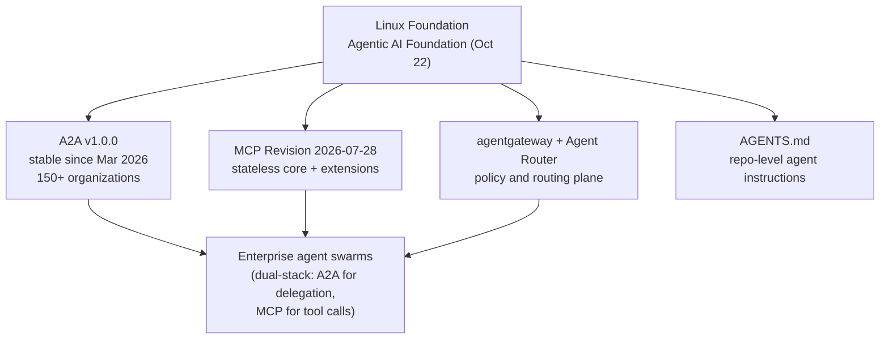

# Tech Radar: KV-Cache Isolation, Go 1.27.3 Urgent, A2A

> **Answer-first:** This week's radar is dominated by one uncomfortable lesson and two consolidation waves. The lesson: KV-cache sharing inside LLM inference engines is now a proven cross-request data-leak class — Cloudflare disclosed that a config/pool-size mismatch in Workers AI GLM-5.3 let decode steps attend over stale cache pages of earlier requests (155 affected responses since the Aug 27 launch), and vLLM shipped three releases in four weeks fixing two more cross-request cache/mask leaks. The consolidation waves: Go shipped its first-ever URGENT release (1.27.3/1.26.10, under 7.5 hours from notification) against forged eMudhra TLS certificates, and agent protocols (A2A, MCP, AGENTS.md, agentgateway) consolidated under the Linux Foundation's Agentic AI Foundation with A2A past 150 organizations. Below: 12 verified briefings for senior backend/platform engineers, each with its source, plus a ring matrix and this week's action list.

> **Prerequisite:** Readers should be familiar with inference-server KV-cache mechanics and paged attention (see our [Disaggregated Prefill/Decode Radar](/radar/2026-09/disaggregated-prefill-decode/)), the MCP Revision 2026-07-28 stateless transport and A2A v1 wire protocol (see [MCP Stateless HTTP & A2A v1.0.1 Wire Protocol](/radar/2026-11/radar-2026-11-07-mcp-stateless-http-a2a-v1-wire-protocol/)), and Go microservices build/release hygiene (see [Go Microservices Production Playbook](/posts/go-microservices/)).

---

```yaml
name: "Weekly Radar 2026-W46: KV-Cache Isolation Gates, Same-Day Go Rebuilds & Linux Foundation Agent Protocol Stack"
ring: "Adopt"
quadrant: "AI Infrastructure & Platform Engineering"
rationale: "Replaces 'trust the inference engine' multi-tenancy and quarterly-only patch cadences with explicit cross-request KV-cache isolation release gates (SGLang >= 0.5.22, vLLM >= 0.32.0), same-day CI rebuild policies triggered by trust-store incidents, and LF-governed A2A v1.0.0 + MCP 2026-07-28 as the dual-stack agent wire."
adr_link: "/radar/2026-11/radar-2026-11-12-kv-cache-isolation-go-urgent-agent-protocols/"
justification: "Three independent cache-isolation defects shipped to production within four weeks (Cloudflare GLM-5.3, vLLM InputBatch.condense, vLLM Mooncake connector), and one trust-store incident made every pre-Oct-19 Go binary a potential forgery target; both failure classes are only addressable through versioned floors, rebuild automation, and per-tenant cache isolation — not through prompt-level mitigations."
```

---

## 1. The Week at a Glance: Radar Ring Matrix

| Ring | Technology / Pattern | Domain | Why This Week |
| :--- | :--- | :--- | :--- |
| **ADOPT** | **SGLang ≥ 0.5.22 / vLLM ≥ 0.32.0 version floors** | AI Infrastructure | Two independent cross-request cache-leak classes (Cloudflare GLM-5.3, `InputBatch.condense`) make older engines unacceptable for multi-tenant serving. |
| **ADOPT** | **Go 1.27.3 / 1.26.10 immediate rebuild** | Languages & Frameworks | First URGENT release in Go history: forged TLS possible against weak eMudhra intermediates; rebuild all distributed binaries. |
| **ADOPT** | **`encoding/json/v2` for new Go services** | Languages & Frameworks | GA in Go 1.27: up to 10x faster unmarshal with safer defaults; v1 now rides on v2, so migration is incremental. |
| **ADOPT** | **A2A v1.0.0 + MCP 2026-07-28 dual-stack agent wire** | AI & Agentic Systems | Both specs now sit under the Linux Foundation's Agentic AI Foundation; A2A passed 150 organizations. |
| **TRIAL** | **CloudNativePG (CNCF Incubating)** | Cloud Native | Promoted to CNCF Incubating at KubeCon NA; the de-facto Postgres-on-K8s operator gains neutral governance. |
| **TRIAL** | **AWS Lambda Web Functions** | Cloud Native | HTTP-native Lambda form factor, up to 128 concurrent requests per instance — collapse adapter stacks. |
| **TRIAL** | **GPT-6.1 Terra (API)** | AI & Agentic Systems | Computer use + visual reasoning at $1/M input, $0.05/M cached input — cached pricing now shapes agent architecture. |
| **ASSESS** | **PostgreSQL 19 (RC2 Nov 12, GA Nov 19)** | Data Platforms | `REPACK (CONCURRENTLY)` and parallel autovacuum are the marquee items; assess at GA, adopt after the first point release. |
| **ASSESS** | **Kafka 4.4.0** | Data Platforms | 25 KIPs including share-group DLQs and transactional state stores; but KIP-1170 bootstrap is not forward-compatible — plan carefully. |
| **ASSESS** | **ClickHouse 26.10 function-composition `|`** | Data Platforms | 104 features / 225 performance optimizations; the composition operator is a genuine SQL ergonomics shift. |
| **HOLD** | **Tiered-storage Kafka on 4.3.1 or older** | Data Platforms | 4.3.2 fixed two tiered-storage data-loss bugs; if you run tiered storage, treat the upgrade as urgent. |
| **HOLD** | **Valkey clusters unpatched for GHSA-f4q9-j22m-xqq9** | Data Platforms | Heap overflow in cluster Pub/Sub with potential RCE for authenticated clients — patch immediately. |

---

## 2. Theme 1 — The KV-Cache Isolation Crack-Up: Cloudflare GLM-5.3, SGLang, and vLLM

> **BLUF:** Paged KV-cache reuse — the optimization that makes LLM serving economically viable — failed multi-tenancy three times in four weeks. Cloudflare disclosed (Oct 26) that a deployment configuration/pool-size mismatch triggered an SGLang bug allowing decode-time attention over stale cache pages of earlier requests; vLLM v0.32.0 fixed a cross-request mask leak in `InputBatch.condense()`; and VulnCheck disclosed a GPU KV-cache leak in vLLM ≤ 0.29.0 via Mooncake transfer-id collision. The engineering answer is not to abandon shared caches but to gate releases on versioned engines with proven isolation fixes.

### 2.1 Cloudflare Workers AI GLM-5.3: 155 Affected Responses Over Ten Weeks

[Cloudflare's disclosure](https://blog.cloudflare.com/kv-cache-exposure-remediation/) describes a cross-request KV-cache exposure in Workers AI serving GLM-5.3, disclosed October 26:

- **Root cause:** a mismatch between the deployment configuration and the actual cache pool size triggered an SGLang bug. When the pool did not match what the configuration promised, decode steps could attend over **stale KV-cache pages belonging to earlier requests**.
- **Impact:** 155 affected responses since the model's August 27 launch — a tiny fraction of traffic, but each one is a cross-tenant data leak.
- **Fix:** SGLang shipped fixes in **v0.5.21 and v0.5.22**, and Cloudflare now sizes the KV pool at roughly **2x the context length** so the reuse boundary can never wrap into live sessions.

```mermaid
flowchart TD
    subgraph Broken["Broken: Config/Pool-Size Mismatch (SGLang pre-0.5.21)"]
        A["Request A<br/>prefill writes pages into shared pool"] --> P["KV Pool Sized SMALLER<br/>than config promises"]
        P --> W["Pool wraps: stale pages of A<br/>remain visible to allocator"]
        W --> B["Request B decode step<br/>attends over A's stale pages"]
        B --> X["Cross-request content leak<br/>(155 responses over 10 weeks)"]
    end
    subgraph Fixed["Fixed: Headroom + Patched Engine (SGLang 0.5.21/0.5.22)"]
        C["Request C"] --> Q["KV Pool Sized ~2x Context Length"]
        Q --> D["Request D decode<br/>only attends its own pages"]
        D --> OK["Isolation holds"]
    end
```



### 2.2 vLLM Ships Three Releases in Four Weeks

The [vLLM release stream](https://github.com/vllm-project/vllm/releases) tells the same story from a second codebase:

- **v0.31.0 (Oct 5)** — baseline for the week of the Cloudflare disclosure.
- **v0.32.0 (Oct 18)** — fixes a **cross-request mask leak in `InputBatch.condense()`**; as of Oct 24 this is the project's recommended minimum for production.
- **v0.33.0 (Nov 2)** — third release in the window, continuing the hardening pace.
- Separately, [VulnCheck disclosed](https://www.vulncheck.com/advisories/vllm-through-0.29.0-gpu-kv-cache-leak-via-mooncake-transfer-id-collision) a GPU KV-cache leak affecting **vLLM through 0.29.0** when using the Mooncake connector, caused by transfer-id collision.

### 2.3 Radar Take: Treat Inference Engines Like Multi-Tenant Databases

*(Opinion, clearly separated from the facts above.)* We have spent a decade learning that shared buffer pools need isolation proofs, not good intentions. Inference engines just joined that club. Three concrete policies:

1. **Pin a versioned engine floor per environment** (SGLang ≥ 0.5.22, vLLM ≥ 0.32.0) and fail CI on drift — the same way you pin a database with a known auth-bypass.
2. **Add a cross-request isolation smoke test** to every engine upgrade: two synthetic sessions with canary tokens, one asserts the second never sees the first's content. If your serving stack cannot pass it, you do not have multi-tenancy.
3. **Keep prompt-level KV-cache alignment**, but align it within tenant boundaries. Our [agentic memory architecture radar](/radar/2026-11/radar-2026-11-01-agentic-memory-architecture/) recommends KV-cache-aligned memory replay — that advice stands, with the added constraint that cache affinity must never cross tenants. The decode-phase mechanics behind this bug class are exactly what we covered in [Disaggregated Prefill/Decode](/radar/2026-09/disaggregated-prefill-decode/).

---

## 3. Theme 2 — Go's First URGENT Release: The eMudhra Intermediates

> **BLUF:** On Oct 17, Mozilla's OneCRL blocked eight eMudhra intermediates; on Oct 19, researchers showed their keys were trivially weak enough to forge TLS for any domain. Because Go ships its own TLS verifier on Linux and performs no revocation checks, Go 1.27.3 and 1.26.10 shipped **under 7.5 hours** after notification (19:13 PDT) — the first URGENT release in Go's history. Cloudflare confirmed active exploitation on Oct 30. Every Go binary built before the fix is a rebuild candidate.

### 3.1 The Incident Timeline

| Date | Event | Source |
| :--- | :--- | :--- |
| **Oct 17** | Mozilla OneCRL blocks 8 eMudhra intermediate CAs. | [Go blog](https://go.dev/blog/emudhra-incident) |
| **Oct 19** | Researchers demonstrate the intermediates' keys are trivially weak — forged TLS possible for any domain; Go team notified. | [Go blog](https://go.dev/blog/emudhra-incident) |
| **Oct 19, 19:13 PDT** | Go 1.27.3 / 1.26.10 released **< 7.5 hours** after notification — Go's first URGENT release. | [Go blog](https://go.dev/blog/emudhra-incident) |
| **Oct 30** | Cloudflare confirms **active exploitation** in the wild. | [Cloudflare blog](https://blog.cloudflare.com/emudhra-patching/) |

The reason Go needed an emergency release: on Linux, the Go runtime ships its **own root store and certificate verifier** (`crypto/x509`) and deliberately performs **no CRL/OCSP revocation checks**. A browser protected by OneCRL alone was safe; a Go service was not. This is a deliberate performance trade-off that only works when the toolchain can react at browser-vendor speed — which, to the team's credit, it just did.

### 3.2 What Platform Teams Should Do This Week

```bash
# Inventory: what Go version is actually baked into each binary?
go version -m ./bin/svc-payments | grep 'go1\.'

# Binary-level vulnerability scan (no source needed)
govulncheck -mode=binary ./bin/svc-payments
```

*(Opinion.)* Treat this as the dress rehearsal for a new class of incident: **trust-store failures that source-level CVE scanners will never flag**, because the bug is not in your dependency graph — it is in the world's PKI. The durable fix is a same-day rebuild capability: a CI pipeline that can rebuild and redeploy every Go artifact within hours of a toolchain release, with `go version -m` output as the audit trail. If your rebuild takes a week, your exposure window is a week. The [Go Microservices Production Playbook](/posts/go-microservices/) build conventions are the right place to encode this.

### 3.3 `encoding/json/v2` Goes GA in Go 1.27

Buried under the incident response but strategically bigger for most codebases: the [Go blog (Nov 4)](https://go.dev/blog/jsonv2) announced **`encoding/json/v2` is GA in Go 1.27**:

- **Performance:** up to **10x faster unmarshal** in benchmarks.
- **Safer defaults:** rejects **duplicate object names** and **invalid UTF-8**; marshals nil slices/maps as `[]`/`{}` instead of `null`; **case-sensitive** field matching (no more silent `json:"..."` case drift).
- **Layering:** a low-level **`jsontext`** streaming package for custom codecs, and — critically — **v1 is now implemented on top of v2**, so you can migrate one option at a time instead of a big-bang rewrite.

*(Opinion.)* The v1-on-v2 reimplementation is the underrated part: it means the default path your existing code takes is already exercised by v2's semantics, and per-option migration makes this a quarter of chores instead of a quarter of risk. Adopt `json/v2` for all new services; migrate hot unmarshal paths first.

---

## 4. Theme 3 — Agent Protocols Consolidate Under the Linux Foundation

> **BLUF:** On Oct 22, the Linux Foundation launched the **Agentic AI Foundation**, bringing A2A (now past **150 organizations**, with enterprise production use in its first year), Agent Router, agentgateway, and the AGENTS.md convention under neutral governance. A2A has been stable at **v1.0.0 since March 2026**; MCP's latest revision remains **2026-07-28** (stateless core + extensions). The agent interop layer has stopped churning and started consolidating.

Per the [Linux Foundation announcement](https://www.linuxfoundation.org/press/a2a-protocol-surpasses-150-organizations-lands-in-major-cloud-platforms-and-sees-enterprise-production-use-in-first-year):

- **A2A** surpassed 150 contributing organizations, landed in major cloud platforms, and saw enterprise production use within its first year; the spec has been stable at v1.0.0 since March 2026.
- **Agent Router** and **agentgateway** — the routing and policy planes for agent traffic — joined the foundation alongside the **AGENTS.md** convention.
- **MCP** continues on its own revision cadence (latest: `2026-07-28`, stateless core with extensions) — [our Nov 7 radar](/radar/2026-11/radar-2026-11-07-mcp-stateless-http-a2a-v1-wire-protocol/) covers why its stateless HTTP transport is the right default for Kubernetes deployments.



*(Opinion.)* Consolidation under a neutral foundation is the signal procurement teams wait for: agent interoperability is no longer a vendor roadmap item but a governed standard. The practical consequence for platform teams is that the [dual-stack pattern we documented in October](/radar/2026-10/radar-2026-10-22-autonomous-agent-swarms-a2a-litellm/) — A2A for agent-to-agent delegation, MCP for tool invocation — is now the boring, defensible default rather than an early-adopter bet.

---

## 5. Quick Hits: Data Platforms, Runtimes, and Cloud Primitives

### 5.1 PostgreSQL 19: RC2 Lands Today, GA Planned Nov 19

Per the [PostgreSQL announcement](https://www.postgresql.org/about/news/postgresql-19-rc-1-released-3409/): RC1 shipped Oct 15, **RC2 is out Nov 12**, and GA is planned for **Nov 19** — roughly six weeks later than the traditional cadence. The marquee feature is **`REPACK (CONCURRENTLY)`** (bloat removal without exclusive locks, previously the job of the external `pg_repack` extension), plus **parallel autovacuum**. One behavior change to scan for: **`COPY ... FORMAT json` now uses query column aliases**. All supported branches (18.7, 17.12, 16.16, 15.20, 14.25) shipped the same day.

*(Opinion.)* For ledger-style workloads like those in our [composable banking radar](/radar/2026-11/radar-2026-11-10-composable-banking-double-entry-ledger-concurrency/), in-core `REPACK (CONCURRENTLY)` removes an entire operational dependency — but adopt after GA plus one point release, not at RC2. If your scaling story still starts with "buy a bigger box", revisit [MySQL sharding and TiDB](/posts/mysql-scaling-sharding-tidb-architecture/) for the partition-first alternative.

### 5.2 Kafka 4.4.0 — and the 4.3.2 Tiered-Storage Wake-Up Call

The [4.4.0 release announcement](https://kafka.apache.org/blog/2026/10/22/apache-kafka-4.4.0-release-announcement) (Oct 22) carries **25 KIPs**, headlined by **KIP-1191** (share-group dead-letter queues), **KIP-892** (transactional state stores for Streams), and **KIP-1170** (storage-format bootstrap — **explicitly not forward-compatible**, so plan upgrades in the documented direction). `broker.id` is deprecated. Separately and more urgently: **4.3.2 (Oct 23) fixed two tiered-storage data-loss bugs**. If you run tiered storage on 4.3.1 or older, treat that patch as an incident response, not an upgrade.

### 5.3 KubeCon NA 2026: Postgres and Ray Move Into CNCF, GPUs Get DRA in EKS

From the [CNCF blog](https://www.cncf.io/blog/2026/11/10/cloudnativepg-becomes-a-cncf-incubating-project/) and the Nov 10 wave of KubeCon NA (Nov 9-12) posts:

- **CloudNativePG** became a **CNCF Incubating** project (Nov 10) — the leading Postgres operator gains neutral governance.
- **KubeRay** was donated to CNCF; **OCM** also moved to incubating.
- **NVIDIA OpenShell** targets sandboxing for autonomous AI agents — the container-level answer to the cache-isolation class of bugs in Theme 1.
- **Istio** declared "global availability for all workloads (traditional and agentic)".
- **EKS Auto Mode** added **DRA for NVIDIA GPUs plus EFA** (Nov 9) — dynamic GPU allocation without manual device plugin wrangling.

*(Opinion.)* The CloudNativePG promotion is the quiet end of "databases don't belong in Kubernetes" for the Postgres world. Governance, not features, was the last blocker for conservative adopters.

### 5.4 GPT-6.1 Terra in the API: Cached Input at $0.05/M

Per [OpenAI's model release notes](https://help.openai.com/en/articles/9624314-model-release-notes): **GPT-6.1 Terra** hit the API Oct 26 with **computer use and visual reasoning**, priced at **$1/M input, $0.05/M cached input (20x cheaper), $5/M output**. GPT-5.5 was retired Oct 14, and **GPT-6 Rosalind Research** (biology-focused, gated access) followed Oct 30. *(Opinion.)* A 20x cached-input discount is not a pricing footnote — it makes prefix-stable agent architectures (stable system prompt, tool schemas, retrieved memory) a first-order cost lever, reinforcing the cache-alignment patterns in our [agentic memory radar](/radar/2026-11/radar-2026-11-01-agentic-memory-architecture/).

### 5.5 AWS Lambda Web Functions: HTTP-Native, 128 Concurrent Requests

[AWS announced](https://aws.amazon.com/blogs/aws/announcing-aws-lambda-web-functions-for-fast-consistent-web-app-performance-anywhere) **Lambda Web Functions** (Oct 12): an HTTP-native Lambda form factor — no API Gateway or function-URL adapter layer — supporting **up to 128 concurrent requests per instance**. Alongside it, **SnapStart for container-image Lambdas** (Oct 28) extends sub-second cold starts to image-based workloads. *(Opinion.)* 128 concurrent requests per instance finally makes Lambda competitive for real web frameworks without paying the adapter tax; this is the biggest serverless ergonomics shift of the quarter.

### 5.6 ClickHouse 26.10: Function Composition, Disk Spilling, LATERAL JOIN

The [ClickHouse 26.10 release post](https://clickhouse.com/blog/clickhouse-release-26-10) (Nov 6) counts **104 features and 225 performance optimizations**. Standouts for analytics engineers: a **function-composition operator `|`** for chaining transformations, **disk spilling for IN-subqueries** (large set comparisons no longer bound by RAM), an **experimental `LATERAL JOIN`**, and **SQLite as an import format**. The composition operator is worth a pilot purely for query readability in dbt-style pipelines.

### 5.7 Valkey: Coordinated Security Release and 9.2.0-rc2

The [Valkey releases](https://github.com/valkey-io/valkey/releases) page shows a coordinated security drop on Oct 26 fixing a **heap overflow in cluster Pub/Sub (GHSA-f4q9-j22m-xqq9)** with **potential RCE for authenticated clients** — patch first, ask questions later. Then **9.2.0-rc2** (Nov 4) previews **forkless RDB snapshots** (goodbye, copy-on-write memory spikes), **zsets on a B+ tree**, and **post-quantum-hybrid TLS certificates**. *(Opinion.)* Forkless persistence is the single most requested operational fix in Redis-lineage servers; the 9.2 line is worth testing against your snapshot windows now.

---

## 6. Radar Takeaways: The Monday-Morning List

*(Opinion — our synthesis, not the sources'.)*

1. **Pin inference-engine floors now:** SGLang ≥ 0.5.22, vLLM ≥ 0.32.0, and add a two-session canary isolation test to your serving CI. The Cloudflare incident proves vendor-grade engineering still ships this bug class; your stack is not special.
2. **Rebuild every distributed Go binary** against 1.27.3/1.26.10 this week, and encode a same-day rebuild capability in CI — trust-store incidents bypass your dependency scanner entirely.
3. **Start `encoding/json/v2` in new services;** migrate hot unmarshal paths opportunistically thanks to the v1-on-v2 layering.
4. **Standardize on A2A v1.0.0 + MCP 2026-07-28** for agent interop; foundation governance removes the last procurement excuse not to.
5. **Calendar two dates:** PostgreSQL 19 GA (Nov 19) for the `REPACK (CONCURRENTLY)` evaluation, and the Kafka 4.3.2 patch if tiered storage is anywhere in your estate.

---

## 7. Frequently Asked Questions


No — the failure was a deployment configuration/pool-size mismatch that triggered an SGLang bug allowing decode attention over stale pages, not a flaw in cache sharing itself. The remediation (SGLang 0.5.21/0.5.22 plus a KV pool sized at roughly 2x context length) preserves cache reuse within proper isolation boundaries. The platform-level lesson is versioned engine floors and cross-request isolation tests, not abandoning prefix caching — which remains essential for both latency and cost (see the cached-input pricing in GPT-6.1 Terra). Reference: [Cloudflare's remediation post](https://blog.cloudflare.com/kv-cache-exposure-remediation/).



Because Go services on Linux do not consult OneCRL: the Go runtime ships its own root store and certificate verifier and performs no CRL/OCSP revocation checks by design. A trust-store block that protects browsers does nothing for a Go binary until the toolchain itself is patched. Hence Go 1.27.3/1.26.10 shipped under 7.5 hours after notification — and hence `go version -m` inventory and same-day CI rebuilds are now table stakes. Reference: [the Go blog incident write-up](https://go.dev/blog/emudhra-incident) and [Cloudflare's patching analysis](https://blog.cloudflare.com/emudhra-patching/).



Upgrade to 4.3.2 first, not 4.4.0: 4.3.2 (Oct 23) fixes two tiered-storage data-loss bugs, so any tiered-storage deployment on 4.3.1 or older is exposed right now. For 4.4.0 itself, the planning item is KIP-1170 — the new storage-format bootstrap is explicitly not forward-compatible, so follow the documented upgrade direction, and note that `broker.id` is deprecated. Reference: [the Apache Kafka 4.4.0 release announcement](https://kafka.apache.org/blog/2026/10/22/apache-kafka-4.4.0-release-announcement).


---

## 8. Primary Sources

- Go eMudhra incident (first URGENT release): [go.dev/blog/emudhra-incident](https://go.dev/blog/emudhra-incident) · Cloudflare exploitation confirmation & patching: [blog.cloudflare.com/emudhra-patching/](https://blog.cloudflare.com/emudhra-patching/)
- `encoding/json/v2` GA in Go 1.27: [go.dev/blog/jsonv2](https://go.dev/blog/jsonv2)
- Cloudflare Workers AI GLM-5.3 cross-request KV-cache exposure: [blog.cloudflare.com/kv-cache-exposure-remediation/](https://blog.cloudflare.com/kv-cache-exposure-remediation/)
- vLLM v0.31.0 / v0.32.0 / v0.33.0: [github.com/vllm-project/vllm/releases](https://github.com/vllm-project/vllm/releases) · Mooncake-connector GPU KV-cache leak (≤ 0.29.0): [vulncheck.com advisory](https://www.vulncheck.com/advisories/vllm-through-0.29.0-gpu-kv-cache-leak-via-mooncake-transfer-id-collision)
- Linux Foundation Agentic AI Foundation, A2A past 150 organizations: [linuxfoundation.org press release](https://www.linuxfoundation.org/press/a2a-protocol-surpasses-150-organizations-lands-in-major-cloud-platforms-and-sees-enterprise-production-use-in-first-year)
- PostgreSQL 19 RC1 announcement (RC2 Nov 12, GA Nov 19): [postgresql.org news](https://www.postgresql.org/about/news/postgresql-19-rc-1-released-3409/)
- Apache Kafka 4.4.0 release announcement: [kafka.apache.org blog](https://kafka.apache.org/blog/2026/10/22/apache-kafka-4.4.0-release-announcement)
- CloudNativePG joins CNCF Incubating (KubeCon NA): [cncf.io blog](https://www.cncf.io/blog/2026/11/10/cloudnativepg-becomes-a-cncf-incubating-project/)
- GPT-6.1 Terra and model retirement dates: [help.openai.com model release notes](https://help.openai.com/en/articles/9624314-model-release-notes)
- AWS Lambda Web Functions: [aws.amazon.com blog](https://aws.amazon.com/blogs/aws/announcing-aws-lambda-web-functions-for-fast-consistent-web-app-performance-anywhere)
- ClickHouse 26.10 release: [clickhouse.com/blog/clickhouse-release-26-10](https://clickhouse.com/blog/clickhouse-release-26-10)
- Valkey security releases and 9.2.0-rc2: [github.com/valkey-io/valkey/releases](https://github.com/valkey-io/valkey/releases)
