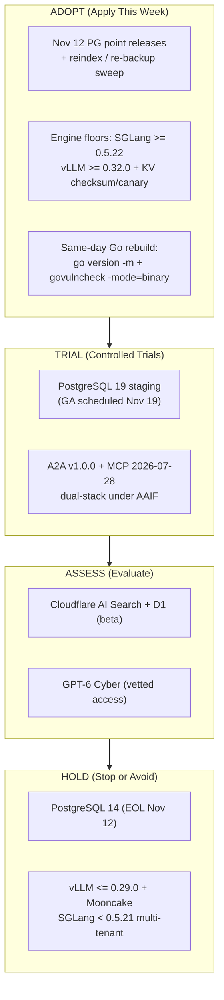
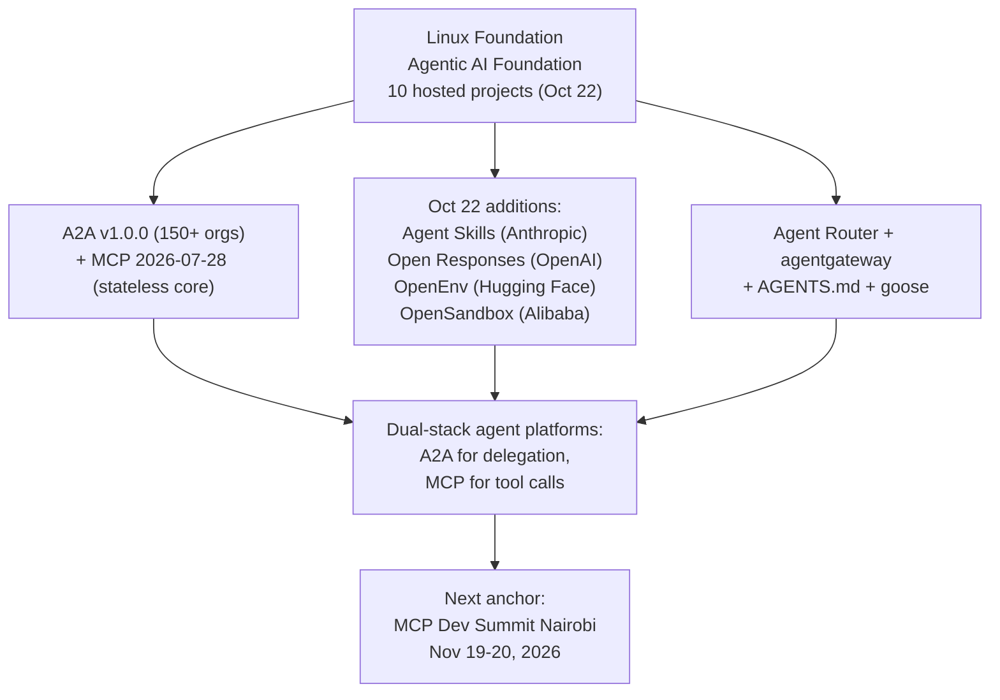

# Tech Radar: PostgreSQL 19 GA Week, KV-Cache Hardening Checklist, AAIF at 10 Projects

> **Answer-first:** This edition covers the week the data-platform calendar and the AI-infrastructure incident ledger converge. **Data platforms:** PostgreSQL 19 GA is **scheduled for November 19** (per the official RC2 announcement), arriving on the heels of the November 12 drop that fixed **52 security vulnerabilities** across 18.7/17.12/16.16/15.20/14.25 and retired PostgreSQL 14 — we turn the incident details into a concrete multi-tenant KV-cache and database hardening checklist. **AI infrastructure:** the Cloudflare GLM-5.3 KV-cache post-mortem (155 affected responses, all prompts over 681,280 tokens) and vLLM's Mooncake transfer-id collision (**CVE-2026-94627**, CVSS 8.7) now have published fixes — SGLang v0.5.22 and vLLM v0.32.0 — that convert directly into an inference hardening checklist. **Agent protocols:** the Linux Foundation's Agentic AI Foundation is at **10 hosted projects** after adding Agent Skills, Open Responses, OpenEnv and OpenSandbox, with the MCP Dev Summit in Nairobi scheduled Nov 19-20. **Toolchain:** Go's eMudhra aftermath formalizes same-day rebuild discipline with `govulncheck -mode=binary`. Plus quick hits: Cloudflare changelog (AI Search + D1, Hyperdrive limits), GPT-6 Cyber, Claude Fable/Mythos 5.2, and the AWS re:Invent preview.

> **Prerequisite:** Readers should start from last week's digest — [Tech Radar: KV-Cache Isolation, Go 1.27.3 Urgent, A2A](/radar/2026-11/radar-2026-11-12-go-urgent-kv-cache-agent-protocols/) — plus the deep dives on [agentic memory architecture](/radar/2026-11/radar-2026-11-01-agentic-memory-architecture/), [MCP stateless HTTP & A2A v1 wire protocol](/radar/2026-11/radar-2026-11-07-mcp-stateless-http-a2a-v1-wire-protocol/), and [vLLM v1 production KV-cache optimization](/radar/2026-09/vllm-v1-production-kv-cache/). The PostgreSQL 19 companion deep-dive is [PostgreSQL 19 GA — The Production Upgrade Guide](/radar/2026-11/radar-2026-11-19-postgresql-19-ga-production-upgrade/).

---

```yaml
name: "Weekly Radar 2026-W47: PostgreSQL 19 GA Week, KV-Cache Version Floors & AAIF Consolidation"
ring: "Adopt"
quadrant: "AI Infrastructure & Platform Engineering"
rationale: "Replaces 'patch when convenient' with two dated obligations this week — the November 12 PostgreSQL security drop (52 CVEs, PG14 EOL) before the November 19 GA evaluation, and pinned inference-engine floors (SGLang >= 0.5.22, vLLM >= 0.32.0) with checksum/canary verification — while standardizing on AAIF-governed A2A v1.0.0 + MCP 2026-07-28 and same-day Go rebuild automation."
adr_link: "/radar/2026-11/radar-2026-11-19-weekly-digest-kv-cache-a2a-go-hardening/"
justification: "The Cloudflare post-mortem proves KV-cache pool/config mismatches leak cross-tenant context without raising an HTTP error (155 responses, all prompts over 681,280 tokens), vLLM CVE-2026-94627 shows the same failure class on disaggregated KV transfer, and the PostgreSQL November drop ships 8.8-rated code-execution CVEs in backup tooling — three independent evidence chains all pointing at versioned floors plus verification gates rather than prompt-level or config-level mitigations."
```

---

## 1. The Week at a Glance: Radar Ring Matrix

| Ring | Technology / Pattern | Domain | Why This Week |
| :--- | :--- | :--- | :--- |
| **ADOPT** | **November 12 PostgreSQL point releases + post-update reindex sweep** | Data Platforms | 52 security vulnerabilities (several 8.8, code execution via `pg_restore`/`pg_dump`); the reindex/re-backup steps are part of "patched", not optional extras. |
| **ADOPT** | **Inference-engine version floors with verification flags** | AI Infrastructure | SGLang v0.5.22 carries the Cloudflare-class fixes; enable `--disaggregation-enable-kv-checksum` and KV canary detection where supported. |
| **ADOPT** | **Same-day Go rebuild discipline (`go version -m` + `govulncheck -mode=binary`)** | Languages & Frameworks | The eMudhra aftermath formalized the URGENT track; trust-store incidents bypass source-level CVE scanners entirely. |
| **TRIAL** | **PostgreSQL 19 in staging (GA scheduled Nov 19)** | Data Platforms | `REPACK (CONCURRENTLY)`, parallel autovacuum, AIO auto-scaling, `WAIT` — see the companion deep-dive for the full upgrade playbook. |
| **TRIAL** | **AAIF-governed dual-stack agent wire (A2A v1.0.0 + MCP 2026-07-28)** | AI & Agentic Systems | AAIF now hosts 10 projects; MCP Dev Summit Nairobi Nov 19-20 keeps the stateless-core cadence moving. |
| **ASSESS** | **Cloudflare AI Search + D1 data sources (beta)** | Cloud Native | Index D1 rows as search documents directly — collapse a vector-ingestion sidecar for small-to-medium stores. |
| **ASSESS** | **GPT-6 Cyber (vetted access)** | AI & Agentic Systems | "Critical" rating under OpenAI's own Preparedness Framework, 48.5% benchmark score, 99.93% reliability on reported tests — assess security implications before adoption. |
| **HOLD** | **PostgreSQL 14 everywhere** | Data Platforms | 14.25 was the final release; the branch is EOL as of November 12, 2026. |
| **HOLD** | **vLLM ≤ 0.29.0 with Mooncake / SGLang < 0.5.21 for multi-tenant serving** | AI Infrastructure | CVE-2026-94627 (CVSS 8.7) and the Cloudflare class both live below the version floors. |



---

## 2. Theme 1 — PostgreSQL 19 GA Week: The Scheduled Date, the Security Drop, and the EOL Cliff

> **BLUF:** November 19 is the **scheduled** GA date for PostgreSQL 19 per the official RC2 announcement, but the urgent item already shipped on November 12: 18.7/17.12/16.16/15.20/14.25 fixed **52 security vulnerabilities** and over 140 bugs, PostgreSQL 14 reached end-of-life with 14.25 as its final release, and several fixes require post-update reindexes or a fresh full backup. GA day is an evaluation day, not a production-upgrade day.

The [November 12 announcement](https://www.postgresql.org/about/news/postgresql-187-1712-1616-1520-1425-and-19-rc-2-released-3442) is the week's most consequential document for data-platform teams:

- **52 CVEs fixed**, including **CVE-2026-6460** (8.8 — type confusion after `ALTER ... SET DATA TYPE` executing arbitrary code), **CVE-2026-116314** (8.8 — `pg_restore` arbitrary code execution), **CVE-2026-116318**/116330 (8.8 — SQL/psql command injection in `pg_dump` output), and **CVE-2026-120145** (8.8 — logical replication writing to subscriber system catalogs).
- **PostgreSQL 14 is end-of-life.** Per the [versioning policy](https://www.postgresql.org/support/versioning/), the branch will never receive another security fix.
- **Post-update steps are mandatory:** reindex affected GIN/pg_trgm GiST/TOAST indexes, reindex lengthless-bpchar B-tree indexes, take a new full backup if you use incremental backups, and clean up invalid `NOT NULL NO INHERIT` constraints on partitioned tables.
- **PostgreSQL 19 RC 2** shipped in the same drop, documented as "mostly identical to the final release," with the revert of `JSON_ARRAY()`/`JSON_OBJECT()` from expression indexes, generated columns and partition keys — drop and redefine any such objects created during beta/RC testing.

The [RC1 announcement](https://www.postgresql.org/about/news/postgresql-19-rc-1-released-3409/) confirms the schedule context: RC1 shipped October 15, RC2 on November 12, **GA planned for November 19** — roughly six weeks past the traditional cadence, bought in exchange for a dense RC series. Headline features for the GA evaluation: in-core **`REPACK (CONCURRENTLY)`**, **parallel autovacuum** with scoring-based prioritization, **auto-scaling async I/O workers** (`io_min_workers`/`io_max_workers`), the **`WAIT` command** for standby read-your-writes, and logical replication that no longer requires a restart when flipping `wal_level = replica`.

**Radar Take:** *(Opinion, clearly separated from the facts above.)* Treat the week as a three-step ladder: patch the running majors first (the 52-CVE drop is live risk), retire PG14 next (the clock has stopped), and evaluate 19 in staging last (full playbook in our companion deep-dive, [PostgreSQL 19 GA — The Production Upgrade Guide](/radar/2026-11/radar-2026-11-19-postgresql-19-ga-production-upgrade/)). Gate production 19 on 19.1 — GA-plus-one is the standing rule for data platforms. For the service-side patterns that depend on Postgres transactional semantics, the [Temporal saga patterns](https://tanhdev.com/posts/temporal-saga-pattern-golang-distributed-transactions-guide/) work is the place where stale-replica reads were first flagged as a correctness risk — 19's `WAIT` command is the database-layer answer.

---

## 3. Theme 2 — KV-Cache Hardening: The Checklist the Incidents Already Wrote

> **BLUF:** Two incidents now have complete published fixes, and together they define the multi-tenant inference hardening checklist. Cloudflare's post-mortem shows a config/pool mismatch (1,048,576-token context over a 681,280-token prefill KV pool) triggered an SGLang bug that let decode attend over stale pages — 155 affected responses, all prompts longer than 681,280 tokens. vLLM ≤ 0.29.0's Mooncake connector leaks GPU KV-cache blocks via transfer-id collision (CVE-2026-94627, CVSS 8.7). The fix floors are SGLang v0.5.22 and vLLM v0.32.0 — plus verification flags, not just versions.

### 3.1 The Cloudflare Post-Mortem, In Numbers

The [Cloudflare remediation post](https://blog.cloudflare.com/kv-cache-exposure-remediation/) is the single most detailed multi-tenant KV-cache incident write-up published to date. The verified mechanics:

- **Window:** August 27 – September 9, 2026; **155 affected responses, all to prompts longer than 681,280 tokens**. Reported September 8 by researcher Gadi Evron (Knostic) via HackerOne; the model went offline within 40 minutes of incident declaration and was restored September 9.
- **Root cause was two overlapping failures.** A deployment misconfiguration: GLM-5.3 ran a 1,048,576-token context window over a prefill KV pool sized for only **681,280 tokens** — and testing validated HTTP codes and streaming, not output coherence, so the mismatch never surfaced. Then an SGLang bug: an over-length prompt was internally rejected and replaced with a **one-token placeholder**, but disaggregation admission queues checked whether a request was *finished*, not whether it was *rejected* — so the placeholder prefill ran, one page of KV was transferred, decode assumed the full cache was overwritten, and the response was generated **attending over stale cache pages of earlier requests**, returned as a clean HTTP 200.
- **The fix pair:** rebalance GPU memory so the prefill pool holds about **2.04 million tokens (~2x context length)** — valid requests never hit the rejection path again — and patch SGLang so rejected requests are retired at the admission queue before any KV transfer (proposed upstream as SGLang #38704; related fixes in #36988/v0.5.20 and #38935/v0.5.21). **SGLang v0.5.22 includes the fixes.**
- **Hardening added:** deferred KV release extended to all failure types, bounded Mooncake transfer batches, load balancer no longer aborts mid-transfer on client disconnect, and a **deployment gate that checks KV pool size against the running engine's context length**. Operators are advised to enable **`--disaggregation-enable-kv-checksum`** and KV canary detection where supported.
- **The stated principle:** KV-cache pages are not zeroed between requests (for performance), so **page ownership tracking is a security boundary** — treat lifecycle bugs as tenant-isolation bugs, with the long-term goal of page-level tagging checked at every read ("integrity by construction").

### 3.2 vLLM: CVE-2026-94627 and the 0.32.0 Security Drop

The [VulnCheck advisory](https://www.vulncheck.com/advisories/vllm-through-0.29.0-gpu-kv-cache-leak-via-mooncake-transfer-id-collision) (CVE-2026-94627, CVSS 8.7, discovered September 21 by Mingkai Yu, Jiapeng Li, and Jiajia Liu) documents the same failure class on vLLM's disaggregated KV transfer: the Mooncake connector fails to track GPU KV-cache block ownership when concurrent child requests share a single transfer ID (CWE-401), letting orphaned KV blocks accumulate until process restart — high availability impact, and the same page-ownership boundary failure Cloudflare described. The fix landed in vLLM PR #49796 and the surrounding hardening wave.

The [vLLM release stream](https://github.com/vllm-project/vllm/releases) shows what a security-hardening release looks like from inside: **v0.32.0 (Oct 18)** fixed three advisories in one drop — chat-template resource exhaustion (GHSA-4hhp-h66f-j5j7), tokenizer `max_token_id` (GHSA-q97c-p368-75c4), and P2P ZMQ socket exhaustion (GHSA-frvg-qw88-hww9) — plus hardened CORS defaults, raster-only untrusted images, signed shared-memory handles, and deep-nested JSON schema rejection. **v0.31.0 (Oct 5)** added prefix-cache key tagging so a LoRA name and `cache_salt` cannot collide. **v0.33.0 (Nov 2)** continues the hardening pace (PyTorch 2.14, `/v1/decisions` endpoint, CUDA 13.0-only artifacts).

### 3.3 The Multi-Tenant Inference Hardening Checklist

Combining both post-mortems with our [vLLM KV-cache optimization radar](/radar/2026-09/vllm-v1-production-kv-cache/), the checklist a platform team should implement before the next engine upgrade:

```bash
# 1) Pin versioned engine floors — fail CI on drift
#    SGLang >= 0.5.22 (carries Cloudflare-class fixes)
#    vLLM   >= 0.32.0 (three GHSA fixes + hardened defaults)
sglang --version   # must be >= 0.5.22
vllm --version     # must be >= 0.32.0

# 2) Enable transport-level integrity where supported
#    (per Cloudflare's guidance for disaggregated prefill/decode)
sglang serve ... --disaggregation-enable-kv-checksum
#    + enable KV canary detection where your engine supports it

# 3) Gate deployment config against the RUNNING engine, not the YAML
#    Cloudflare's own remediation: KV pool must be sized >= ~2x context length
#    so the rejection path is never reachable by valid traffic.
#    (Automate: query engine-reported context length + pool size at boot;
#     abort deployment on mismatch.)

# 4) Two-session canary isolation test in serving CI:
#    session A writes a canary token; session B's output must never contain it.
#    If the stack cannot pass this, you do not have multi-tenancy.

# 5) Binary-level scan of the shipped engine artifact
govulncheck -mode=binary ./bin/inference-gateway   # Go control plane
#    (for Python engines: pin via lockfile + image digest, scan the image SBOM)
```

**Radar Take:** *(Opinion.)* The two post-mortems converge on one architecture principle: **cache reuse is an economics feature; cache isolation is a security boundary — and the second cannot be derived from the first.** Cloudflare's "measure pool vs context length directly on every node" and the checksum/canary flags are the operational form of that principle. Our [agentic memory radar](/radar/2026-11/radar-2026-11-01-agentic-memory-architecture/) recommends KV-cache-aligned memory replay for token economics — that advice stands, with the added hard constraint that cache affinity never crosses tenants.

---

## 4. Theme 3 — Agent Protocols: AAIF at 10 Projects, MCP Stateless Core, Nairobi Next

> **BLUF:** No new spec revision landed in the Nov 13-15 window — and that stability is itself the news. The Agentic AI Foundation now hosts **10 projects** after the October 22 addition of Agent Skills (Anthropic), Open Responses (OpenAI), OpenEnv (Hugging Face) and OpenSandbox (Alibaba); A2A remains stable at **v1.0.0** with **150+ organizations**; MCP's latest revision remains **2026-07-28** (stateless core). The next calendar anchor is the **MCP Dev Summit Nairobi, November 19-20**.

Per the [Linux Foundation press release](https://www.linuxfoundation.org/press/agentic-ai-foundation-announces-four-new-projects-agent-skills-open-responses-openenv-and-opensandbox) (AGNTCon + MCPCon North America, San Jose, October 22-23):

- **AAIF grew from 3 launch projects (December 2025) to 10 hosted projects** in its first year: Agent2Agent (A2A), Agent Router, agentgateway, AGENTS.md, goose, MCP — plus the four new additions: **Agent Skills** (reusable capability packages for agents, contributed by Anthropic), **Open Responses** (multi-provider LLM interface spec based on the OpenAI Responses API, contributed by OpenAI), **OpenEnv** (containerized RL environments exposing MCP and Gym interfaces, contributed by Hugging Face), and **OpenSandbox** (sandbox platform for AI apps with Docker/Kubernetes runtimes, contributed by Alibaba).
- **A2A governance and adoption:** Google transferred A2A to the AAIF in August 2026; the [April 2026 milestone press release](https://www.linuxfoundation.org/press/a2a-protocol-surpasses-150-organizations-lands-in-major-cloud-platforms-and-sees-enterprise-production-use-in-first-year) documented **150+ organizations**, embedding in Azure AI Foundry/Copilot Studio and Amazon Bedrock AgentCore, with Signed Agent Cards for cryptographic agent identity in v1.0.
- **MCP:** the [2026-07-28 specification](https://blog.modelcontextprotocol.io/posts/2026-07-28) remains the current revision — stateless core, no `Mcp-Session` header, tasks as an official extension — and [Google's adoption write-up](https://developers.googleblog.com/scaling-ai-agent-infrastructure-with-the-mcp-stateless-updates) describes scaling agent infrastructure on plain HTTP because of it. Our [Nov 7 radar](/radar/2026-11/radar-2026-11-07-mcp-stateless-http-a2a-v1-wire-protocol/) covers the wire-level design.



**Radar Take:** *(Opinion.)* A week with zero protocol churn is the strongest evidence yet that the interop layer has stabilized: procurement can pin A2A v1.0.0 + MCP 2026-07-28 without fearing a mid-quarter break. The four new AAIF projects are worth one tracking line each — Agent Skills in particular is the capability-packaging layer that our [agentic memory architecture](/radar/2026-11/radar-2026-11-01-agentic-memory-architecture/) analysis assumed would eventually be standardized. Watch Nairobi next week for the stateless-core adoption cadence.

---

## 5. Theme 4 — Go: Same-Day Rebuild Discipline Becomes Standard Practice

> **BLUF:** The eMudhra aftermath (Go 1.27.3/1.26.10, released under 7.5 hours from notification on October 19 — the first URGENT-track release in Go's history) is now the reference playbook for toolchain incidents. Two durable consequences: the Go team committed to Linux revocation-check parity (tracking the upki project in issue #82402), and platform teams formalized same-day rebuild pipelines validated by `go version -m` and `govulncheck -mode=binary`.

The [Go blog's incident write-up](https://go.dev/blog/emudhra-incident) details the timeline worth internalizing: OneCRL blocked the eight eMudhra intermediates October 17; researchers demonstrated the keys were trivially weak (recoverable "in microseconds") on October 19; the Go security team was alerted at **11:45 PDT**, finalized the patch at **14:00**, began release at **15:00**, and announced **1.27.3/1.26.10 at 19:13 PDT** — under 7.5 hours end-to-end, with the release process itself taking "just under four and a quarter hours." The structural reason Go had to move at incident-response speed: on Linux, Go ships its own certificate verifier (`crypto/x509`) with **no revocation checking** — a deliberate trade-off that only works when the toolchain can react at browser-vendor speed.

```bash
# The standing verification trio for every Go artifact, after any toolchain advisory:

# 1) What toolchain is baked into this binary? (audit trail)
go version -m ./bin/svc-payments | grep 'go1\.'

# 2) Binary-level vulnerability scan (no source required — works on
#    container-extracted artifacts and long-term archives)
govulncheck -mode=binary ./bin/svc-payments

# 3) CI gate: fail the release pipeline if toolchain < current security floor
go version -m ./bin/svc-payments | grep -q 'go1\.27\.3\|go1\.26\.10' \
  || { echo "toolchain below security floor"; exit 1; }
```

**Radar Take:** *(Opinion.)* The durable artifact of this incident is not the patch — it is the **URGENT track itself**, which converts "rebuild when convenient" into a dated obligation. Encode the trio above into release CI now; trust-store incidents bypass your dependency scanner entirely because the bug is not in your dependency graph. The [Go Microservices Production Playbook](/posts/go-microservices/) build conventions are the right place to pin this. If your service layer rides on workflow engines, the same rebuild discipline applies to sidecars and workers — see the [Temporal workflow Go architecture series](https://tanhdev.com/series/cornerstone-technologies/temporal-workflow-go-architecture/).

---

## 6. Quick Hits: Cloud, Models, and the Road to re:Invent

### 6.1 Cloudflare Developer Platform (Nov 10-13 Changelog)

From the [Cloudflare changelog](https://developers.cloudflare.com/changelog/): **AI Search can now index D1 database rows as documents (beta, Nov 12)** — collapse a vector-ingestion sidecar for small-to-medium stores; **Hyperdrive raised connection and configuration limits (Nov 11)**; **Workers/Durable Objects spending limits (Nov 13)**; Workers gained new Rules hash functions (`sha1()`, `md5()`, `sha512()`, Nov 12); **EmbeddingGemma 2 and Inkling 2 Small landed on Workers AI (Nov 12)**. *(Opinion.)* AI Search + D1 is the quiet consolidation of "search over your database" into the platform — worth a spike if your RAG ingestion pipeline is a sidecar you pay for.

### 6.2 GPT-6 Cyber: A "Critical"-Rated Model in Vetted Release

Per [OpenAI's announcement](https://openai.com/index/introducing-gpt-6-cyber) and [Reuters coverage](https://www.reuters.com/technology/openai-launches-gpt-6-cyber-with-critical-cybersecurity-rating-2026-11-05) (November 5): OpenAI released **GPT-6 Cyber**, a cybersecurity-specialized model built to find and exploit security flaws, to a small group of vetted customers, rating it **"Critical"** under its own Preparedness Framework — with reported benchmark figures of **48.5%** and reliability rising to **99.93%** from 94.49%. *(Opinion.)* Whatever one thinks of the framing, the operational fact is a new access-control tier ("Daybreak Red", vetted customers) between frontier capability and the public API — security teams should track who in their org qualifies and what the use policy is.

### 6.3 Claude Fable 5.2 and Mythos 5.2

Per [Anthropic's announcement](https://www.anthropic.com/claude-fable-and-mythos-5-2) (November 9-11): **Claude Fable 5.2** (coding, reasoning, agent workloads) and **Claude Mythos 5.2** ("most capable models for daunting technical work") shipped as the week's flagship pair, targeting coding, finance and the sciences. *(Opinion.)* The relevant engineering question is not the leaderboard delta but the migration cost: re-run your agent eval suites against 5.2 before pinning, since tool-call formatting and long-context behavior shifts are the usual regression class.

### 6.4 AWS re:Invent Preview: Durable Functions, Managed Instances, MicroVMs

Per [AWS's official re:Invent news hub](https://www.aboutamazon.com/aws-reinvent-news-updates) (conference Nov 30 – Dec 4, Las Vegas): the serverless track previews **new Lambda execution models — Durable Functions, Lambda Managed Instances, and Lambda MicroVMs** — with agentic AI infrastructure as the central theme. *(Opinion.)* "Durable Functions" is the name to watch: durable execution for Lambda would close the gap between step-function orchestration and in-process checkpointing that workflow engines like Temporal (our [architecture series](https://tanhdev.com/series/cornerstone-technologies/temporal-workflow-go-architecture/)) currently own — expect the convergence question at re:Invent.

---

## 7. Radar Takeaways: The Monday-Morning List

*(Opinion — our synthesis, not the sources'.)*

1. **Patch, then evaluate:** apply the November 12 PostgreSQL point releases with the full post-update sweep this week; book PostgreSQL 19 as a staging evaluation, not a production upgrade (gate on 19.1).
2. **Retire PostgreSQL 14 now.** EOL as of November 12 — every day on 14 is unpatched exposure.
3. **Pin inference floors with verification, not just versions:** SGLang ≥ 0.5.22 and vLLM ≥ 0.32.0, with `--disaggregation-enable-kv-checksum`, KV canaries, the pool-vs-context-length deployment gate, and the two-session canary isolation test in CI.
4. **Formalize the Go rebuild trio** (`go version -m`, `govulncheck -mode=binary`, CI toolchain floor) — the URGENT track made same-day rebuilds a dated obligation, not an aspiration.
5. **Keep the dual-stack agent wire pinned:** A2A v1.0.0 + MCP 2026-07-28 under AAIF governance; watch MCP Dev Summit Nairobi (Nov 19-20) for stateless-core adoption signals.

---

## 8. Frequently Asked Questions


No. The GA date is scheduled per the official RC2 announcement, and the release notes' migration section lists steps `pg_upgrade` cannot automate (locale-provider reindexes for FTS/pg_trgm/fuzzystrmatch, the `max_locks_per_transaction` default doubling, JIT now off by default). Patch your current major first (the November 12 drop fixed 52 CVEs), evaluate 19 in staging with production-shaped data, and gate production on 19.1. Full playbook: [PostgreSQL 19 GA — The Production Upgrade Guide](/radar/2026-11/radar-2026-11-19-postgresql-19-ga-production-upgrade/).



Three concrete items from the published post-mortems: (1) verify engine versions against the floors — SGLang ≥ 0.5.22 (carries the Cloudflare-class fixes) and vLLM ≥ 0.32.0 (GHSA fixes plus hardened defaults); (2) enable transport integrity where supported (`--disaggregation-enable-kv-checksum`, KV canary detection); (3) add a deployment gate that measures KV pool size against the running engine's context length — Cloudflare's pool was sized for 681,280 tokens against a 1,048,576-token context, and the 155 leaked responses were all prompts longer than the pool. Reference: [Cloudflare's remediation post](https://blog.cloudflare.com/kv-cache-exposure-remediation/) and the [VulnCheck advisory for CVE-2026-94627](https://www.vulncheck.com/advisories/vllm-through-0.29.0-gpu-kv-cache-leak-via-mooncake-transfer-id-collision).



Because the fix only protects rebuilt binaries: Go's Linux verifier (`crypto/x509`) performs no revocation checks, so every Go binary that uses TLS and was built before 1.27.3/1.26.10 trusts chains to the compromised intermediates until rebuilt — and Cloudflare confirmed active exploitation October 30. The standing controls are `go version -m` inventory, `govulncheck -mode=binary` scanning, and a CI gate that fails releases below the security floor. Reference: [the Go blog incident write-up](https://go.dev/blog/emudhra-incident).



No new revision landed — A2A remains v1.0.0 (stable since March 2026, 150+ organizations) and MCP remains at Revision 2026-07-28 (stateless core). What did move: AAIF reached 10 hosted projects on October 22 (Agent Skills, Open Responses, OpenEnv, OpenSandbox joining the six originals), and the MCP Dev Summit in Nairobi (November 19-20) is the next calendar anchor. Treat the stability itself as the signal: it is now safe to pin both specs in integration contracts. Reference: [the AAIF press release](https://www.linuxfoundation.org/press/agentic-ai-foundation-announces-four-new-projects-agent-skills-open-responses-openenv-and-opensandbox).


---

## 9. Primary Sources

- PostgreSQL November 12 update — 18.7/17.12/16.16/15.20/14.25 + 19 RC 2, 52 CVEs, PG14 EOL, post-update steps: [postgresql.org announcement](https://www.postgresql.org/about/news/postgresql-187-1712-1616-1520-1425-and-19-rc-2-released-3442)
- PostgreSQL 19 RC 1 announcement (RC schedule, GA planned Nov 19): [postgresql.org news](https://www.postgresql.org/about/news/postgresql-19-rc-1-released-3409/) · PostgreSQL 19 release notes: [postgresql.org/docs/19/release-19.html](https://www.postgresql.org/docs/19/release-19.html)
- Cloudflare Workers AI GLM-5.3 cross-request KV-cache remediation: [blog.cloudflare.com/kv-cache-exposure-remediation/](https://blog.cloudflare.com/kv-cache-exposure-remediation/)
- vLLM Mooncake transfer-id collision — CVE-2026-94627 (CVSS 8.7): [VulnCheck advisory](https://www.vulncheck.com/advisories/vllm-through-0.29.0-gpu-kv-cache-leak-via-mooncake-transfer-id-collision) · vLLM releases (v0.31.0/v0.32.0/v0.33.0, GHSA fixes): [github.com/vllm-project/vllm/releases](https://github.com/vllm-project/vllm/releases)
- Go eMudhra incident — first URGENT-track release, sub-7.5-hour timeline: [go.dev/blog/emudhra-incident](https://go.dev/blog/emudhra-incident)
- Linux Foundation AAIF — four new projects, 10 hosted projects (Oct 22): [linuxfoundation.org press release](https://www.linuxfoundation.org/press/agentic-ai-foundation-announces-four-new-projects-agent-skills-open-responses-openenv-and-opensandbox) · A2A 150+ organizations milestone: [linuxfoundation.org press release](https://www.linuxfoundation.org/press/a2a-protocol-surpasses-150-organizations-lands-in-major-cloud-platforms-and-sees-enterprise-production-use-in-first-year)
- MCP 2026-07-28 specification (stateless core): [blog.modelcontextprotocol.io/posts/2026-07-28](https://blog.modelcontextprotocol.io/posts/2026-07-28) · Google adoption analysis: [developers.googleblog.com](https://developers.googleblog.com/scaling-ai-agent-infrastructure-with-the-mcp-stateless-updates)
- Cloudflare developer platform changelog (Nov 10-13): [developers.cloudflare.com/changelog/](https://developers.cloudflare.com/changelog/)
- GPT-6 Cyber ("Critical" Preparedness rating, vetted access, Nov 5): [openai.com](https://openai.com/index/introducing-gpt-6-cyber) · [Reuters](https://www.reuters.com/technology/openai-launches-gpt-6-cyber-with-critical-cybersecurity-rating-2026-11-05)
- Claude Fable 5.2 / Mythos 5.2 (Nov 9-11): [anthropic.com/claude-fable-and-mythos-5-2](https://www.anthropic.com/claude-fable-and-mythos-5-2)
- AWS re:Invent preview (Durable Functions, Lambda Managed Instances, MicroVMs): [aboutamazon.com](https://www.aboutamazon.com/aws-reinvent-news-updates)

### Internal References

- Companion deep-dive: [PostgreSQL 19 GA — The Production Upgrade Guide](/radar/2026-11/radar-2026-11-19-postgresql-19-ga-production-upgrade/)
- Prior week's digest: [Tech Radar: KV-Cache Isolation, Go 1.27.3 Urgent, A2A](/radar/2026-11/radar-2026-11-12-go-urgent-kv-cache-agent-protocols/)
- KV-cache mechanics and economics: [vLLM v1 Production KV-Cache Radar](/radar/2026-09/vllm-v1-production-kv-cache/) · [Agentic Memory Architecture](/radar/2026-11/radar-2026-11-01-agentic-memory-architecture/)
- Agent wire protocols: [MCP Stateless HTTP & A2A v1 Wire Protocol](/radar/2026-11/radar-2026-11-07-mcp-stateless-http-a2a-v1-wire-protocol/)
- Platform conventions and durable execution: [Go Microservices Production Playbook](/posts/go-microservices/) · [Temporal Workflow Go Architecture Series](https://tanhdev.com/series/cornerstone-technologies/temporal-workflow-go-architecture/) · [Temporal Saga Pattern for Distributed Transactions](https://tanhdev.com/posts/temporal-saga-pattern-golang-distributed-transactions-guide/)
