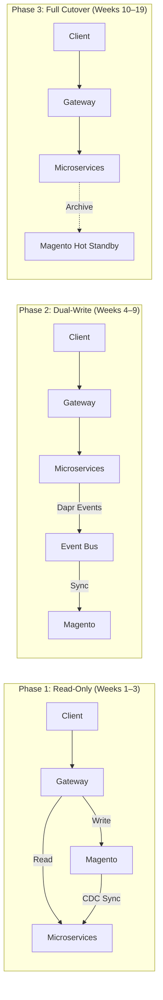

[Series Hub](/series/composable-commerce-migration/) | [Next Chapter: Part 1: Decomposing Magento into 21 Services with DDD →](/series/composable-commerce-migration/part-1-ddd-bounded-contexts/)

---

> **Answer-first:** Migrating from a monolithic Magento deployment to a Composable Commerce platform with 21 Go microservices eliminates the $200k/year license fee entirely, boosts flash-sale capacity by 10x, and removes the risk of single-vendor lock-in.

---

**Answer-first:** Start with a **Modular Monolith** mindset, then progressively shift to **Composable Commerce** built on 21 Go microservices, Kratos v2, and Dapr PubSub. This is the definitive answer to replacing Magento Enterprise. It delivers extreme commerce capability (multi-warehouse, payment sagas, real-time search) at a **license cost of $0**, while also meeting the API-first requirements of **Agentic Commerce** in the 2026 AI ecosystem.
<!--more-->

Any engineering team building a serious system on Magento eventually hits the same three walls: **the licensing wall**, **the scalability wall**, and **the developer velocity wall**.

This is not idle theory. Distilled from 17 years of enterprise architecture experience (E-E-A-T), this series documents the architectural decisions, migration playbooks, and real-world Golang delivery process.

## 1. The Three Walls of Magento Enterprise

### Wall 1: The Licensing Wall

| Edition | Annual Cost |
|---|---|
| Magento Open Source | $0 (self-hosted) |
| Adobe Commerce (Cloud, Starter) | ~$22,000/year |
| Adobe Commerce (Cloud, Pro) | $40,000–$125,000/year |
| Adobe Commerce (On-Premise, Enterprise) | $125,000–$200,000/year |

### Wall 2: Scalability

Magento 2 is a monolith. When traffic surges, you have to scale the entire system (10× Varnish, 10× PHP-FPM), driving AWS costs through the roof. With a microservices architecture, by contrast:
You scale only `order-service` and `payment-service` independently. This is exactly the model Shopee and PayPay use.

### Wall 3: Lack of AI & Agentic Commerce Readiness (2026)

Legacy systems were never designed to be "Citation-Ready". 2026 marks the rise of **Agentic Commerce**, where AI agents read catalogs, advise customers, and complete payments on behalf of users. Magento's patchwork API wall blocks the rapid extension and AI optimization this trend demands.

## 2. The Migration Roadmap: No "Big Bang" Shift

The industry in 2026 has learned a costly lesson: do not jump straight from a monolith to microservices if you cannot yet operate them well.

The fatal barrier: **you cannot switch Magento off for maintenance**. Our strategy is to apply the **Strangler Fig Pattern** across 3 phases spanning 14–19 weeks:

* **Warning (2026):** Do not turn your system into a "Distributed Monolith". Microservices that share a single database or constantly call each other synchronously will end up worse than the original Magento.

## 3. The Composable Commerce Architecture

The platform documented in this series handles the entire customer business flow, independent of Magento, integrating Kratos v2, Dapr PubSub, Postgres (database-per-service), and ArgoCD GitOps.

## Frequently Asked Questions (FAQ)

### How long does the entire migration take?
End to end: **14–19 weeks**. A safe rollback window is kept open throughout thanks to Magento running in "Hot Standby" mode.

### Should I move to microservices right away?
No. If your team has fewer than 10 people, or fewer than 2,000 orders per day, consider restructuring into a **Modular Monolith** on top of Magento itself (or using Hyvä themes to speed up the frontend) before committing to Composable Commerce.

---
*This article is part of the **[Composable Commerce Migration Series](/series/composable-commerce-migration/)**. Author: Lê Tuấn Anh.*

---

---

---

[Series Hub](/series/composable-commerce-migration/) | [Next Chapter: Part 1: Decomposing Magento into 21 Services with DDD →](/series/composable-commerce-migration/part-1-ddd-bounded-contexts/)
