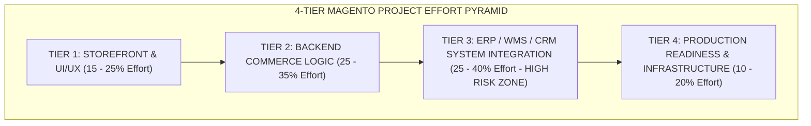
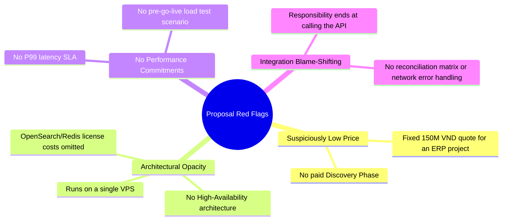
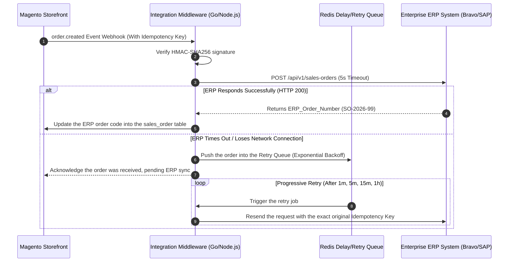

> **Answer-first:** An enterprise Magento project in Vietnam distributes real-world effort across 4 tiers: Storefront UI (15-25%), Backend Business Logic (25-35%), ERP/WMS System Integration (25-40%), and Production Operations (10-20%). The leading cause of budget overrun is underestimating the domestic systems integration tier. Enterprises should run a Paid Discovery Phase, build an integration matrix with idempotency guarantees, and calculate a 3-year Total Cost of Ownership (TCO) before signing any Fixed-Price contract.

> Explore the full architectural migration handbook in the [Magento Migration Vietnam Series](/series/magento-migration-vietnam/).

---

## 1. The Landscape of the Magento Development Market in Vietnam

The **Magento development market in Vietnam** is extremely polarized between two segments:
1. **Standard Website Outsourcing Segment (SME/Boutique Stores):** Installing a pre-built theme, tweaking a few extensions purchased from Amasty or Mageplaza, integrating a basic payment gateway. Cost ranges from VND 100 to 300 million.
2. **Enterprise Digital Commerce Segment:** Serving retail chains with hundreds of stores, manufacturing companies (B2B), or multinational brands. This is where Magento must act as the central orchestration hub, connecting omnichannel operations with an ERP ecosystem (SAP, Bravo, Fast), a WMS for warehouse operations, and a loyalty CRM. Realistic costs range from **VND 800 million to over 3 billion**.

Over 65% of enterprise-segment Magento projects are delivered late or overrun their budgets by double compared to the initial estimate. The root cause is not the PHP coding ability of the developers, but a **serious misalignment in the Scoping and Proposal quoting stage**.

---

## 2. The 4-Tier Real-World Effort Pyramid

Most proposals from inexperienced agencies only quote the first two tiers and forget — or gloss over — the last two, where 80% of the technical risk hides:



### 2.1. Tier 1: Storefront & Customer Experience (15 - 25% Effort)
- Includes programming the PWA interface (Hyvä Themes or a Next.js headless), CMS landing pages, megamenu navigation, and advanced product search filters.
- **Risk level:** Low. This is the most visible part, the easiest to visually accept, and rarely causes cascading failures into other systems.

### 2.2. Tier 2: Backend Commerce Logic (25 - 35% Effort)
- Custom modules for per-customer-group pricing logic (B2B Tier Pricing), multi-condition promotion rules (bundle purchases, cart-based gifts), and B2B order approval workflows (Order Approval Workflow).
- **Risk level:** Medium. Risk explodes when the business has overlapping discount rules that must be tested across dozens of promotion combination matrices.

### 2.3. Tier 3: ERP / WMS / CRM System Integration (25 - 40% Effort - The Red Risk Zone)
- Two-way connections with domestic ERP systems (Bravo, MISA, Fast) or international ones (SAP S/4HANA, Microsoft Dynamics 365).
- Real-time inventory synchronization with the WMS and carriers (GHN, Viettel Post).
- **Risk level:** **EXTREMELY HIGH**. Integration work is not simply calling a few HTTP REST APIs. It demands:
  - **Resilience:** What does the system do when the ERP server times out just as the customer presses the order button?
  - **Idempotency:** If a flaky network causes a webhook to be delivered twice, will the WMS print two picking slips?
  - **Reconciliation:** What mechanism detects orders whose status silently drifts out of sync?

### 2.4. Tier 4: Operational Readiness & Production Infrastructure (10 - 20% Effort)
- Load testing (k6 Load Testing) simulating 10,000 concurrent users, security audits (Penetration Testing), automated GitOps CI/CD pipelines, and APM monitoring and alerting systems (Datadog/NewRelic/Prometheus).
- **Risk level:** High. A system not properly prepared at this tier will collapse during its very first Mega Sale campaign.

---

## 3. 8 Proposal Red Flags to Eliminate Immediately

When evaluating bids from Magento development vendors in Vietnam, if you spot any of the following signs, the CTO/PM should demand clarification immediately:



1. **Fixed-Price quotes without detailed PRD documentation:** An agency willing to quote exactly VND 300 million after a single 60-minute verbal meeting will certainly find ways to cut features or spam Change Requests (CR) throughout delivery.
2. **"Free ERP integration":** No ERP integration project is ever easy. Any vendor that commits to doing this for free has simply never worked hands-on with the crusty SOAP XML protocols or the undocumented APIs of domestic ERP providers.
3. **Installing too many third-party extensions (> 30 plugins):** Abusing cheap extensions to shortcut development time turns Magento into a "source code junkyard", triggering plugin conflicts and making future security upgrades practically impossible.
4. **No plan for an identical Staging environment:** A staging environment whose hardware configuration diverges wildly from the production cluster (for example: staging runs standalone MySQL while production runs a distributed-latency Aurora MySQL cluster).
5. **Ignoring the Vietnamese diacritics search problem:** By default, MySQL Full-text Search or Elasticsearch configured without Vietnamese analyzers returns badly wrong results when customers type keywords without or with diacritics (for example: "áo sơ mi" vs "ao so mi").
6. **No SLA performance commitments:** The proposal does not state page response times (P99 Time to First Byte < 300ms, P99 Checkout Latency < 1.5s under a 1,000 concurrent user load).
7. **No Disaster Recovery strategy:** No Point-in-Time Recovery (PITR) backup plan for the database and no clear RPO/RTO policies.
8. **Missing Knowledge Transfer phase:** No commitment to train the customer's internal engineering team to take ownership of the source code after acceptance.

---

## 4. The Enterprise Integration Matrix

To make the project succeed, the technical specification must define a detailed **Integration Matrix** for every touchpoint:



### Detailed Specification of the 4 Core Integration Flows

| Data Flow | Data Direction | Technical Protocol | Processing Frequency | Data Safety Guarantee |
| :--- | :--- | :--- | :--- | :--- |
| **Order Sync** | Magento $\rightarrow$ ERP | JSON Webhook over HTTPS | Real-time | Idempotency Key (`order_increment_id`), 5 retries with Exponential Backoff. |
| **Inventory Update** | ERP/WMS $\rightarrow$ Magento | REST Batch API / Streaming | Every 5 minutes or instant | Uses the Bulk Inventory API with data version checks (`version_id`) to prevent stale overwrites. |
| **Tiered Pricing** | ERP $\rightarrow$ Magento | Message Queue (RabbitMQ) | Nightly scheduled / On-demand | Sends only deltas (changes), automatically refreshes the Full-Page Cache (Varnish Purge). |
| **Order Reconciliation** | Two-way | Scheduled Batch Script | 23:30 nightly | Reports status-mismatch lists to a dashboard for manual reconciliation by Accounting. |

---

## 5. Production Source Code: Enterprise-Grade ERP Webhook Integration Middleware

Below is enterprise-standard Node.js source code that receives order webhooks from Magento and pushes them to the ERP, with HMAC signature verification, deduplication via an Idempotency Token, and a retry queue for when the ERP is congested:

```javascript
/**
 * Enterprise Integration Middleware: Magento 2 to ERP Connector
 * Guarantees 100% idempotency and never drops an order when the ERP fails.
 */

const express = require('express');
const crypto = require('crypto');
const axios = require('axios');
const Redis = require('ioredis');

const app = express();
app.use(express.json({ verify: verifyHMACSignature }));

const redis = new Redis(process.env.REDIS_URL || 'redis://localhost:6379');
const ERP_ENDPOINT = process.env.ERP_API_URL || 'https://erp.enterprise.local/api/orders';
const WEBHOOK_SECRET = process.env.WEBHOOK_SECRET || 'secure-shared-secret-key';

// Middleware verifying the HMAC signature that protects the webhook from forgery
function verifyHMACSignature(req, res, buf) {
  const signature = req.headers['x-magento-signature'];
  if (!signature) {
    throw new Error('Missing X-Magento-Signature authentication header');
  }

  const expectedSignature = crypto
    .createHmac('sha256', WEBHOOK_SECRET)
    .update(buf)
    .digest('hex');

  if (signature !== expectedSignature) {
    throw new Error('HMAC signature mismatch! Rejecting request.');
  }
}

app.post('/api/v1/magento-order-webhook', async (req, res) => {
  const orderData = req.body;
  const idempotencyKey = `idemp:order:${orderData.increment_id}`;

  try {
    // 1. Idempotency check: has this order already been processed successfully?
    const existingStatus = await redis.get(idempotencyKey);
    if (existingStatus === 'COMPLETED') {
      return res.status(200).json({ status: 'ALREADY_PROCESSED', message: 'Order was already synced previously' });
    }

    // Lock the key temporarily for 60 seconds to prevent two simultaneous webhook deliveries
    const locked = await redis.set(idempotencyKey, 'PROCESSING', 'NX', 'EX', 60);
    if (!locked) {
      return res.status(429).json({ error: 'This order is already being processed by another worker' });
    }

    // 2. Transform the data into the ERP's canonical format
    const erpPayload = {
      external_order_id: orderData.increment_id,
      customer_code: orderData.customer_email,
      total_amount: orderData.grand_total,
      created_at: orderData.created_at,
      items: orderData.items.map(item => ({
        sku: item.sku,
        qty: item.qty_ordered,
        unit_price: item.price,
      })),
    };

    // 3. Send the command to the ERP with a strict 5-second Timeout
    try {
      const response = await axios.post(ERP_ENDPOINT, erpPayload, {
        timeout: 5000,
        headers: { 'X-Idempotency-Key': orderData.increment_id },
      });

      // Mark as completed in Redis with a 7-day TTL
      await redis.set(idempotencyKey, 'COMPLETED', 'EX', 7 * 86400);

      return res.status(200).json({
        status: 'SUCCESS',
        erp_reference: response.data.erp_order_id,
      });

    } catch (erpError) {
      console.warn(`[ERP ERROR] Unable to reach the ERP: ${erpError.message}. Pushing to the Retry queue...`);

      // 4. Push the order into a Redis Stream / Delay Queue to retry later
      await redis.lpush('queue:erp_retry_orders', JSON.stringify({
        payload: erpPayload,
        attempt: 1,
        next_retry: Date.now() + 60000, // Retry after 1 minute
      }));

      // Still return 202 Accepted to Magento so the checkout flow is never blocked
      return res.status(202).json({
        status: 'QUEUED_FOR_RETRY',
        message: 'ERP temporarily unavailable, the order has been queued for automatic retry',
      });
    }

  } catch (err) {
    console.error('[CRITICAL] Webhook processing error:', err);
    return res.status(500).json({ error: err.message });
  }
});

const PORT = process.env.PORT || 3000;
app.listen(PORT, () => console.log(`[MIDDLEWARE] Listening ready on port ${PORT}`));
```

---

## 6. 3-Year Total Cost of Ownership (TCO) Analysis

A classic strategic mistake made by CFOs is comparing only the initial build cost (CAPEX) while ignoring the ongoing maintenance and operations cost (OPEX) over a full 3 years:

| Cost Item (3 Years) | Magento Open Source (Self-Hosted AWS Cluster) | Adobe Commerce (Enterprise License) | Headless SaaS (Shopify Plus / BigCommerce) |
| :--- | :--- | :--- | :--- |
| **License Fee** | **$0** (Open source) | **$75,000 - $150,000** (Based on GMV) | $72,000 ($2,000/month base) |
| **Cloud Infrastructure AWS / GCP** | **$45,000** ($1,250/month for EKS, Aurora, Redis) | **Included** (Adobe Commerce Cloud) | **$0** (Included in the monthly fee) |
| **Initial Build Cost** | **$35,000 - $60,000** | **$70,000 - $120,000** | $25,000 - $40,000 |
| **Security Patch Upgrades** | **$18,000** (Roughly 4-6 upgrade cycles/year) | **$15,000** (Dev testing and applying still required) | **$0** (SaaS updates automatically) |
| **Operations / DevOps Team** | **$36,000** (1 part-time engineer) | **$24,000** | **$12,000** |
| **TOTAL 3-YEAR TCO** | **~$134,000 - $159,000** | **~$184,000 - $309,000** | **~$109,000 - $124,000** |

**Strategic takeaway:** If your business runs a GMV below VND 100 billion/year and has no overly specialized order-processing workflows, Headless SaaS can optimize TCO better. However, if the business needs 100% control of its data, deep B2B logic customization, and tight integration with its factory/domestic ERP cluster, self-hosted Magento Open Source on AWS with a canonical architecture remains the most sustainable investment.

---

## 7. Frequently Asked Questions (FAQ)


A Paid Discovery Phase lasting 2 to 4 weeks lets the lead architects thoroughly dissect the existing ERP/WMS APIs, clarify complex promotion rules, and produce a Solution Architecture Document (SAD). This small upfront investment (typically 5-10% of the total project) saves the business hundreds of millions of VND in rework and completely eliminates the risk of the project collapsing midway.



Check 4 core criteria: (1) Ask for Adobe Certified Professional/Expert certificates from the developers actually assigned to the project; (2) Ask to see the real architecture diagrams of similar projects they have successfully delivered; (3) Verify whether their CI/CD process and code standards strictly follow the Magento Coding Standard; and (4) Talk directly with their Lead Architect rather than only working with Sales.



Absolutely, if architected correctly: use Varnish Cache for Full-Page Caching (cache hit rate > 90%), deploy an AWS Aurora MySQL cluster with auto-scaling Read Replicas, load sessions and cache into a Redis Cluster, and separate background message queue consumers onto dedicated worker servers.



A Fixed-Price contract is only safe when you already have an extremely detailed PRD specification after the Discovery Phase and the integration scope has been 100% confirmed. For large digital transformation projects with many third parties involved, a Hybrid model (Fixed-Price for the standard core features and Time & Materials for complex custom integration modules) is the most balanced and fair solution for both sides.


---

## 8. Related Technical Documentation

- **EAV Migration SQL Handbook:** See how to flatten the database in [Flattening the EAV Model with SQL & a Node.js Stream Pipeline](/series/magento-migration-vietnam/exporting-magento-2-data-flat-sql-nodejs/).
- **Decoupling Strategy Away from Magento:** The microservices extraction roadmap in [Leaving Magento for a Microservices Architecture](/series/magento-migration-vietnam/moving-from-magento-to-microservices/).
- **The State of Magento in Vietnam:** An expert ecosystem assessment in the [Magento Vietnam Development Guide](/series/magento-migration-vietnam/magento-vietnam/).
- **Explore the Complete Handbook:** Access the full documentation set in the [Magento Migration Vietnam Series](/series/magento-migration-vietnam/).


