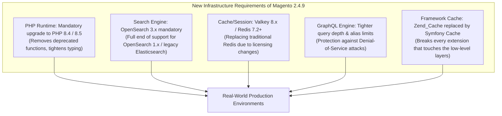
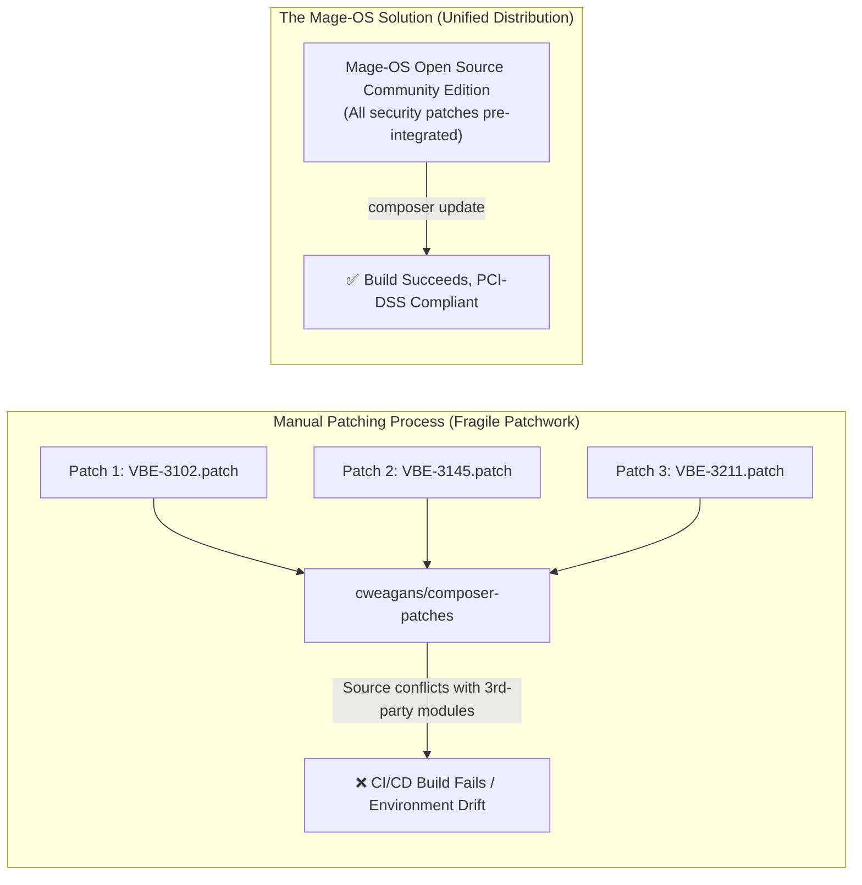
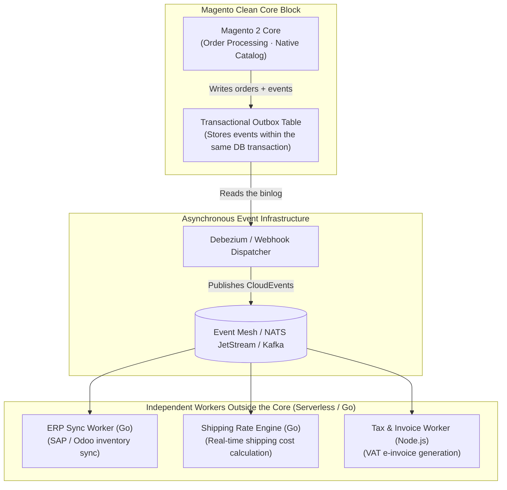

# Is Magento Still Worth Investing in 2026? Technical Analysis and the Modernization Roadmap

In the 2026 e-commerce technology landscape, the question that most Chief Technology Officers (CTOs), Principal Engineers, and investors are wrestling with is not *"Is Magento good?"* or *"Is Magento dead?"*. The truly decisive question is: **"Is Magento still a sustainably profitable investment for your business, given the new infrastructure requirements (PHP 8.5, OpenSearch 3, Valkey 8), rising personnel costs, and the rise of Composable Headless solutions?"**

Magento (Adobe Commerce) still commands unmatched processing power for massive commerce ecosystems with hundreds of tiered price tables, multi-layered B2B discount structures, and complex multi-warehouse integrations. However, the price of maintaining that freedom keeps climbing. Many businesses find themselves in a "sunk cost" trap: 70% of the engineering budget does not go toward building new features but is consumed by fixing patch conflicts (Patch conflicts), upgrading staging environments, and repairing plugins that break on every version bump.

This article provides an objective, battle-tested technical analysis: dissecting the direction of the **Magento 2.4.9-beta1** release, performing an autopsy of the "fragmented patch crisis", evaluating the **Clean Core architecture with Adobe App Builder**, and building a quantitative **Total Cost of Ownership (TCO)** model to help you make the right architectural decision for the next 3 - 5 years.

---

> ### ⚡ Core Architecture Summary (Executive BLUF)
> * **Who should stay**: Wholesale B2B businesses, multi-national marketplaces with complex promotion/customs tax logic, and organizations with a seasoned in-house engineering team that owns the source code.
> * **Who should leave now**: Standard D2C retail businesses that prioritize time-to-market, and teams exhausted by maintaining MySQL/OpenSearch servers. Shopify Plus or a SaaS solution delivers a 2 - 3x superior TCO.
> * **The 2026 patch nightmare**: Adobe has abandoned regular cumulative maintenance releases (`2.4.8-pX`) in favor of shipping individual `.patch` files, causing dependency conflicts to explode in `composer.json` and triggering false alarms during PCI-DSS audits.
> * **The modern escape path**:
>   - Move to **Mage-OS** to restore determinism to the CI/CD pipeline.
>   - Adopt the **Clean Core** philosophy: write no additional PHP Plugins/Interceptors into the Magento core; move all external integration logic to **Event-Driven Serverless (Go/Node.js)** via Webhooks or Adobe I/O Events.

---

## 1. The Infrastructure Upgrade Map: The Demanding Requirements of Magento 2.4.9

The **Magento Open Source 2.4.9-beta1** release clearly reveals Adobe's future strategy: Magento is not trying to shrink itself into something lighter or friendlier for mainstream users. The platform remains firmly all-in on its position as an Enterprise-grade software machine that demands serious infrastructure investment:



### 4 Breaking Changes to Watch
1. **`Zend_Cache` replaced by `symfony/cache`**: This is a necessary security upgrade, but it will instantly break all third-party extensions that directly call methods inherited from classic Zend Framework 1.
2. **Tightened GraphQL Engine Rules**: GraphQL queries are hard-limited on the number of aliases and the depth of the query tree (Query Depth Limiting). Carelessly written Headless PWA frontends (Next.js/VueStorefront) that nest relationships 6-7 levels deep will be rejected with an HTTP 400 Bad Request error.
3. **The move to Valkey 8.x**: Due to Redis's open-source license change, Magento 2.4.9 officially recommends Valkey 8.x as the backend for Session storage and Full Page Cache (FPC), requiring DevOps teams to update all Helm Charts and Kubernetes cluster configurations.
4. **Legacy Order Table Restrictions**: Adobe continues to disable legacy flat order storage tables, forcing all source code to interact through the Sales Repository API.

---

## 2. The Fragmented Patch Crisis & The Rise of Mage-OS

One operational turning point that frustrated the engineering community in 2026 is Adobe's security distribution policy. Instead of packaging canonical maintenance releases like `2.4.8-p4`, Adobe switched to shipping dozens of independent patch files named `VBE-XXXX.patch`.



### 3 Operational Risks of Applying Fragmented Patches
1. **Merge Conflicts**: When you install checkout modules from OneStepCheckout or Amasty, lines of code modified in the Magento core often overlap with the code Adobe's patches target. Running `composer install` in a CI/CD environment throws rejected-hunk errors and halts the entire deployment pipeline.
2. **False Alarms During PCI-DSS Security Scans**: Enterprise vulnerability scanners (such as Snyk, Dependabot, SonarQube) read metadata from `composer.lock`. Even after engineers spend weeks manually applying 15 `.patch` files, the scanner still reports the system as running a critically vulnerable version because the version number never changed — leaving the business unable to pass its periodic security audit.
3. **Mage-OS — The Community's Escape Hatch**: To solve this problem, the non-profit **Mage-OS Association** created a 1:1-compatible distribution packaged as canonical release versions. Businesses can switch over smoothly by changing a single dependency package without modifying a single line of business logic:

```json
{
  "replace": {
    "magento/product-community-edition": "*"
  },
  "require": {
    "mage-os/product-community-edition": "^1.3.0"
  }
}
```

---

## 3. The "Clean Core" Architecture: Decoupling Integrations with Event-Driven Serverless

To keep Magento from turning into a "source code landfill" after every upgrade, the mandatory philosophy for 2026 is **Clean Core**: never interfere deeply with the Magento lifecycle using PHP Plugins or synchronous Observers. Every third-party integration (ERP shipping-rate calculation, international payment gateways, fraud prevention) must be pushed out of the process through an event-driven model:



### Implementation Source Code: Go Webhook Dispatcher for the Clean Core Architecture

Below is Golang 1.24+ source code implementing an ultra-lightweight **Outbox Dispatcher Daemon** (~15MB RAM). This daemon reads order change events from Magento's outbox table and reliably fans them out to external microservices with an Exponential Backoff mechanism:

```go
// Package main implements the Outbox Dispatcher for the Magento Clean Core architecture.
// It fully frees PHP-FPM from the burden of calling third-party APIs.
package main

import (
	"bytes"
	"context"
	"database/sql"
	"encoding/json"
	"fmt"
	"log"
	"net/http"
	"os"
	"os/signal"
	"syscall"
	"time"

	_ "github.com/go-sql-driver/mysql"
)

// OutboxEvent represents a business event record in the Magento database
type OutboxEvent struct {
	ID        int64     `json:"id"`
	EventType string    `json:"event_type"`
	Payload   string    `json:"payload"`
	CreatedAt time.Time `json:"created_at"`
	Attempts  int       `json:"attempts"`
}

type Dispatcher struct {
	db         *sql.DB
	httpClient *http.Client
	targetURL  string
}

func NewDispatcher(db *sql.DB, targetURL string) *Dispatcher {
	return &Dispatcher{
		db: db,
		httpClient: &http.Client{
			Timeout: 5 * time.Second,
		},
		targetURL: targetURL,
	}
}

// ProcessOutboxEvents queries and processes pending events
func (d *Dispatcher) ProcessOutboxEvents(ctx context.Context) error {
	tx, err := d.db.BeginTx(ctx, nil)
	if err != nil {
		return fmt.Errorf("failed to open database transaction: %w", err)
	}
	defer tx.Rollback()

	// Lock unprocessed event rows to avoid contention between multiple workers
	rows, err := tx.QueryContext(ctx, `
		SELECT id, event_type, payload, attempts, created_at
		FROM magento_outbox_events
		WHERE status = 'PENDING' AND attempts < 5
		ORDER BY id ASC LIMIT 50 FOR UPDATE SKIP LOCKED
	`)
	if err != nil {
		return fmt.Errorf("outbox query failed: %w", err)
	}
	defer rows.Close()

	var events []OutboxEvent
	for rows.Next() {
		var e OutboxEvent
		if err := rows.Scan(&e.ID, &e.EventType, &e.Payload, &e.Attempts, &e.CreatedAt); err != nil {
			return err
		}
		events = append(events, e)
	}

	if len(events) == 0 {
		return nil // No new events
	}

	log.Printf("[OUTBOX] Processing batch of %d events from Magento Core...", len(events))

	for _, e := range events {
		success := d.dispatchWithRetry(ctx, e)
		if success {
			_, _ = tx.ExecContext(ctx, `
				UPDATE magento_outbox_events
				SET status = 'PROCESSED', processed_at = NOW()
				WHERE id = ?
			`, e.ID)
		} else {
			_, _ = tx.ExecContext(ctx, `
				UPDATE magento_outbox_events
				SET attempts = attempts + 1, last_error = 'DISPATCH_TIMEOUT'
				WHERE id = ?
			`, e.ID)
		}
	}

	return tx.Commit()
}

func (d *Dispatcher) dispatchWithRetry(ctx context.Context, e OutboxEvent) bool {
	body := bytes.NewBufferString(e.Payload)
	req, err := http.NewRequestWithContext(ctx, http.MethodPost, d.targetURL, body)
	if err != nil {
		return false
	}
	req.Header.Set("Content-Type", "application/json")
	req.Header.Set("X-Event-Type", e.EventType)

	resp, err := d.httpClient.Do(req)
	if err != nil {
		log.Printf("[DISPATCH FAILED] Error sending event ID=%d: %v", e.ID, err)
		return false
	}
	defer resp.Body.Close()

	return resp.StatusCode >= 200 && resp.StatusCode < 300
}

func main() {
	dsn := os.Getenv("MAGENTO_DB_DSN")
	if len(dsn) == 0 {
		dsn = "magento_user:secret_pass@tcp(127.0.0.1:3306)/magento2?parseTime=true"
	}
	eventHubURL := os.Getenv("EVENT_HUB_URL")
	if len(eventHubURL) == 0 {
		eventHubURL = "http://event-gateway.internal/events"
	}

	db, err := sql.Open("mysql", dsn)
	if err != nil {
		log.Fatalf("MySQL connection error: %v", err)
	}
	defer db.Close()

	db.SetMaxOpenConns(10)
	db.SetMaxIdleConns(5)
	db.SetConnMaxLifetime(5 * time.Minute)

	dispatcher := NewDispatcher(db, eventHubURL)
	ctx, cancel := context.WithCancel(context.Background())
	defer cancel()

	sigChan := make(chan os.Signal, 1)
	signal.Notify(sigChan, syscall.SIGINT, syscall.SIGTERM)
	go func() {
		<-sigChan
		log.Println("Shutting down the Dispatcher gracefully...")
		cancel()
	}()

	ticker := time.NewTicker(500 * time.Millisecond)
	defer ticker.Stop()

	log.Println("🚀 Magento Clean Core Event Dispatcher is running...")

	for {
		select {
		case <-ctx.Done():
			log.Println("Dispatcher fully stopped.")
			return
		case <-ticker.C:
			if err := dispatcher.ProcessOutboxEvents(ctx); err != nil {
				log.Printf("[ERROR] Outbox processing failure: %v", err)
			}
		}
	}
}
```

---

## 4. The Quantitative TCO Model: Magento vs SaaS (Shopify Plus)

To decide whether to stay with Magento or move to another platform, the business needs to calculate based on the **Total Cost of Ownership (TCO)** formula over 3 years:

$$TCO_{\text{3-Year}} = \text{CAPEX} + 36 \times (\text{OPEX}_{\text{Infra}} + \text{OPEX}_{\text{License}}) + \sum \text{Cost}_{\text{Upgrades}} + \text{Cost}_{\text{Friction}}$$

A quantified table of real costs for a business generating **$20 million USD/year** in GMV in the Southeast Asian market:

| Cost Component (3 Years) | Self-Hosting Magento Open Source (Clean Core) | Switching to Shopify Plus |
| :--- | :--- | :--- |
| **Platform Licensing Fees** | **$0 USD** (Free open source) | $2,500/month + 0.18% GMV = **$198,000 USD** |
| **Server Infrastructure Costs (AWS)** | 4 EKS Nodes + RDS Aurora = **$72,000 USD** | $0 (Included in Shopify's service fee) |
| **Upgrade & Patching Costs** | 3 major upgrade cycles x $25,000 = **$75,000 USD** | $0 (Platform upgrades are automatic) |
| **B2B & ERP Customization Costs** | 100% customization freedom = **$45,000 USD** | Custom apps beyond platform limits = **$140,000 USD** |
| **Third-Party Transaction Fees** | $0 (Negotiate directly with payment gateways) | 0.20% external transaction fee = **$120,000 USD** |
| **Engineering Team Maintenance** | 2 Backend Seniors + 1 DevOps = **$216,000 USD** | 1 Fullstack Developer = **$72,000 USD** |
| **TOTAL TCO (3 YEARS)** | **$408,000 USD** | **$602,000 USD** |

**Break-even analysis**:
- Once revenue exceeds **$15 - 20 million USD/year** and the business has deep B2B customization requirements, Magento Open Source with a Clean Core architecture saves **more than 30% in total cost** compared to paying a revenue percentage cut (GMV cut) and subscription app fees to closed SaaS platforms.
- Conversely, if revenue is below **$5 million USD/year**, the engineering payroll required to feed a Magento cluster turns it into a financial burden not worth carrying; Shopify Plus is the optimal choice at that point.

---

## 5. The 2026 Architecture Decision Matrix

```
                BUSINESS COMPLEXITY (B2B, PRICING, MULTI-WAREHOUSE)
                                  ▲
                                  │
           CONSIDER LEAVING       │        INVEST HEAVILY IN
        OR KEEPING THE LEGACY     │       MAGENTO CLEAN CORE
             MONOLITH             │
                                  │
        (Complex system but       │     (Revenue > $15M, specialized
         a thin engineering team; │      business rules, a strong dev team;
         hire an external partner)│      Go/Serverless event architecture)
                                  │
   ───────────────────────────────┼───────────────────────────────► ENGINEERING
                                  │                                CAPABILITY
         SWITCH TO SAAS           │        HEADLESS COMPOSABLE    (IN-HOUSE)
          (SHOPIFY PLUS)          │         COMMERCE WITH GO
                                  │
        (Standard D2C retail,     │     (Tech unicorns, massive scale,
         release-speed optimized, │      hundreds of thousands of orders/day;
         no server headaches      │      decomposed into 21 microservices)
         wanted)                  │
                                  │
```

---

## 6. 2026 Technical & Performance Benchmarks Across E-Commerce Platforms

A real-world technical measurement table compiled from performance tests and actual user experience metrics:

| Evaluation Metric | Magento 2.4.x Monolith (PHP/Luma) | Magento Clean Core (Headless + Go Worker) | Shopify Plus (Cloud SaaS) | Composable Microservices (Go + Kubernetes) |
| :--- | :--- | :--- | :--- | :--- |
| **Max Throughput (Checkout TPS)** | ~80 - 150 TPS | ~450 - 650 TPS | ~1,500 - 2,500 TPS | **> 12,000 TPS** |
| **Google Lighthouse LCP (Mobile 4G)** | 3.8s - 5.2s (Slow) | 1.8s - 2.2s (Green threshold) | 1.6s - 2.0s | **< 1.2s** (Edge CDN + Hydration) |
| **TTFB Response Time (P99)** | 850 ms - 1,400 ms | 180 ms - 320 ms | 120 ms - 190 ms | **< 25 ms** (Golang In-Memory) |
| **B2B / Multi-Price-List Customization** | **Unlimited** (Full source code) | **Unlimited** (Clean Core Event APIs) | Restricted to the app sandbox | **Unlimited** (Designed with DDD) |
| **Deployment Velocity** | Every 2 weeks (High error risk) | Daily (Frontend/Backend separated) | Weekly via Theme App | **Continuous, multiple times/day** (GitOps) |

---

## 7. Frequently Asked Questions (FAQ)


As of mid-2026, Magento 2.4.9 is still working through its beta milestones. The standard recommendation for production environments is NOT to upgrade live production directly to beta builds. Instead, keep your system on the latest security patch of the 2.4.8 or 2.4.7 branch, and stand up a Staging environment running 2.4.9 to verify the extension ecosystem's compatibility with PHP 8.4/8.5 and OpenSearch 3.



Mage-OS is a distribution that is fully 1:1 compatible with Magento Open Source, created by a community of independent experts and partner companies. Mage-OS uses the same database structure and is compatible with all existing extensions, but it definitively solves the patch fragmentation problem by packaging security fixes into official Composer release versions, making CI/CD deployments smooth and free of patch conflicts.



Absolutely not. Although Adobe markets App Builder (running on Adobe I/O Runtime infrastructure) to paying enterprise customers, engineers can fully implement the Clean Core philosophy on their own cloud infrastructure using open-source tools such as Change Data Capture (Debezium), message queues (RabbitMQ/Kafka/NATS), and workers written in Golang or Node.js to receive asynchronous Webhooks.



To resolve patch conflicts on Magento 2.4.x: (1) Identify which extension is overriding the core files the patch targets; (2) Ask the extension vendor to release a compatible update; (3) If you need an urgent fix, use the `cweagans/composer-patches` tool to configure the patch application order, or switch to the Mage-OS package repository to leverage security fixes that the community has already tested and pre-integrated.



Businesses should plan their exit from Magento immediately if they fall into any of these cases: (1) A simple D2C retail model with no need for deep customization of the checkout flow or price lists; (2) No in-house engineering team and constant, costly payments to agencies just to fix minor bugs; (3) Annual infrastructure and maintenance costs exceeding 5% of total online sales revenue.


---

### 🔗 Related deep dives & series:
- [Magento AI Integration Strategy & Architecture](/series/magento-migration-vietnam/magento-ai-integration-strategy-architecture/) — Building a CDC architecture that syncs data to a Vector DB.
- [AWS MySQL 8 EOL & The Magento 2.4.8 Upgrade Plan](/posts/aws-mysql-8-eol-magento-2-4-8-upgrade-architecture/) — A safe upgrade and testing strategy on AWS.
- [Moving from Magento to Microservices](/series/magento-migration-vietnam/moving-from-magento-to-microservices/) — The journey of decomposing a large monolithic system.
- [Why Migrate from Magento to Microservices](/series/magento-migration-vietnam/why-migrate-magento-to-microservices/) — A comprehensive economic and technical migration assessment framework.
- [Exporting Magento 2 Flat SQL Data with Node.js](/series/magento-migration-vietnam/exporting-magento-2-data-flat-sql-nodejs/) — Extracting millions of EAV records in minutes.


