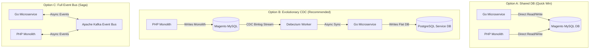
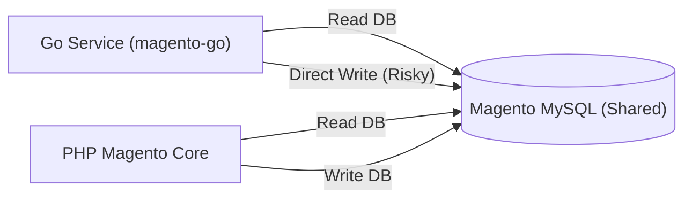
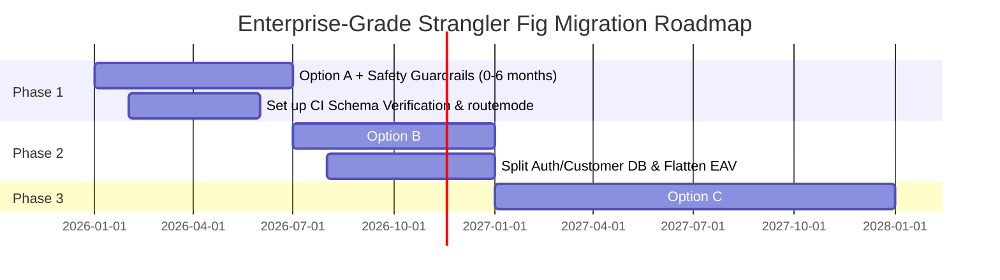

> **Answer-first:** Migrating Magento to Golang offers 3 strategies: Shared DB delivers an immediate compute speed-up but accumulates technical debt; CDC (Debezium) + Outbox lets Go own a flat schema without touching a single line of PHP code; a Full Event Bus (Kafka) provides complete isolation but requires the PHP team to maintain a rock-solid event publisher.

## What you will learn that AI will not tell you
- Why Go running on Magento's MySQL is faster at the compute layer but still hits a bottleneck at the EAV query layer — and what the real solution is.
- The single deciding factor between CDC (Option B) and Event Bus (Option C): who owns the Magento PHP source code.

---

## The Strangler Fig Dilemma: Compute vs. Data

When converting from the Magento monolith to a Golang backend, architects face a decision that is anything but obvious: should we migrate the *API layer* and the *database* at the same time?

Migrating both simultaneously requires setting up Eventual Consistency, Dual-Writes, and a Saga model from Day 1. This slows time-to-market and prevents the business from seeing any performance improvement for 9–18 months.

The alternative is the **Shared Database Quick Win** — migrate the API compute layer first, keep the data layer untouched, and buy time to design a proper DB separation strategy.

But "buying time" only works if you have a clear plan for Phase 2. This article defines all three options and gives you a decision framework for choosing the right path.

---

## Three Options on the Table



---

## Option A — Shared Database (Quick Win)



In Phase 1 of the Strangler Fig model, you place a smart router (for example, the `routemode` shadow proxy) in front of Magento, then rewrite the highest-traffic APIs in Go — but the Go service connects directly to Magento's existing MySQL.

### Why it works (immediate benefits)

**Magento PHP can spend 100–200ms just booting the framework before executing a single SQL statement.** Go eliminates this overhead entirely. Measured in a real Magento→Go migration project (`mag-go`), the same authentication endpoint dropped from 180ms to 8ms — **up to a 22x reduction** — without changing a single database query.

1. **Instant compute separation.** The bloat of the PHP framework (DI container, ORM hydration, module observers) disappears completely.
2. **No data synchronization problem.** Both systems read committed records on the same MySQL — no eventual consistency lag.
3. **Trivially easy rollback.** A single configuration change in `routemode` can flip the traffic flow back to PHP.

### The dark side — why this cannot be the end state

#### Dark side 1: The Magento DB is a "hidden API" you do not control

Magento's schema is not your API — but Go is now coupled to it as if it were.

```text
Magento 2.4.6 → 2.4.7 upgrade
  → Column renamed in customer_entity
  → Go struct binding silently errors or panics
  → Production incident at 2 a.m.
```

Adobe dropped support for the "split database" feature in Magento 2.4.6+. Each upgrade consolidates the schema even further. Every Go struct pointing at a Magento table is an undeclared dependency with no SLA.

#### Dark side 2: Write Conflicts — Race Conditions on shared tables

| Table | PHP writes | Go writes | Risk Level |
|---|---|---|---|
| `customer_entity` | ✅ | ✅ (token updates, addresses) | **HIGH** |
| `oauth_token` | ✅ | ✅ (magento-go auth module) | **CRITICAL** |
| `customer_address_entity` | ✅ | ✅ | **HIGH** |
| `quote` / `sales_order` | ✅ | Only via Proxy | Medium |

MySQL's row-level locks prevent dirty reads but **do not prevent logical business conflicts**. If Go updates a customer's session token at the same moment Magento invalidates it, the result is a corrupted authentication state — not a database error.

#### Dark side 3: The Distributed Monolith trap

```text
Go service ───────▶ Shared MySQL ◀─────── PHP Magento
    ↑                                           ↑
"microservice"                       de facto monolithic coupling
```

You now have two separate runtimes but **the same failure domain**. A full-scan Go query on `catalog_product_entity_varchar` can degrade Magento's checkout performance. Architecturally, this is identical to a monolith — just harder to debug because two codebases are involved.

#### Dark side 4: EAV is the real bottleneck — and Go cannot fix it

```sql
-- Just to load one customer with all EAV attributes:
SELECT ce.*, 
       cevs.value AS first_name,   -- customer_entity_varchar (JOIN 1)
       cevi.value AS store_id,     -- customer_entity_int (JOIN 2)
       ...
FROM customer_entity ce
JOIN customer_entity_varchar cevs ON ce.entity_id = cevs.entity_id
JOIN customer_entity_int cevi ON ce.entity_id = cevi.entity_id
...  -- 5–10 JOINs in total
```

Go executes this query faster than PHP, but **the query plan is exactly the same**. The bottleneck is the EAV schema design, not the programming language. The only real fix is flattening the EAV model into a Go-owned schema — which requires separating the database.

### How to run Option A safely (non-negotiable guardrails)

If you commit to Option A as an interim state:

1. **Read-only constraint**: Go is only allowed to `SELECT` on Magento-owned tables. Every write must be proxied back to Magento's PHP API.
2. **Table ownership policy**: Document the tables Go is allowed to read. No undocumented reads permitted.
3. **CI schema pinning checks**: Run a schema diff on every Magento upgrade PR. If a column that Go references changes, fail the build immediately.
4. **Set a hard deadline for Phase 2**: Option A without a scheduled Phase 2 date will inevitably become permanent through sheer inertia.

---

## Option B — Evolutionary CDC + Outbox (The recommended path)

```text
┌──────────────┐              ┌──────────────────┐
│  PHP Magento │──WRITE──────▶│  Magento MySQL   │
└──────────────┘              │  (master)        │
                              └────────┬─────────┘
                                       │ binlog (no PHP changes needed)
                                       ▼
                               ┌──────────────┐
                               │  Debezium    │  ← reads the binlog directly
                               │  CDC Engine  │
                               └──────┬───────┘
                                      │ stream events
                                      ▼
┌──────────────┐  WRITE-OWNED  ┌────────────────────────┐
│  Go (magento-go) │──────────────▶│  Go DB (separated)     │
│              │  READ-SYNCED  │  Flat schema           │
│              │◀──────────────│  token, session,       │
└──────────────┘               │  customer_flat...      │
        │                      └────────────────────────┘
        │ Outbox events (Go → Magento if needed)
        ▼
   ┌──────────┐
   │  Kafka   │──▶ Magento consumer
   └──────────┘
```

**One core insight:** Debezium reads MySQL's binary log (`binlog`) directly. This means **you never need to modify a single line of Magento PHP code** to stream every data change into Go's database.

### How CDC + Outbox works

**Step 1 — Go creates its own database for the data it owns:**
```sql
-- Go-owned tables (Go writes here, Magento never touches them)
CREATE TABLE magento_customer_token (
  id UUID PRIMARY KEY,
  customer_id BIGINT NOT NULL,
  token_hash VARCHAR(255) NOT NULL,
  expires_at TIMESTAMP NOT NULL
);

CREATE TABLE magento_outbox (
  id UUID PRIMARY KEY,
  event_type VARCHAR(100) NOT NULL,
  payload JSONB NOT NULL,
  created_at TIMESTAMP DEFAULT now(),
  published_at TIMESTAMP
);
```

**Step 2 — Debezium streams Magento's changes → Go DB:**
```yaml
# debezium-connector.yaml
connector.class: io.debezium.connector.mysql.MySqlConnector
database.hostname: magento-mysql-master
database.include.list: magento
table.include.list: magento.customer_entity, magento.catalog_product_entity
# Debezium reads the binlog — no Magento PHP changes required
```

**Step 3 — Go writes use the Outbox Pattern (atomic):**
```go
// Inside a single DB transaction — zero dual-write risk
tx.Exec(`INSERT INTO magento_customer_token (...) VALUES (...)`)
tx.Exec(`INSERT INTO magento_outbox (event_type, payload)
         VALUES ('TOKEN_CREATED', $1)`, tokenPayload)
// The OutboxProcessor publishes to Kafka every 500ms
// Debezium captures the outbox rows → routes them back to Magento if needed
```

### Why Option B wins for most teams

| What you gain | What you avoid |
|---|---|
| Go owns its schema — flatten EAV → 5x faster reads | Never touching Magento PHP code |
| ACID (safe) writes on Go's own DB | Saga complexity on Day 1 |
| Debezium streams Magento's changes to Go | No dual-write race conditions |
| Domain-by-domain rollout (Auth first, Checkout last) | No Big Bang cutover risk |

---

## Option C — Full Database Separation + Event Bus

```text
┌─────────────────────────────────────────────────────────────┐
│                     EVENT BUS (Kafka)                        │
│  topic: customer.updated │ order.created │ inventory.changed │
└──────────┬───────────────────────────────┬──────────────────┘
           │ PUBLISH                       │ CONSUME
           ▼                               ▼
┌──────────────────┐          ┌───────────────────────────────┐
│  PHP Magento     │          │  Go Service (magento-go)      │
│                  │          │                               │
│  Magento MySQL   │          │  Go DB (privately owned, flat │
│  (fully owned)   │          │  schema)                      │
│                  │          │  CQRS read projections        │
│  ← Magento must  │          │  customer_flat, order_summary │
│    publish ALL   │          └───────────────────────────────┘
│    state changes │                         │ PUBLISH
│    as events     │◀────────────────────────┘
│                  │  (compensating events)
└──────────────────┘
```

In Option C, both systems are fully isolated. Communication happens **entirely through the event bus**. Each service owns its database outright.

### What Option C demands that Option B does not

The core difference is **who publishes the events**:

| | Option B (CDC) | Option C (Event Bus) |
|---|---|---|
| **Who publishes changes?** | Debezium reads the binlog automatically | PHP Magento must write to an outbox table |
| **Does Magento PHP code need changes?** | ❌ Not required | ✅ **Mandatory** — every state change needs an event |
| **Risk if the PHP team is slow** | Zero (CDC is infrastructure) | High (Go DB will suffer data gaps) |
| **Sync latency** | 50–200ms (binlog lag) | 10–100ms (if Kafka is healthy) |
| **Event replay** | Yes (binlog history) | Yes (Kafka retention) |

**Option C is the correct long-term target architecture.** But it requires the Magento PHP team to reliably emit domain events for *every* state change — customer updates, order status, inventory adjustments, promotion applications. Miss a single event type and Go's database silently drifts out of sync with Magento.

---

## The Three-Way Comparison Matrix

| Criterion | Option A: Shared DB | Option B: CDC + Outbox | Option C: Full Event Bus |
|---|---|---|---|
| **Consistency model** | Strong ACID ✅ | ACID writes, eventual reads ⚠️ | Eventual consistency ❌ |
| **Schema coupling** | Tight — Magento owns it ❌ | Diminishes per domain ⚠️ | Loose — event schema ✅ |
| **Write conflict risk** | High — race conditions ❌ | Low — independent writes ✅ | None — full isolation ✅ |
| **EAV performance** | Unchanged ❌ | Flatten per domain ⚠️ | Full flatten ✅ |
| **Independent scaling** | No ❌ | Partial ⚠️ | Complete ✅ |
| **Go service rollback** | Easy — flip routemode ✅ | Easy per domain ✅ | Hard — event schema backward compat ❌ |
| **Time to Production** | Running today ✅ | 3–6 months ⚠️ | 9–18 months ❌ |
| **Magento code changes** | None ✅ | **None** (CDC reads the binlog) ✅ | **Mandatory** — event publisher ❌ |
| **New infrastructure** | None ✅ | Debezium + Kafka ⚠️ | Kafka + Schema Registry + CQRS ❌ |
| **Debugging difficulty** | Low ✅ | Medium ⚠️ | High — trace across multiple hops ❌ |
| **Team skills required** | Low ✅ | Medium ⚠️ | High — distributed systems ❌ |
| **Fault isolation** | None — 1 DB = everything goes down ❌ | Partial ⚠️ | Complete ✅ |
| **Checkout transaction safety** | ACID ✅ | Requires Saga ⚠️ | Saga + compensating transactions ❌ |
| **Inventory oversell risk** | None (ACID) ✅ | Low if CDC lag < 100ms ⚠️ | High if consumer lag ❌ |
| **Replay / Audit capability** | None ❌ | Partial (Outbox) ⚠️ | Complete (Kafka retention) ✅ |

---

## Per-Option Risk Table

### Option A — Shared DB risks

| Risk | Likelihood | Impact | Mitigation |
|---|---|---|---|
| Magento upgrade breaks Go structs | **High** (every upgrade) | Service outage | Schema pinning + CI diff checks |
| Race condition on auth table writes | **Medium** | Data corruption | Table ownership policy, Go read-only |
| DB bottleneck under scale | **High** | Both sides slow down | Dedicated read replica for Go |
| Becoming a permanent distributed monolith | **Certain** without a deadline | Architecture debt | Set an explicit Phase 2 deadline |

### Option B — CDC risks

| Risk | Likelihood | Impact | Mitigation |
|---|---|---|---|
| CDC pipeline failure | **Low** (Debezium HA) | Go DB out of sync | Lag monitoring + alerting |
| Duplicate event delivery | **Medium** | Duplicate writes | Idempotency key on every consumer |
| MySQL binlog storage pressure | **Low** | Storage cost | Binlog retention policy |
| Temporary dual-write period | **Medium** | Data drift | Outbox pattern from day one |

### Option C — Full Event Bus risks

| Risk | Likelihood | Impact | Mitigation |
|---|---|---|---|
| **Magento misses publishing events** | **Very High** | Go DB data gaps | Mandatory integration test suite |
| Event schema changes | **High** (business-driven) | Consumer crashes | Schema Registry + backward compat |
| Saga failure → out-of-sync orders | **Medium** | Revenue impact | Dead-letter queue + manual handling |
| Event storm during flash sales | **Medium** | Kafka overload | Topic partitioning + consumer latency SLAs |
| Read-your-own-write latency | **High** | Poor UX | Optimistic UI updates |

> **⚠️ Critical note for Option C:** PHP Magento must write to the outbox table *within the same database transaction* as the business state change. This is routinely implemented incorrectly — publishing straight to Kafka after the DB commit creates a dual-write gap. If the Kafka publish fails, the event silently vanishes and Go's database drifts permanently.

---

## Decision Framework — Which option is right for you?

```text
Q1: Does your team have 2+ engineers with distributed systems experience?
  └─ NO  → Stay on Option A, add guardrails (schema pinning, read-only policy)
  └─ YES → Q2

Q2: Is your tolerance for inventory oversell equal to zero?
  └─ YES → Option B (CDC keeps ACID writes, no eventual consistency risk at write time)
  └─ NO  → Both B and C are viable

Q3: Do you need Go to scale fully independent of Magento's DB?
  └─ NO  → Option B is sufficient and recommended
  └─ YES → Q4

Q4: Can the Magento PHP team commit to building and maintaining event publishers?
  └─ NO  → Option B is mandatory (CDC requires no PHP changes)
  └─ YES → Option C is viable (roadmap: 12–18 months)
```

---

## Domain Priority — What to separate first

Not all domains carry the same risk. Migrate in this sequence regardless of whether you choose Option B or C:

| Domain | Priority | Why | Risk |
|---|---|---|---|
| **Auth / Token** (`auth/`) | **First** | Go already owns the token logic, no Magento dependency | Low |
| **OIDC** (`oidc/`) | **First** | Belongs entirely to Go, needs no Magento data | Low |
| **Wishlist** (`wishlist/`) | 2nd | Simple domain, small data volume | Low |
| **Customer read** (`customer/`) | 2nd | Flatten EAV → 5x faster reads, writes remain proxied | Medium |
| **Customer write** | 3rd | Needs a Saga with Magento to sync addresses/profiles | Medium |
| **Cart / Checkout** (`cartcheckout/`) | **Last** | Highest business risk, needs a mature Saga | High |

**Never move Cart/Checkout to a separate database until the Saga model has been proven in Production on lower-risk domains.**

---

## Infrastructure Checklist Before Separating the Database

Before committing to Option B or C, validate the following prerequisites:

```yaml
required_before_option_b:
  - mysql_binlog_enabled: true          # Verify with: SHOW VARIABLES LIKE 'log_bin'
  - debezium_or_dms: deployed           # Debezium embedded or standalone
  - kafka_or_redis_streams: deployed    # CDC event transport platform
  - outbox_table: created_in_go_db      # Create the magento_outbox table
  - idempotent_consumers: implemented   # Consumers check the idempotency key
  - cdc_lag_monitoring: configured      # Alert if lag > 500ms

additional_for_option_c:
  - php_event_publisher: implemented    # Magento module writing to the outbox table
  - schema_registry: deployed           # Schema management via Avro or Protobuf
  - saga_orchestrator: stable           # Proven in production on small domains
  - dead_letter_queue: configured       # For failed saga compensations
```

---

## Recommended Roadmap



---

## Hands-On Implementation: Transactional Outbox & CDC Consumer in Golang

Below is production-grade Go code demonstrating the two key components when moving from Shared DB to CDC:
1. **Outbox Publisher**: Writes events to the Outbox table within the same transaction as the business data.
2. **Debezium CDC Consumer**: Reads and parses the MySQL binlog event stream from Debezium to update the Read Model.

```go
package migration

import (
	"context"
	"database/sql"
	"encoding/json"
	"fmt"
	"time"
)

// OutboxEvent represents the event structure stored in the Go service's database.
type OutboxEvent struct {
	ID            string    `json:"id"`
	AggregateType string    `json:"aggregate_type"`
	AggregateID   string    `json:"aggregate_id"`
	EventType     string    `json:"event_type"`
	Payload       string    `json:"payload"`
	CreatedAt     time.Time `json:"created_at"`
}

// OutboxRepository manages writing events atomically alongside business data.
type OutboxRepository struct {
	db *sql.DB
}

func NewOutboxRepository(db *sql.DB) *OutboxRepository {
	return &OutboxRepository{db: db}
}

// SaveWithTx guarantees ACID atomicity: the order data and the outbox event
// are written in the same transaction.
func (r *OutboxRepository) SaveWithTx(ctx context.Context, tx *sql.Tx, event OutboxEvent) error {
	query := `
		INSERT INTO outbox_events (id, aggregate_type, aggregate_id, event_type, payload, created_at)
		VALUES ($1, $2, $3, $4, $5, $6);
	`
	_, err := tx.ExecContext(ctx, query, event.ID, event.AggregateType, event.AggregateID, event.EventType, event.Payload, event.CreatedAt)
	if err != nil {
		return fmt.Errorf("failed to write outbox event: %w", err)
	}
	return nil
}

// DebeziumPayload represents the CDC message structure from the MySQL binary log.
type DebeziumPayload struct {
	Before map[string]interface{} `json:"before"`
	After  map[string]interface{} `json:"after"`
	Op     string                 `json:"op"` // c = create, u = update, d = delete
	TSMS   int64                  `json:"ts_ms"`
}

// ProcessCDCRecord syncs events from Magento MySQL into Go's optimized database.
func ProcessCDCRecord(rawMessage []byte) error {
	var record struct {
		Payload DebeziumPayload `json:"payload"`
	}
	if err := json.Unmarshal(rawMessage, &record); err != nil {
		return fmt.Errorf("failed to parse Debezium JSON: %w", err)
	}

	op := record.Payload.Op
	switch op {
	case "c", "u":
		// Insert or update the flat Read Model in the Go service
		entityID := record.Payload.After["entity_id"]
		email := record.Payload.After["email"]
		fmt.Printf("Synced entity record %v (Email: %v) to the Go Read Store\n", entityID, email)
	case "d":
		// Handle soft/hard delete events
		entityID := record.Payload.Before["entity_id"]
		fmt.Printf("Processing delete for entity %v\n", entityID)
	}

	return nil
}
```

---

## Quantitative Comparison: Shared DB vs. CDC (Debezium) vs. Full Event Bus

| Technical Criterion | Option A: Shared DB | Option B: Evolutionary CDC | Option C: Full Event Bus (Kafka) |
| :--- | :--- | :--- | :--- |
| **Time to First Value (TTFV)** | **1–3 weeks (extremely fast)** | 2–3 months | 6–12 months |
| **PHP Source Code Dependency** | Very high (shares the schema intact) | **Zero (reads the binlog only, no PHP changes)** | High (requires the PHP team to write event publishers) |
| **Data Sync Latency** | 0ms (reads committed MySQL data directly) | 15ms – 80ms (binlog replication lag) | 20ms – 150ms (producer + consumer lag) |
| **Write Race Risk** | Very high (needs heavyweight locking) | Low (Go owns its own tables) | **Zero (each service owns its database)** |
| **Infrastructure Operational Complexity** | Extremely low (reuses the existing RDS) | Medium (maintains Kafka Connect + Debezium) | High (operates a Kafka cluster + Schema Registry) |
| **Fit as an End State** | Poor (accumulates heavy technical debt) | **Excellent (a solid stepping stone to microservices)** | **Perfect for the target event-driven architecture** |

---

## ❓ Frequently Asked Questions (FAQ)


The Shared Database lets the Go team achieve superior performance immediately (startup time drops from PHP's 180ms to Go's 8ms) without building distributed synchronization infrastructure. However, it turns the Magento database into an uncontrolled implicit API. When Magento upgrades (e.g. 2.4.6 to 2.4.7) and renames columns, Go structs silently break or cause severe row-lock conflicts.



Debezium connects directly to the MySQL Binary Log (binlog) at the storage engine level without adding any query load to the Magento database. Every INSERT, UPDATE, and DELETE is instantly converted into a JSON event stream published to Kafka, allowing Go microservices to update caches or flat read databases without modifying a single line of PHP source code.



Option C should only be adopted once business domains are fully independent, the engineering team can maintain a Schema Registry protocol, and — especially — when transaction flows require a distributed Saga orchestration model (such as cart, checkout, and inventory deduction). For catalog browsing, legacy users, and order lookups, CDC is the most cost-effective solution.



In Magento, a single product or customer is scattered across dozens of EAV tables, requiring 35+ SQL JOINs. When moving to Go via CDC, Debezium captures records from the EAV tables, then the Go Consumer aggregates and flattens the data into a single JSONB document on PostgreSQL or Elasticsearch, bringing search query latency below 5ms.



Use a Shadow Traffic Routing model (or the routemode smart proxy). Place a reverse proxy (Envoy or a Cloudflare Worker) at the edge. Initially, PHP handles 100% of traffic and responds to customers, while the proxy mirrors requests to the Go service in the background to measure latency and error rates with zero impact on real users.


---

## 🔗 Related Deep Dives & Series

- [Zero-Downtime: Moving From Magento to Microservices](/series/magento-migration-vietnam/moving-from-magento-to-microservices/) — The 3-phase monolith decomposition strategy.
- [Magento to Microservices: When & Why](/series/magento-migration-vietnam/why-migrate-magento-to-microservices/) — Identifying boundaries and opportunity costs.
- [Banking Microservices Architecture: Go, Saga & Event Sourcing](/posts/banking-microservices-architecture/) — Designing an immutable ledger and the Outbox pattern.
- [Dapr Workflow Go Guide: Orchestrated Saga Pattern](/posts/dapr-workflow-saga-orchestration-guide/) — Self-healing distributed transaction orchestration.


